# PostgreSQL & Patroni — Lern-Tutorial

Persönliches Tutorial/Lernprotokoll, entstanden aus einem interaktiven Tutoring-Track. Ziel: PostgreSQL und Patroni (High Availability) strukturiert verstehen — erst PostgreSQL als eigenständiges System, danach HA/Patroni als zusätzliche Schicht.

Stand: 01.10.2026

---

## Teil 0 — PostgreSQL-Architektur-Grundlagen

### Der "Cluster"

In PostgreSQL nennt man das, was auf einem einzelnen Server läuft, wenn man PostgreSQL installiert und startet, einen **Cluster**. Wichtig: Das hat zunächst nichts mit mehreren Servern oder Hochverfügbarkeit zu tun (das kommt erst später bei Patroni dazu) — hier ist "Cluster" einfach eine einzelne laufende PostgreSQL-Instanz auf einer Maschine.

Ein Cluster kann **mehrere Datenbanken gleichzeitig** enthalten. Direkt nach der Installation gibt es meist schon Standard-Datenbanken: `postgres`, `template0`, `template1`. Eigene Datenbanken kommen dazu.

Besonderheit: Eine einzelne Verbindung zu Postgres ist immer nur mit **genau einer** Datenbank gleichzeitig verbunden. Man kann nicht einfach "umschalten" — dafür braucht man eine neue Verbindung (oder Spezial-Erweiterungen wie `dblink`). Die Datenbanken innerhalb eines Clusters sind stark voneinander isoliert.

### Das Data Directory (PGDATA)

Alle Datenbanken eines Clusters liegen physisch in **einem einzigen Ordner** — dem Data Directory, oft `PGDATA` genannt (z.B. `/var/lib/postgresql/16/main`).

Wichtige Inhalte:

| Pfad | Inhalt |
|---|---|
| `base/` | Die eigentlichen Tabellen-/Index-Dateien, ein Unterordner pro Datenbank |
| `pg_wal/` | Die WAL-Segmente (Write-Ahead Log) — zentral für Crash-Recovery und Replikation |
| `postgresql.conf` | Zentrale Server-Konfiguration (Speicherlimits, Logging, Netzwerk, etc.) |
| `pg_hba.conf` | "Türsteher"-Datei: legt fest, welcher Client (IP, User, Auth-Methode) sich verbinden darf |
| `postmaster.pid` | Zeigt an, dass und mit welcher Prozess-ID der Server läuft |

### MVCC (Multi-Version Concurrency Control)

PostgreSQL hat — anders als z.B. MySQL mit austauschbaren Storage-Engines (MyISAM/InnoDB) — genau **eine feste Engine**, die nach dem MVCC-Prinzip arbeitet.

Kernidee: Ein `UPDATE` überschreibt eine Zeile **nicht** an Ort und Stelle. Stattdessen wird eine komplett **neue Version** der Zeile geschrieben, und die alte Version wird nur als "veraltet" markiert (nicht sofort gelöscht). Ein `DELETE` funktioniert ähnlich. So blockieren lesende und schreibende Transaktionen sich gegenseitig nicht — jede Transaktion sieht einfach die für sie passende Version.

Diese veralteten Zeilenversionen heißen **"dead tuples"**. Es gibt kein festes Limit, wie viele davon entstehen können — das hängt z.B. davon ab, wie lange andere Transaktionen noch laufen.

### VACUUM

Damit die Tabelle nicht unbegrenzt wächst, gibt es den Hintergrundprozess **`VACUUM`** (automatisch als `autovacuum`). Er entfernt tote Tupel physisch, sobald sie wirklich niemand mehr braucht, und gibt den Platz zur Wiederverwendung frei. Ohne funktionierendes Autovacuum bläht sich eine Tabelle auf ("Table Bloat") — sie wird größer, obwohl die Datenmenge gleich bleibt, und Queries werden langsamer.

*(Vergleich zu MySQL/InnoDB: InnoDB macht intern auch MVCC, legt alte Versionen aber in einem separaten "Undo Log" ab, das von einem "Purge"-Thread aufgeräumt wird — statt wie Postgres direkt im Haupt-Tabellenspeicher ("Heap").)*

### Rollen & Berechtigungen

PostgreSQL kennt kein getrenntes Konzept von "User" und "Group" — beides heißt **"Role"**.

- Eine Rolle mit dem Attribut `LOGIN` kann sich verbinden (verhält sich wie ein "User").
- Eine Rolle ohne `LOGIN` kann sich nicht verbinden, dient nur als Container für Rechte (verhält sich wie eine "Group").
- Rollen können anderen Rollen zugewiesen werden: `GRANT rolle_name TO andere_rolle` — das vererbt Rechte (Gruppen-Pattern). Typisches Muster: ein paar Gruppen-Rollen mit klar definierten Rechten (z.B. nur Lesen) + einzelne Login-Rollen, die man in die passende Gruppe steckt statt jedes Recht einzeln zu vergeben.

### WAL & Replikation — Grundprinzip

Jede Änderung wird zuerst ins **WAL** (Write-Ahead Log) geschrieben, bevor sie als "committed" bestätigt wird. Bei **Streaming-Replikation** wird dieser WAL-Strom an eine oder mehrere Replicas geschickt, die ihn nachspielen.

Wichtiger Trade-off — **asynchrone vs. synchrone Replikation**:

- **Asynchron (Standard):** Der Primary wartet beim `COMMIT` *nicht* darauf, dass die Replica die Änderung empfangen hat. Schnell, aber: Stürzt der Primary genau in diesem Moment ab, sind die letzten committeten Änderungen, die die Replica noch nicht erreicht haben, **verloren** — sie liegen nur auf der toten Primary-Platte.
- **Synchron** (`synchronous_commit` + `synchronous_standby_names`): Der Primary wartet auf Bestätigung der Replica, bevor er dem Client "committed" meldet. Kein Datenverlust im Failover-Fall, aber höhere Latenz und ein Verfügbarkeitsrisiko, falls die Replica mal nicht erreichbar ist.

*(Dieses Thema wird in einer späteren Lektion noch vertieft, sobald Streaming-Replikation praktisch aufgesetzt wird.)*

### Wichtig: PostgreSQL funktioniert auch komplett ohne Patroni

Die überwiegende Mehrheit aller PostgreSQL-Installationen läuft als einzelne, eigenständige Instanz ohne jede Replikation oder HA-Tooling. **Patroni** kommt erst ins Spiel, wenn man mehrere PostgreSQL-Instanzen zu einem hochverfügbaren Verbund mit automatischem Failover zusammenschalten will. Patroni speichert selbst keine Daten — es ist ein Orchestrator "von außen", der mehrere eigenständige PostgreSQL-Cluster überwacht und im Ernstfall einen Failover durchführt. PostgreSQL selbst "weiß" nichts von Patroni.

→ Deshalb: Erst PostgreSQL solo verstehen und einsetzen können, Patroni kommt danach als zusätzliche Schicht.

---

## Teil 1 — Hands-on: PostgreSQL Installation

### Umgebung

- Parallels-VM auf Mac (Apple Silicon / ARM), unabhängig vom Proxmox-Homelab
- Ubuntu 24.04.4 LTS ("noble"), Hostname `ubuntu-gnu-linux-24-04-3`
- Linux-User: `parallels`

### Installation

```bash
sudo apt update
sudo apt install -y postgresql postgresql-contrib
```

- `postgresql` — Kernpaket (Server + Client-Tools)
- `postgresql-contrib` — nützliche Zusatz-Erweiterungen

Ergebnis: PostgreSQL **16.15** (Ubuntu-Paket, aarch64-Build) installiert, keine Fehler. Cluster `16/main` wurde automatisch angelegt unter `/var/lib/postgresql/16/main` (= das PGDATA-Verzeichnis aus Teil 0). Der Installer legt außerdem automatisch einen Linux-Systembenutzer `postgres` (Besitzer der Dateien) sowie eine gleichnamige PostgreSQL-Superuser-Rolle `postgres` an.

### Dienst prüfen

```bash
sudo systemctl status postgresql
```

Hinweis: `postgresql.service` ist bei Ubuntu nur ein **Meta-Service**, der prüft, ob alle installierten Cluster-Versionen laufen, und sich dann selbst beendet (`active (exited)` ist normal!). Der eigentliche Serverprozess läuft unter einem versionierten Service, z.B. `postgresql@16-main`.

### Erste Verbindung (als Superuser)

```bash
sudo -i -u postgres psql
```

Im `psql`-Prompt getestet:

```sql
SELECT version();
```

→ Bestätigt: `PostgreSQL 16.15 (Ubuntu 16.15-0ubuntu0.24.04.1) on aarch64-unknown-linux-gnu`.

### Eigene Rolle + Datenbank anlegen (Praxis zu Teil 0)

Statt dauerhaft als Superuser `postgres` zu arbeiten, wurde eine eigene Login-Rolle plus Datenbank angelegt:

```sql
CREATE ROLE flo WITH LOGIN PASSWORD '<FLO_PASSWORD>';
CREATE DATABASE testdb OWNER flo;
```

### Verbindung als neue Rolle — peer vs. host Authentifizierung

```bash
psql -h localhost -U flo -d testdb
```

Wichtiges Detail: Ohne `-h localhost` würde die Verbindung über den lokalen Unix-Socket laufen, und dort gilt standardmäßig **"peer"-Authentifizierung** — der Linux-Login-Name muss exakt mit dem Postgres-Rollennamen übereinstimmen (deshalb funktionierte `sudo -i -u postgres psql` ohne Passwort). Mit `-h localhost` wird eine TCP-Verbindung erzwungen, für die eine andere Regel in `pg_hba.conf` greift — dort wird ein Passwort verlangt (scram-sha-256), passend zum vorher gesetzten Passwort für `flo`.

Erkennungsmerkmal im Prompt: `testdb=>` (statt `testdb=#`) zeigt an, dass man **kein** Superuser mehr ist.

---

## Teil 2 — Rollen-Rechte in der Praxis & pg_hba.conf

### Rechte-Grenzen live getestet

Als nicht-Superuser-Rolle `flo` in `testdb` ausprobiert:

```sql
CREATE TABLE notizen (id SERIAL PRIMARY KEY, text TEXT);
```
→ **Funktioniert** — `flo` ist Besitzer von `testdb`, darf also Tabellen anlegen.

```sql
CREATE ROLE noch_ein_user WITH LOGIN;
```
→ **Permission denied** — `CREATE ROLE` ist ein Superuser-Recht (bzw. braucht das `CREATEROLE`-Attribut), das `flo` nicht hat. Bestätigt live, dass die Rollen-Rechte aus Teil 0 tatsächlich greifen.

### pg_hba.conf im Detail

Wichtiger Hinweis zur Ubuntu/Debian-Paketierung: `postgresql.conf` und `pg_hba.conf` liegen bei Debian-basierten Systemen **nicht** im Data Directory, sondern unter `/etc/postgresql/16/main/` (Debian-Konvention: Konfiguration unter `/etc`). Die eigentlichen Daten bleiben unter `/var/lib/postgresql/16/main`.

Angeschaut mit:
```bash
sudo grep -v '^#' /etc/postgresql/16/main/pg_hba.conf | grep -v '^$'
```

Format jeder Zeile: `TYPE  DATABASE  USER  ADDRESS  METHOD`. Regeln werden von oben nach unten geprüft, **erste passende Zeile gewinnt**.

Inhalt (Standard-Konfiguration nach Installation):

```
local   all             postgres                                peer
local   all             all                                     peer
host    all             all             127.0.0.1/32            scram-sha-256
host    all             all             ::1/128                 scram-sha-256
local   replication     all                                     peer
host    replication     all             127.0.0.1/32            scram-sha-256
host    replication     all             ::1/128                 scram-sha-256
```

Erklärung der wichtigsten Zeilen:
- `local all postgres peer` — warum `sudo -i -u postgres psql` ohne Passwort funktioniert (Linux-User `postgres` == Rolle `postgres`).
- `local all all peer` — warum eine lokale Verbindung als `flo` (ohne `-h localhost`) NICHT funktioniert hätte: kein Linux-User `flo` vorhanden.
- `host all all 127.0.0.1/32 scram-sha-256` — warum `psql -h localhost -U flo -d testdb` nach einem Passwort fragt (TCP-Verbindung → diese Regel statt peer).
- Die `replication`-Zeilen sind Sonderregeln für die Pseudo-Datenbank `replication`, die für WAL-Streaming zwischen Primary und Replica gebraucht wird — aktuell nur von localhost erlaubt.

**Für eine echte Replica auf einer zweiten Maschine später nötig:**
1. Neue Zeile in `pg_hba.conf` mit der IP/dem Subnetz der Replica, z.B. `host replication replicator_user 192.168.178.0/24 scram-sha-256` (neue Zeile hinzufügen, bestehende nicht überschreiben).
2. Zusätzlich `listen_addresses` in `postgresql.conf` anpassen (Standard: nur `localhost`) — `pg_hba.conf` regelt *wer* darf, `listen_addresses` regelt *wo der Server überhaupt lauscht*. Ohne Anpassung von `listen_addresses` kommen externe Verbindungsversuche gar nicht erst an.

## Teil 3 — Streaming-Replikation live aufgesetzt

Für den ersten praktischen Replikations-Versuch wurde **auf derselben VM** ein zweiter PostgreSQL-Prozess auf einem anderen Port als Replica eingerichtet (statt gleich einer zweiten Maschine) — zeigt den vollen Mechanismus ohne zusätzliche Netzwerk-Komplexität. Eine echte zweite Maschine kommt später für den vollen Patroni-Aufbau.

### 1. Replikations-Rolle auf dem Primary

```sql
CREATE ROLE replicator WITH REPLICATION LOGIN PASSWORD '<REPLICATION_PASSWORD>';
```

Das `REPLICATION`-Attribut ist unabhängig von normalen Tabellenrechten — nur Rollen damit (oder Superuser) dürfen den WAL-Stream abonnieren.

### 2. Basis-Backup ziehen

```bash
sudo -u postgres pg_basebackup -h 127.0.0.1 -p 5432 -U replicator -D /var/lib/postgresql/16/replica -P -R
```

- `-D` — Zielverzeichnis, wird das neue PGDATA der Replica
- `-R` — schreibt automatisch `standby.signal` + Verbindungsdaten zum Primary (Postgres 12+)
- Die bestehende `pg_hba.conf`-Regel `host replication all 127.0.0.1/32 scram-sha-256` erlaubte das sofort, keine Änderung nötig (nur lokal).

**Stolperfalle (Debian-spezifisch):** `pg_basebackup` kopiert nur, was tatsächlich im Data Directory liegt. Da Debian/Ubuntu `pg_hba.conf`/`postgresql.conf` nach `/etc/postgresql/16/main/` auslagert (siehe Teil 2), fehlten beide Dateien in der Kopie komplett → Start schlug fehl (`could not load .../replica/pg_hba.conf`). Fix: Dateien manuell in den Replica-Datenordner kopieren, da eine manuell gestartete Instanz (ohne Debian-Cluster-Tooling) sie dort standardmäßig sucht:

```bash
sudo cp /etc/postgresql/16/main/pg_hba.conf /var/lib/postgresql/16/replica/pg_hba.conf
sudo chown postgres:postgres /var/lib/postgresql/16/replica/pg_hba.conf
```

### 3. Port setzen & Replica starten

```bash
echo "port = 5433" | sudo tee -a /var/lib/postgresql/16/replica/postgresql.conf
sudo -u postgres /usr/lib/postgresql/16/bin/pg_ctl -D /var/lib/postgresql/16/replica -l /var/lib/postgresql/16/replica/logfile start
```

→ `server started`. Manuell mit `pg_ctl` statt über den Debian-Service, da dieser zweite Cluster nicht in dessen Verwaltung registriert ist.

### 4. Verifiziert

```sql
-- auf dem Primary:
SELECT client_addr, state, sync_state FROM pg_stat_replication;
-- → 127.0.0.1 | streaming | async

-- auf der Replica (Port 5433):
SELECT pg_is_in_recovery();
-- → t
```

`pg_is_in_recovery()` ist die Funktion, mit der eine Anwendung (oder später Patroni/HAProxy) programmatisch prüfen kann, ob eine Instanz Primary oder Replica ist.

### 5. Live-Test: Schreiben auf Primary, Lesen auf Replica

```bash
psql -h 127.0.0.1 -p 5432 -U flo -d testdb -c "INSERT INTO notizen (text) VALUES ('Hallo von Primary');"
psql -h 127.0.0.1 -p 5433 -U flo -d testdb -c "SELECT * FROM notizen;"
```
→ Die Zeile "Hallo von Primary" erscheint auf der Replica, obwohl sie nur auf dem Primary eingefügt wurde. Replikation bestätigt Ende-zu-Ende.

*(Nebenbei gelernt: Ein `!` in einem doppelt gequoteten Bash-`-c`-String löst History-Expansion aus (`bash: !': event not found`) und lässt den Befehl gar nicht erst laufen — reine Shell-Falle, nichts mit Postgres zu tun.)*

### 6. Replica ist read-only

```bash
psql -h 127.0.0.1 -p 5433 -U flo -d testdb -c "INSERT INTO notizen (text) VALUES ('Test von Replica');"
```
→ `ERROR: cannot execute INSERT in a read-only transaction`. Bestätigt: Eine Streaming-Replica nimmt niemals eigene Schreibbefehle an, sie spielt ausschließlich den WAL vom Primary nach.

## Teil 4 — Manueller Failover live durchgeführt

### Warum HA nötig ist

Ein einzelner PostgreSQL-Server ist ein Single Point of Failure — Hardwaredefekt, OS-Crash, geplante Wartung, menschlicher Fehler. Fällt er aus, ist die Anwendung tot, bis jemand manuell eingreift.

### Was "manuell eingreifen" konkret bedeutet

1. Feststellen, dass der Primary wirklich tot ist (nicht nur kurz nicht erreichbar)
2. Die Replica befördern ("promote")
3. Die Anwendung auf die neue Primary umbiegen
4. Den alten Primary später sauber aufräumen (darf nicht einfach als Primary wieder starten — Datenstand könnte abweichen)

Jeder Schritt kostet Zeit — genau die Downtime, die HA/Patroni auf Sekunden reduzieren soll.

### Split-Brain-Gefahr

Wird eine Replica befördert, während der alte Primary in Wirklichkeit noch läuft (z.B. nur Netzwerkproblem statt echtem Absturz), entstehen **zwei gleichzeitig aktive Primaries**, die unabhängig voneinander Schreibzugriffe annehmen — **Split-Brain**, potenziell nicht mehr reparierbarer Datenwiderspruch. Genau dieses Problem macht einen zuverlässigen Konsens-Mechanismus (etcd/Raft) für automatisierte Failover-Systeme nötig.

### Live durchgeführt

```bash
# Primary "abstürzen lassen"
sudo systemctl stop postgresql@16-main

# Bestätigt: App wäre jetzt tot
psql -h 127.0.0.1 -p 5432 -U flo -d testdb -c "SELECT 1;"
# → Connection refused

# Replica (Port 5433) zur neuen Primary befördern
sudo -u postgres /usr/lib/postgresql/16/bin/pg_ctl -D /var/lib/postgresql/16/replica promote
# → server promoted

# Bestätigt: kein Standby mehr
psql -h 127.0.0.1 -p 5433 -U flo -d testdb -c "SELECT pg_is_in_recovery();"
# → f

# Bestätigt: nimmt jetzt Schreibzugriffe an
psql -h 127.0.0.1 -p 5433 -U flo -d testdb -c "INSERT INTO notizen (text) VALUES ('Ich bin jetzt Primary');"
# → INSERT 0 1
```

Kompletter manueller Failover erfolgreich durchgeführt und verifiziert. Offen (bewusst nicht gemacht): alten Primary (5432) sauber als neue Replica der jetzigen Primary (5433) wieder einrichten.

## Teil 5 — Konsensus-Problem & etcd/Raft

### Das Problem

Bei mehreren PostgreSQL-Knoten (z.B. 3, orchestriert von Patroni) muss im Ausfallfall irgendjemand zuverlässig entscheiden: "Der alte Primary ist wirklich tot, wir befördern jetzt eine Replica." Dürfte jeder Knoten das für sich selbst entscheiden, landet man sofort wieder beim Split-Brain-Problem (siehe Teil 4) — besonders bei Netzwerkproblemen, bei denen unterschiedliche Knoten unterschiedliche Sichten auf die Lage haben.

### Die Lösung: Mehrheits-Konsensus (Raft)

**Raft** (implementiert von **etcd**) löst das über ein Mehrheitsprinzip: Eine Entscheidung gilt nur dann als gültig, wenn eine **Mehrheit (Quorum)** aller Knoten zustimmt — nie nur ein einzelner Knoten für sich.

Beispiel bei 3 Knoten: Ein Netzwerkproblem teilt den Cluster in eine Gruppe von 2 und einen isolierten Einzelknoten. Die Gruppe von 2 hat die Mehrheit (2 von 3) und darf handeln (z.B. neuen Leader wählen). Der isolierte Knoten weiß: keine Mehrheit → darf sich NICHT selbst zum Leader machen, auch wenn er den Rest nicht mehr sieht. Split-Brain wird so zuverlässig verhindert.

### Warum ungerade Knotenzahl (3, 5, 7 statt 2, 4, 6)

Bei einer geraden Anzahl (z.B. 4) kann sich der Cluster exakt 50/50 aufteilen (2 vs. 2) — keine Seite hat die nötige Mehrheit (bräuchte 3 von 4). Ergebnis: Der Cluster "friert ein", niemand wählt einen neuen Leader, bis die Verbindung wiederhergestellt ist. Lieber kurzzeitig keine Verfügbarkeit als zwei widersprüchliche Leader gleichzeitig. Bei ungerader Knotenzahl ist ein exaktes Patt rechnerisch unmöglich.

### Rolle von etcd für Patroni

Patroni erfindet dieses Konsensus-Problem nicht neu, sondern nutzt etcd als fertiges, battle-tested System dafür. Patroni selbst führt keine eigene Wahl durch — es schreibt/liest lediglich einen Eintrag in etcd (z.B. "wer ist aktuell der Primary"), und etcd sorgt intern über Raft dafür, dass sich alle Knoten auf genau einen konsistenten Stand einigen.

## Teil 6 — Was Patroni konkret macht

Patroni ist ein eigenständiger (Python-)Agent-Prozess, der auf **jedem** Knoten neben der jeweiligen PostgreSQL-Instanz läuft (nicht in Postgres eingebaut). Auf einem 3-Knoten-Cluster laufen also 3× PostgreSQL + 3× Patroni.

Was Patroni automatisiert — direkt gespiegelt an den manuellen Schritten aus Teil 4:

1. **Verwaltet den lokalen PostgreSQL-Prozess** (start/stop/konfigurieren) — automatisiert das, was wir von Hand mit `pg_ctl` gemacht haben.
2. **Leader-Election über etcd**: Der Patroni-Prozess auf dem aktuellen Primary hält in etcd einen "Leader Lock" mit Ablaufzeit (TTL), den er laufend erneuert (Herzschlag). Bleibt der Herzschlag aus, läuft der Lock ab.
3. **Automatischer Failover**: Sobald der Lock frei wird, konkurrieren die übrigen Patroni-Prozesse darum — dank etcd/Raft-Mehrheitsprinzip kann garantiert nur einer gewinnen. Der Gewinner befördert seine lokale Instanz automatisch (der `pg_ctl promote`-Schritt von vorhin, jetzt automatisiert).
4. **REST-API** (Standard-Port 8008) je Knoten: Beantwortet "bist du gerade Primary oder Replica?". Wird von HAProxy für Health-Checks genutzt.
5. Versucht in der Regel auch, einen wiederkehrenden alten Primary automatisch als neue Replica einzugliedern (Detail für später, klappt nicht immer ohne manuellen Eingriff).

### Die verbleibende Lücke: Anwendung umbiegen

Patroni weiß intern, wer Primary ist — aber die Anwendung selbst nicht automatisch. Genau das übernimmt **HAProxy**: Es sitzt als stabiler Eintrittspunkt vor allen Knoten, fragt laufend über Patronis REST-API ab, wer gerade Primary ist, und leitet Verbindungen ausschließlich dorthin. Die Anwendung verbindet sich immer mit derselben HAProxy-Adresse und merkt vom Failover im Hintergrund nichts.

## Offene nächste Schritte

- HAProxy (Health-Checks, Routing zum Primary)
- keepalived / Virtual IP (VRRP)
- Referenz-Gesamtarchitektur: [technotim.live PostgreSQL-HA-Anleitung](https://technotim.live/posts/postgresql-high-availability/) (3-Knoten-Cluster: PostgreSQL + etcd + Patroni + HAProxy + keepalived)

---

## Teil 7 — Capstone-Projekt: Echter 3-Knoten-Cluster auf Proxmox

Ab hier verlassen wir die Single-VM-Testumgebung (Parallels) und bauen den Cluster real auf drei Proxmox-VMs nach. Projekt-Repo: [github.com/florian-englmeier/postgresql-ha-lab](https://github.com/florian-englmeier/postgresql-ha-lab) (MIT-Lizenz).

### Strategie: Ein Template klonen statt dreimal von Hand installieren

Statt drei VMs komplett einzeln aufzusetzen: eine VM (`ph-node1`) vollständig mit allen Paketen vorbereiten, dann zweimal klonen. Wichtige Regel dabei: Alles, was auf allen Knoten **identisch** sein muss (Pakete), kommt vor dem Klonen rein. Alles, was pro Knoten **eindeutig** sein muss (Hostname, IP, `machine-id`, SSH-Host-Keys, spätere Patroni-/etcd-Config), wird bewusst **nach** dem Klonen, pro Knoten einzeln, konfiguriert — sonst kollidieren die Klone im Netzwerk.

### Netzwerk- und Sizing-Schema

Heimnetz `192.168.178.0/24` (Fritzbox-DHCP bis `.254`), IPs vorab per Ping + Fritzbox-Geräteliste als frei verifiziert:

| Knoten | VMID | Hostname | IP |
|---|---|---|---|
| Node 1 | 201 | ph-node1 | 192.168.178.201 |
| Node 2 | 202 | ph-node2 | 192.168.178.202 |
| Node 3 | 203 | ph-node3 | 192.168.178.203 |
| Virtuelle IP (später, HAProxy/keepalived) | — | — | 192.168.178.200 |

Sizing pro Knoten: 2 vCPU / 4 GB RAM / 20 GB Disk (für dieses Lernprojekt ausreichend — PostgreSQL, Patroni und etcd sind im Leerlauf alle drei genügsam; erst bei Lasttests oder großen Datenmengen würde man hier nachlegen).

OS: **Ubuntu Server 24.04 LTS**, volle Server-Version (nicht "minimized" — mehr Debug-Komfort für's Tutorial), OpenSSH-Server bei Installation aktiviert, keine Featured Snaps installiert (bewusst alles klassisch über `apt`/`pip` statt Snap, für konsistente, dokumentierbare Config-Pfade).

Proxmox-VM-Netzwerk: Bridge `vmbr0`, Modell **VirtIO (paravirtualized)** — treiberbasierter virtueller Adapter, der (im Gegensatz zu einem emulierten Adapter wie Intel E1000) weiß, dass er virtualisiert läuft, und direkter mit dem Hypervisor kommuniziert: spürbar schneller, weniger CPU-Overhead. Ubuntu 24.04 bringt die nötigen VirtIO-Treiber von Haus aus mit.

Statische IP wurde direkt im Ubuntu-Installer gesetzt (Subiquity, manueller IPv4-Modus) statt per DHCP + Fritzbox-Reservierung — einfacher, weil die Netplan-Config (`/etc/netplan/00-installer-config.yaml`) beim Klonen sowieso pro Knoten angepasst werden muss.

*Kleiner Exkurs Subnetzmaske:* `/24` (CIDR) und `255.255.255.0` (klassische Maske) sind zwei Schreibweisen für **dieselbe** Sache — `/24` heißt "die ersten 24 Bit der Adresse sind der Netzwerk-Anteil" (binär: `11111111.11111111.11111111.00000000`), umgerechnet exakt `255.255.255.0`. Man kombiniert nie beide Schreibweisen gleichzeitig.

### Paket-Installation auf dem Template (ph-node1)

```bash
sudo apt update && sudo apt upgrade -y
sudo apt install -y postgresql postgresql-contrib python3-pip python3-psycopg2 etcd-server etcd-client
sudo pip install patroni[etcd] --break-system-packages
```

Ergebnis: PostgreSQL 16.15, Patroni 4.1.5, etcdctl 3.4.30.

Zwei Dinge zu dieser Zeile, die leicht zu verwechseln sind:

- **`patroni[etcd]`** — pip-"Extras"-Syntax: installiert Patroni-Kern **plus** die passende Python-Client-Bibliothek für den gewählten Consensus-Store (Patroni unterstützt neben etcd auch Consul, ZooKeeper u.a.).
- **`--break-system-packages`** — kein Paket, sondern eine reine `pip`-Kommandozeilen-Option, die Ubuntu 24.04s PEP-668-Schutz (`externally-managed-environment`) bewusst übersteuert. Der Schutz verhindert normalerweise, dass `pip` versehentlich das von `apt` verwaltete System-Python durcheinanderbringt. Für eine dedizierte Single-Purpose-VM (läuft nur Patroni) ist das Risiko vernachlässigbar.

`etcd` kommt bewusst über `apt`, nicht `pip` — es ist ein in Go geschriebenes, fertig kompiliertes Binary, kein Python-Paket.

### Cleanup vor dem Klonen

Sowohl `etcd` als auch `postgresql` starten nach der Installation automatisch mit einer Default-Einzelknoten-Konfiguration — das würde beim Klonen mitkopiert und später Probleme machen (analog zum `machine-id`-Problem, nur auf Anwendungsebene):

```bash
# etcd hat sich bereits selbst zum Einzelknoten-Cluster-Leader gewählt und Daten
# unter /var/lib/etcd abgelegt — den richtigen 3-Knoten-Cluster bauen wir erst,
# wenn alle IPs feststehen (nächster Schritt)
sudo systemctl stop etcd
sudo systemctl disable etcd
sudo rm -rf /var/lib/etcd/*

# PostgreSQL-Autostart deaktivieren — Patroni übernimmt die Prozess-Steuerung
# später komplett selbst, der systemd-Autostart würde dem in die Quere kommen
sudo systemctl stop postgresql
sudo systemctl disable postgresql
```

### Geplante Post-Klon-Schritte (pro Klon einzeln, über die Proxmox-Konsole — nicht SSH, da die Klone anfangs dieselbe IP wie das Template haben und SSH bei IP-Konflikt unzuverlässig ist)

- Hostname ändern (`ph-node2` / `ph-node3`)
- Netplan-IP ändern (`/etc/netplan/00-installer-config.yaml`, dann `sudo netplan apply` — sofortige Übernahme ohne Reboot)
- `machine-id` neu generieren
- SSH-Host-Keys neu generieren

### Status

`ph-node1` fertig installiert und für den Klon vorbereitet. Als Nächstes: `ph-node1` sauber herunterfahren, in Proxmox zweimal als Full Clone (nicht Linked Clone) auf VMID 202/203 kopieren.

### Exkurs: Git — "fetch first" beim ersten Push ins GitHub-Repo

Beim Verbinden des lokalen Projektordners mit dem auf GitHub.com bereits angelegten Repo trat folgender Fehler auf:

```
! [rejected]        main -> main (fetch first)
error: failed to push some refs to 'https://github.com/florian-englmeier/postgresql-ha-lab.git'
```

**Ursache:** Beim Anlegen des Repos über die GitHub-Weboberfläche hatte GitHub automatisch schon einen ersten Commit im `main`-Branch erzeugt (typisch, wenn beim Erstellen z.B. "Add a README file" oder eine Lizenzvorlage angehakt ist). Lokal wurde das Verzeichnis dagegen mit `git init` als **komplett neues, unabhängiges Repo** gestartet — eine eigene Commit-Historie ganz ohne Bezug zum GitHub-Commit.

Git erlaubt einen `push` standardmäßig nur als **Fast-Forward**: Der aktuelle Stand des Remote-Branches muss ein direkter Vorfahre dessen sein, was hochgeladen wird. Da hier zwei völlig getrennte Wurzel-Commits aufeinandertrafen, hätte ein einfacher Push den GitHub-Commit stillschweigend überschrieben — das verhindert Git bewusst mit dieser Fehlermeldung.

**Lösung:**

```bash
git fetch origin
git merge origin/main --allow-unrelated-histories -X ours -m "merge: lokale README/LICENSE behalten"
git push -u origin main
```

- `--allow-unrelated-histories` — erlaubt das Zusammenführen zweier Repos ohne gemeinsamen Ursprungs-Commit (Git verweigert das sonst standardmäßig als Sicherheitsmaßnahme).
- `-X ours` — bei echten Datei-Konflikten (z.B. beide Seiten haben eine `README.md`) gewinnt automatisch die lokale Version, ohne manuelle Konfliktauflösung.

Ergebnis: ein Merge-Commit mit **zwei Elternteilen** (lokaler Wurzel-Commit + GitHub-Wurzel-Commit), der beide Historien zusammenführt. Sichtbar mit:

```bash
git log --oneline --graph --all --decorate
```

Danach war der lokale `main`-Branch ein echter Fast-Forward-Nachfolger des Remote-Standes, der Push ging durch.

## Teil 8 — etcd als 3-Knoten-Cluster konfigurieren

Bisher lief etcd auf jedem Knoten isoliert für sich (deaktiviert und mit leerem Datenverzeichnis seit dem Klon-Cleanup). Jetzt bringen wir den drei Knoten bei, sich gegenseitig zu finden und gemeinsam den Raft-Cluster zu bilden, den wir konzeptionell schon aus Teil 5 kennen.

### Zwei getrennte Kommunikationskanäle

Man kann sich die drei etcd-Prozesse als ein dreiköpfiges Gremium vorstellen, das per Raft gemeinsam Entscheidungen trifft. Dieses Gremium braucht zwei unterschiedliche Kanäle:

- **Peer-Kanal, Port `2380`** — die private Leitung zwischen den Knoten selbst: Abstimmen, Protokolle abgleichen, Leader wählen.
- **Client-Kanal, Port `2379`** — der öffentliche Schalter, an dem Außenstehende (später: Patroni) Fragen stellen ("wer ist gerade Primary?").

Deshalb gibt es in der Config-Datei für jeden Kanal ein eigenes Adress-Paar.

### "Listen" vs. "Advertise" — der typische Stolperstein

- **Listen** beantwortet: "An welchen Türen meines eigenen Hauses nehme ich Besuch an?" — rein lokal, auf der Maschine selbst (inkl. `127.0.0.1` für lokalen Zugriff).
- **Advertise** beantwortet: "Welche Adresse gebe ich anderen, damit sie mich von außen finden?" — muss eine im Netz erreichbare, echte IP sein. `127.0.0.1` wäre hier nutzlos, weil das für einen anderen Knoten "ich selbst" bedeuten würde, nicht "der andere Knoten".

Jeder Knoten lauscht auf seiner eigenen Adresse (Listen) UND ruft gleichzeitig aktiv die Advertise-Adressen der beiden anderen an — das läuft in beide Richtungen parallel, keine Einbahnstraße.

### Das gemeinsame Adressbuch: `ETCD_INITIAL_CLUSTER`

Diese Zeile muss auf **allen drei Knoten identisch** sein — sie ist das gemeinsame Adressbuch: "hier sind Namen und Adressen aller drei Gründungsmitglieder". Ohne dieses Adressbuch wüsste keiner der drei, wen er überhaupt kontaktieren soll.

Zwei weitere Einstellungen dazu:

- **`ETCD_INITIAL_CLUSTER_STATE="new"`** — sagt den dreien: "Wir gründen hier gerade gemeinsam einen brandneuen Cluster." (Im Unterschied zu `"existing"`, das man nutzen würde, um einem bereits laufenden Cluster später einen vierten Knoten hinzuzufügen.)
- **`ETCD_INITIAL_CLUSTER_TOKEN`** — ein eindeutiger Name für genau diesen einen Cluster. Rein theoretisch könnten im selben Netzwerk mehrere unabhängige etcd-Cluster existieren — der Token verhindert, dass die sich versehentlich vermischen, falls sich z. B. IP-Bereiche überschneiden würden.

### Die Config-Dateien

`/etc/default/etcd` auf jedem Knoten (Debian/Ubuntu-Paket liest diese Environment-Datei beim Start des systemd-Dienstes ein). Gleicher Aufbau auf allen drei Knoten, nur `ETCD_NAME` und die eigene IP in den vier "eigenen" Zeilen ändern sich — `ETCD_INITIAL_CLUSTER`, `_STATE` und `_TOKEN` bleiben überall identisch:

```bash
# ph-node1 (192.168.178.201)
sudo tee /etc/default/etcd > /dev/null <<'CFG'
ETCD_NAME="ph-node1"
ETCD_DATA_DIR="/var/lib/etcd/default.etcd"
ETCD_INITIAL_CLUSTER="ph-node1=http://192.168.178.201:2380,ph-node2=http://192.168.178.202:2380,ph-node3=http://192.168.178.203:2380"
ETCD_INITIAL_CLUSTER_STATE="new"
ETCD_INITIAL_CLUSTER_TOKEN="ph-etcd-cluster-1"
ETCD_INITIAL_ADVERTISE_PEER_URLS="http://192.168.178.201:2380"
ETCD_LISTEN_PEER_URLS="http://192.168.178.201:2380,http://127.0.0.1:2380"
ETCD_LISTEN_CLIENT_URLS="http://192.168.178.201:2379,http://127.0.0.1:2379"
ETCD_ADVERTISE_CLIENT_URLS="http://192.168.178.201:2379"
CFG
```

Auf `ph-node2` und `ph-node3` derselbe Block mit `ETCD_NAME`, `ETCD_INITIAL_ADVERTISE_PEER_URLS`, `ETCD_LISTEN_PEER_URLS`, `ETCD_LISTEN_CLIENT_URLS` und `ETCD_ADVERTISE_CLIENT_URLS` auf die jeweils eigene IP (`.202` bzw. `.203`) angepasst.

Aktivieren und starten (Reihenfolge egal — etcd wartet von selbst, bis es die anderen erreicht):

```bash
sudo systemctl enable etcd
sudo systemctl start etcd
```

Cluster-Gesundheit prüfen (auf einem beliebigen Knoten):

```bash
etcdctl member list
etcdctl endpoint health --cluster
```

**Ergebnis (verifiziert am 16.09.2026):** Alle drei Knoten haben sich gefunden, jeder mit eigener Member-ID im Status `started`, und der Health-Check bestätigt für alle drei Endpoints ein erfolgreich committetes Proposal — das Mehrheitsprinzip funktioniert nicht nur theoretisch, sondern live:

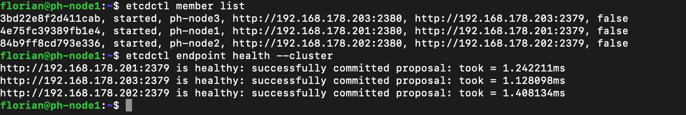

## Teil 9 — Patroni konfigurieren und Cluster starten

Datenverzeichnis (`/var/lib/postgresql/16/patroni`, `postgres:postgres`, `chmod 700`) und `patroni.yml` auf jedem Knoten angelegt (Details siehe Config-Auszug oben in der Session-Historie — `scope`, `restapi`, `etcd3` und `postgresql`-Block jeweils mit der eigenen IP, Replikations-/Superuser-Passwort auf allen drei Knoten identisch).

### systemd-Unit

`pip install` legt keinen systemd-Dienst an — selbst geschrieben, identisch auf allen drei Knoten unter `/etc/systemd/system/patroni.service`:

```ini
[Unit]
Description=Patroni PostgreSQL HA
After=network.target etcd.service
Requires=etcd.service

[Service]
Type=simple
User=postgres
Group=postgres
ExecStart=/usr/local/bin/patroni /etc/patroni.yml
ExecReload=/bin/kill -s HUP $MAINPID
KillMode=process
TimeoutSec=30
Restart=on-failure

[Install]
WantedBy=multi-user.target
```

`User=postgres`, weil Patroni die PostgreSQL-Binaries startet und die aus Sicherheitsgründen nicht als root laufen dürfen. `Requires=etcd.service` stellt sicher, dass der lokale etcd-Dienst garantiert läuft, bevor Patroni startet.

### Was beim ersten Start automatisch passiert

Alle drei Patroni-Prozesse versuchen beim Start gleichzeitig, sich in etcd als Initiator einzutragen — dank Raft/Mehrheitsprinzip gewinnt genau einer. Der Gewinner führt `initdb` aus und wird automatisch **Leader**. Die anderen beiden erkennen über etcd, dass bereits ein Leader existiert, und ziehen sich automatisch per `pg_basebackup` eine Kopie davon — werden also automatisch zu **Replicas**. Das ist exakt der Automatisierungsschritt aus Teil 6, jetzt live beobachtet statt nur konzeptionell.

```bash
sudo systemctl daemon-reload
sudo systemctl enable patroni
sudo systemctl start patroni
```

### Verifiziert (17.09.2026)

```
florian@ph-node2:~$ patronictl -c /etc/patroni.yml list
+ Cluster: postgres-ha (7686474206101860353) ------+----+-------------+-----+------------+-----+
| Member   | Host            | Role    | State     | TL | Receive LSN | Lag | Replay LSN | Lag |
+----------+-----------------+---------+-----------+----+-------------+-----+------------+-----+
| ph-node1 | 192.168.178.201 | Leader  | running   |  1 |             |     |            |     |
| ph-node2 | 192.168.178.202 | Replica | streaming |  1 |   0/5047D30 |   0 |  0/5047D30 |   0 |
| ph-node3 | 192.168.178.203 | Replica | streaming |  1 |   0/5047D30 |   0 |  0/5047D30 |   0 |
+----------+-----------------+---------+-----------+----+-------------+-----+------------+-----+
```

`ph-node1` hat das Rennen gewonnen und ist Leader, `ph-node2`/`ph-node3` sind Replicas im Zustand `streaming` mit **Lag = 0** in beiden Spalten (Receive und Replay LSN) — vollständig synchron, alle auf derselben Timeline (`TL 1`).

## Teil 10 — HAProxy: automatisches Routing zur aktuellen Primary

HAProxy soll nie selbst "wissen" müssen, wer gerade Primary ist — das würde die Config ständig veralten lassen. Stattdessen nutzt es Patronis REST-API (Port 8008): Der Pfad `/primary` antwortet mit HTTP **200**, wenn der jeweilige Knoten gerade Primary ist, und mit **503**, wenn er Replica ist. HAProxy fragt das laufend bei allen drei Knoten ab und leitet echten PostgreSQL-Traffic (Port 5432) ausschließlich an den einen Knoten weiter, der gerade mit 200 antwortet. Fällt der Primary aus und Patroni befördert automatisch eine Replica, schwenkt HAProxy automatisch um — ganz ohne manuellen Eingriff.

Praktischer Vorteil dieser Konfiguration: Sie ist auf **allen drei Knoten identisch** (zeigt ja nur auf feste IPs, nicht auf "sich selbst") — keine Anpassung pro Knoten nötig, anders als bei etcd und Patroni.

```bash
sudo apt install -y haproxy

sudo tee /etc/haproxy/haproxy.cfg > /dev/null <<'CFG'
global
    maxconn 100

defaults
    log global
    mode tcp
    retries 2
    timeout client 30m
    timeout connect 4s
    timeout server 30m
    timeout check 5s

listen stats
    mode http
    bind *:7000
    stats enable
    stats uri /

listen postgres
    bind *:5000
    option httpchk GET /primary
    http-check expect status 200
    default-server inter 3s fall 3 rise 2 on-marked-down shutdown-sessions
    server ph-node1 192.168.178.201:5432 maxconn 100 check port 8008
    server ph-node2 192.168.178.202:5432 maxconn 100 check port 8008
    server ph-node3 192.168.178.203:5432 maxconn 100 check port 8008
CFG

sudo systemctl enable haproxy
sudo systemctl restart haproxy
```

`mode tcp` bei der `postgres`-Regel, weil PostgreSQL kein HTTP spricht — nur der Health-Check gegen Patroni läuft über HTTP, der eigentliche Datenverkehr ist rohes TCP. `listen stats` auf Port 7000 ist ein eingebautes Web-Dashboard (`http://<knoten-ip>:7000/`), auf dem live sichtbar ist, welcher Server gerade "UP" ist.

### Verifiziert (17.09.2026)

`psql` lokal auf dem Mac installiert (`brew install libpq`), dann über HAProxy verbunden:

```
psql -h 192.168.178.201 -p 5000 -U postgres -c "SELECT pg_is_in_recovery();"
 pg_is_in_recovery
--------------------
 f
(1 row)
```

`f` (false) bestätigt: Die Verbindung über HAProxy (Port 5000) landet tatsächlich bei der aktuellen Primary — Routing funktioniert wie gedacht.

---

## Teil 11 — keepalived: virtuelle IP für automatisches Failover

HAProxy allein löst nur einen Teil des Problems: Es routet korrekt zur aktuellen Primary — aber die Anwendung muss trotzdem wissen, welchen der drei Knoten sie als HAProxy-Adresse ansprechen soll. Fällt genau dieser Knoten aus, ist die App wieder tot, obwohl Cluster und HAProxy-Configs auf allen drei Knoten identisch sind. **keepalived** schließt diese letzte Lücke: Es implementiert **VRRP** (Virtual Router Redundancy Protocol) und lässt eine einzige virtuelle IP (`192.168.178.200`) zwischen den drei Knoten wandern — immer dorthin, wo gerade ein gesunder HAProxy läuft. Die Anwendung verbindet sich nur noch mit dieser einen, stabilen Adresse.

### Funktionsweise

Die drei Knoten handeln per **Priorität** aus, wer die VIP aktuell binden darf (ph-node1 = 150, ph-node2 = 100, ph-node3 = 90 — im Normalfall gewinnt also node1). Damit die VIP nicht stur an einem Knoten kleben bleibt, dessen HAProxy abgestürzt ist, überwacht ein **Track-Script** (`check_haproxy.sh`) den lokalen HAProxy-Dienst und lässt keepalived die eigene Priorität senken, sobald HAProxy nicht mehr läuft — der nächste Knoten mit der höchsten verbleibenden Priorität übernimmt dann automatisch.

**Design-Entscheidung: Unicast statt Multicast.** VRRP kommuniziert standardmäßig per Multicast (`224.0.0.18`). In Heimnetzen/auf Proxmox-Bridges kann das an IGMP-Snooping oder Switch-Filtern scheitern — im schlimmsten Fall sehen sich die Knoten gegenseitig nicht mehr und alle drei halten sich gleichzeitig für MASTER (Split-Brain bei der VIP). Stattdessen **Unicast** verwendet: VRRP-Pakete werden gezielt an die drei bekannten IPs geschickt statt gebroadcastet — unabhängig vom Multicast-Verhalten des Netzwerks.

### Installation (auf allen drei Knoten identisch)

```bash
sudo apt install -y keepalived

sudo tee /etc/keepalived/check_haproxy.sh > /dev/null <<'SCRIPT'
#!/bin/bash
# Exit 0 = HAProxy lebt, Exit 1 = tot -> keepalived senkt Priorität
systemctl is-active --quiet haproxy
SCRIPT

sudo chmod +x /etc/keepalived/check_haproxy.sh
```

### `/etc/keepalived/keepalived.conf` — pro Knoten unterschiedlich

Gleicher Dateipfad auf allen drei Maschinen, aber jeweils eigener Inhalt (state, priority, unicast_src_ip/unicast_peer):

```
# ph-node1 (192.168.178.201) — state MASTER, priority 150
vrrp_script chk_haproxy {
    script "/etc/keepalived/check_haproxy.sh"
    interval 2
    weight 20
    fall 3
    rise 2
}

vrrp_instance VI_1 {
    state MASTER
    interface ens18
    virtual_router_id 51
    priority 150
    advert_int 1

    unicast_src_ip 192.168.178.201
    unicast_peer {
        192.168.178.202
        192.168.178.203
    }

    authentication {
        auth_type PASS
        auth_pass <VRRP_PASSWORD>
    }

    virtual_ipaddress {
        192.168.178.200/24
    }

    track_script {
        chk_haproxy
    }
}
```

Auf ph-node2 (`.202`) und ph-node3 (`.203`) identisch, außer: `state BACKUP`, `priority 100` bzw. `90`, sowie `unicast_src_ip`/`unicast_peer` auf die jeweils eigene bzw. die beiden anderen IPs angepasst.

```bash
sudo systemctl enable --now keepalived
```

### Verifiziert (17.09.2026)

`ip a show ens18` auf ph-node1:

```
inet 192.168.178.201/24 brd 192.168.178.255 scope global ens18
inet 192.168.178.200/24 scope global secondary ens18
```

Die VIP ist als sekundäre Adresse sauber an node1 gebunden. Von außen (Mac) getestet:

```
$ ping 192.168.178.200
5 packets transmitted, 5 received, 0% packet loss

$ psql -h 192.168.178.200 -p 5000 -U postgres -c "SELECT pg_is_in_recovery();"
 pg_is_in_recovery
--------------------
 f
(1 row)
```

Damit ist der komplette Stack — keepalived (VIP) → HAProxy (Routing) → Patroni (Leader-Election) → PostgreSQL — end-to-end über eine einzige stabile Adresse erreichbar, ganz ohne knotenspezifisches Wissen auf Anwendungsseite.

---

## Teil 12 — Der echte Failover-Test (und drei Bugs unterwegs)

Der eigentliche Beweis, dass die Architektur trägt: HAProxy auf node1 gezielt stoppen und beobachten, ob die VIP automatisch zu einem gesunden Knoten wandert — ganz ohne manuellen Eingriff. Der erste Anlauf ist dabei **nicht** sauber durchgelaufen, und genau die drei Fehler unterwegs sind lehrreicher als ein Test, der auf Anhieb geklappt hätte.

### Bug 1: Positives `weight` verhindert den Failover komplett

Erste Config-Version hatte `weight 20` (positiv) im `vrrp_script`-Block. Die Logik dahinter ist additiv: Läuft der Check erfolgreich, wird die Basis-Priorität **erhöht** (150 → 170). Schlägt er fehl, wird der Bonus nur wieder **abgezogen** — zurück auf die Basis (170 → 150). Das Problem: 150 ist immer noch höher als node2s 100 und node3s 90. Node1 blieb also MASTER, obwohl HAProxy dort tot war — der Cluster war komplett offline, ohne dass keepalived das je gemerkt hätte:

```
14:18:31  Script `chk_haproxy` now returning 3
14:18:35  VRRP_Script(chk_haproxy) failed (exited with status 3)
14:18:35  Changing effective priority from 170 to 150   ← immer noch höchste Priorität!
```

**Fix:** `weight` komplett weglassen. Ohne `weight`-Angabe schaltet keepalived die VRRP-Instanz bei Script-Fehlschlag in den **FAULT-Zustand** — unabhängig von der Priorität wird sie zwingend aus dem Rennen genommen, statt nur an einem Arithmetik-Ergebnis herumzudrehen.

### Bug 2: `enable_script_security` sucht einen User, den es nicht gibt

Mit dem `weight`-Fix kam prompt die nächste Runde: `enable_script_security` in `global_defs` verlangt, dass Track-Scripts unter einem **unprivilegierten** User laufen (Root-Scripts + Config-Schreibrecht wäre ein Sicherheitsrisiko). Ohne explizite `user`-Angabe sucht keepalived automatisch nach einem System-User `keepalived_script` — den gab es auf keinem der drei Knoten:

```
Script user 'keepalived_script' does not exist
(...) Unable to set default user for vrrp script chk_haproxy - removing
(...) track_script chk_haproxy not found, ignoring...
```

Das Tückische daran: keepalived startet trotzdem klaglos — der Track-Script-Block wird einfach still entfernt, der Health-Check ist komplett tot, ohne dass ein offensichtlicher Fehler das zeigt.

**Fix:** Den erwarteten System-User anlegen:
```bash
sudo useradd --system --no-create-home --shell /usr/sbin/nologin keepalived_script
```

### Bug 3: Falsche Dateiberechtigung blockiert den neuen User

Nach dem User-Fix kam noch eine dritte Runde: Das Check-Script war aus einer früheren Sicherheitsrunde mit `chmod 700` (nur Owner-root darf ausführen) gesetzt. Der neue `keepalived_script`-User (uid 999) durfte es also gar nicht ausführen:

```
WARNING - script '/etc/keepalived/check_haproxy.sh' is not executable for uid:gid 999:988 - disabling.
```

**Fix:** `sudo chmod 755 /etc/keepalived/check_haproxy.sh` — root behält Schreibrecht, alle anderen dürfen lesen und ausführen.

### Der Test, diesmal sauber

Mit allen drei Fixes auf allen drei Knoten angewendet, Ausgangszustand verifiziert (alle drei `VRRP_Script(chk_haproxy) succeeded`, node1 MASTER mit VIP), dann:

```bash
# Auf node1:
sudo systemctl stop haproxy
```

Status-Check über alle drei Knoten während node1s HAProxy aus ist:

```
== 192.168.178.201 ==   haproxy: inactive   VIP: nicht hier
== 192.168.178.202 ==   haproxy: active     VIP: HIER -> MASTER
== 192.168.178.203 ==   haproxy: active     VIP: nicht hier
```

Von außen (Mac) bestätigt, während node1 weiterhin ausgeschaltet ist:

```
$ ping -c 5 192.168.178.200
64 bytes from 192.168.178.200: icmp_seq=0 ttl=64 time=0.862 ms
64 bytes from 192.168.178.200: icmp_seq=1 ttl=64 time=0.747 ms
(0% packet loss)

$ psql -h 192.168.178.200 -p 5000 -U postgres -c "SELECT pg_is_in_recovery();"
 pg_is_in_recovery
--------------------
 f
(1 row)
```

Die VIP ist automatisch zu node2 gewandert, HAProxy dort hat den Traffic übernommen, `psql` antwortet weiterhin mit `f` (verbunden mit einer laufenden Primary) — komplett ohne manuellen Eingriff. Nach `sudo systemctl start haproxy` auf node1 übernimmt node1 die VIP automatisch zurück (höhere Basis-Priorität, 150 vs. 100).

**Wichtige Einordnung:** Dieser Test validiert den **HAProxy/keepalived-Layer** (Traffic-Routing bei HAProxy-Ausfall) — nicht den **Patroni-Layer** (DB-Primary-Wechsel bei PostgreSQL-Ausfall), der schon in [Teil 4](#teil-4--manueller-failover-live-durchgeführt) manuell und in Teil 9 automatisiert verifiziert wurde. Beide Mechanismen arbeiten unabhängig voneinander zusammen und ergeben erst gemeinsam die vollständige HA-Kette: Stirbt PostgreSQL/Patroni auf dem Primary-Knoten, übernimmt Patroni die Leader-Wahl; stirbt HAProxy (oder der ganze Knoten), übernimmt keepalived die VIP. Ein noch härterer Test — node1 komplett herunterfahren statt nur HAProxy zu stoppen — würde beide Mechanismen gleichzeitig auslösen und ist ein möglicher nächster Schritt.

---
## Teil 13 — Backup & Recovery

Bevor es an die Befehle geht, das Fundament: **warum** Backups überhaupt nötig sind, **welche zwei Arten** es gibt und **wie** aus einem Backup eine Zeitmaschine wird. Diese Einleitung fasst die Konzepte zusammen — die praktischen Schritte folgen ab 11.1.

### Warum überhaupt Backups? — Replikation ≠ Backup

Naheliegender Einwand: "Wir haben doch einen 3-Knoten-Cluster mit Streaming-Replikation — jede Änderung landet sofort auf allen Knoten. Wozu dann noch Backups?"

Der Denkfehler steckt darin, dass **Replikation und Backup zwei völlig verschiedene Probleme lösen**:

- **Replikation schützt vor Ausfall** (Hardware-Defekt, OS-Crash, Netzwerk). Fällt ein Knoten aus, übernimmt ein anderer.
- **Backup schützt vor Fehlern und Katastrophen** — und *genau das kann Replikation nicht*.

Das entscheidende Beispiel: Ein Admin tippt auf dem Leader

```sql
DROP TABLE kundendaten;
```

Was macht die Replikation? Sie ist schnell und zuverlässig — und repliziert diesen Befehl in Millisekunden brav auf **alle drei Knoten**. Die Tabelle ist damit *überall* weg. Replikation kann nicht unterscheiden zwischen "gewollte Änderung" und "Katastrophe" — sie kopiert einfach alles. Nur ein Backup konserviert einen Zustand von *vorher*.

Der zweite Fall ist die **physische Trennung**: Rechenzentrum brennt, Blitzschlag, oder Ransomware verschlüsselt alle drei VMs gleichzeitig. Dann sind alle Knoten gleichzeitig tot — und nur ein Backup an einem *anderen* Ort rettet die Daten.

> **Merksatz fürs Gespräch:** Replikation ≠ Backup. Replikation schützt vor *Ausfall*, Backup schützt vor *Fehlern und Katastrophen*.

### Die Landkarte: zwei unabhängige Achsen

Backup-Strategie hat **zwei Achsen**, die man sauber getrennt denken muss:

**Achse 1 — das Format:** logisch vs. physisch

| | Logisch (`pg_dump`) | Physisch (`pg_basebackup`) |
|---|---|---|
| Was | SQL-Befehle (`CREATE`, `INSERT`) — ein **Rezept** zum Nachbauen | Rohe Dateien, jedes Bit 1:1 — ein **Foto** der Platte |
| Lesbar | ja, reiner Text | nein, binär |
| Portabel | ✅ jede Version, jede Maschine | ❌ an PG-Version/Format gebunden |
| Geschwindigkeit | langsamer bei großen DBs | schnell |
| Ideal für | Umzug, Versionswechsel, Migration | schnelle 1:1-Kopie, Disaster Recovery |

> **Merksatz:** Umzug oder neue PostgreSQL-Version → **logisch** (das Rezept nimmt man mit in jede Küche). Schnelle 1:1-Kopie derselben Instanz → **physisch** (das Foto passt nur in dieselbe Küche).

**Achse 2 — die Zeit:** einfaches Backup vs. PITR

Ein einfaches Backup bringt dich nur auf **einen** Zeitpunkt zurück — den Moment des Backups. Passiert das Unglück um 14:37 Uhr und das letzte Backup war um 02:00 Uhr, verlierst du alles dazwischen. Die Lösung heißt **PITR (Point-in-Time-Recovery)**:

```
Base Backup  =  Ausgangszustand   (das Foto um 02:00)
WAL          =  Änderungen danach (lückenloses Protokoll jeder Änderung)
PITR         =  Base Backup + WAL bis Zeitpunkt X
```

Das **WAL** (Write-Ahead Log) ist dasselbe Protokoll, das auch die Replikation nutzt: PostgreSQL schreibt jede Änderung dort hinein, bevor sie gilt. Archiviert man dieses WAL lückenlos, kann man vom Backup-Zeitpunkt aus bis auf **jede beliebige Sekunde** danach vorspulen.

> **Konsequenz:** Ohne WAL-Archivierung kommt man im Ernstfall nur auf den Backup-Zeitpunkt zurück — alles danach ist verloren. Base Backup allein = Standbild. Base Backup + WAL = Video mit Rückspulfunktion.

### Schnell-Referenz (zum Abfragen)

- **Warum Backup trotz HA/Replikation?** → Replikation kopiert auch Fehler (`DROP TABLE` landet auf allen Knoten); schützt nicht vor Bedienfehler, Ransomware, RZ-Ausfall.
- **Logisch vs. physisch?** → Rezept (SQL, portabel) vs. Foto (Rohdateien, versionsgebunden).
- **Welches Backup für Versionswechsel 16 → 18?** → logisch (`pg_dump`), weil SQL versionsunabhängig ist.
- **Was ist PITR?** → Base Backup + archiviertes WAL = Rücksprung auf einen exakten Zeitpunkt.
- **Was braucht PITR zwingend?** → eingeschaltete WAL-Archivierung; ohne sie nur Rücksprung auf den Backup-Moment.

---

### 13.1 Logisches Backup mit `pg_dump`

`pg_dump` exportiert eine Datenbank als SQL-Befehle (`CREATE TABLE`, `INSERT INTO` usw.). Das Ergebnis ist eine lesbare, portable Datei — kein binäres Format.

#### Praxis: Titanic-Datenbank sichern und wiederherstellen

```bash
# Backup erstellen (Format "custom" = komprimiert, ideal für pg_restore)
pg_dump -U postgres -d titanic -F c -f ~/titanic_backup.dump

# Ergebnis prüfen
ls -lh ~/titanic_backup.dump
# → -rw-rw-r-- 1 florian florian 24K Sep 20 18:34 titanic_backup.dump
```

**Parameter erklärt:**

| Parameter | Bedeutung |
|---|---|
| `-U postgres` | Als postgres-User verbinden |
| `-d titanic` | Diese Datenbank sichern |
| `-F c` | Format "custom" — komprimiert, ideal für `pg_restore` |
| `-f ~/titanic_backup.dump` | Ausgabedatei |

#### Restore-Test — die goldene Regel

> **Ein Backup ist kein Backup bis du es erfolgreich restored hast.**

```bash
# Neue leere Zieldatenbank anlegen
sudo -u postgres createdb titanic_restore

# Restore durchführen
pg_restore -U postgres -d titanic_restore ~/titanic_backup.dump

# Verify — sind die Daten wirklich da?
sudo -u postgres psql -d titanic_restore -c "SELECT COUNT(*) FROM passengers;"
# → count: 891 ✅
```

**Ergebnis (verifiziert 20.09.2026):** Alle 891 Passagiere erfolgreich wiederhergestellt.

---

### 13.2 Logisch vs. Physisch — der entscheidende Unterschied

| | Logisches Backup (`pg_dump`) | Physisches Backup (`pg_basebackup`) |
|---|---|---|
| **Was wird gesichert** | SQL-Befehle (`CREATE`, `INSERT`) | Rohe Datenbankdateien (1:1-Kopie) |
| **Format** | Lesbar, portabel | Binär, nicht lesbar |
| **Scope** | Einzelne DB oder Tabelle | Gesamte PostgreSQL-Instanz |
| **Geschwindigkeit** | Langsamer bei großen DBs | Schnell |
| **Point-in-Time-Recovery** | ❌ | ✅ |
| **Ideal für** | Migration, Entwicklung, kleine DBs | Produktion, Disaster Recovery |

**Einfache Analogie:**

| | Logisch | Physisch |
|---|---|---|
| Wie | Rezept abschreiben | Küche fotografieren |
| Ergebnis | SQL-Datei | Datei-Kopie |
| PITR möglich | ❌ | ✅ |
| Portabel | ✅ | ❌ |


---

### 13.3 Physisches Backup mit `pg_basebackup`

`pg_basebackup` kopiert die rohen Datenbankdateien 1:1 — so wie sie auf der Festplatte liegen. Ergebnis: ein kompletter Snapshot der gesamten PostgreSQL-Instanz.

#### Wichtig: Auf welcher IP lauscht PostgreSQL?

Vor dem Backup immer prüfen, auf welcher IP PostgreSQL tatsächlich lauscht:

```bash
sudo ss -tlnp | grep postgres
# → LISTEN 0  200  192.168.178.201:5432  0.0.0.0:*
```

In unserem Cluster lauscht PostgreSQL nur auf `192.168.178.201` (nicht auf `127.0.0.1`) — weil Patroni `listen_addresses` in der `patroni.yml` entsprechend gesetzt hat. Deshalb schlägt `-h 127.0.0.1` fehl, `-h 192.168.178.201` funktioniert.

**Merke:** `ss -tlnp` ist der beste Freund bei Verbindungsproblemen — zeigt sofort welcher Prozess auf welcher IP und welchem Port lauscht.

#### Backup durchführen

```bash
sudo -u postgres pg_basebackup \
  -h 192.168.178.201 \
  -U replicator \
  -D /var/lib/postgresql/16/backup_test \
  -F tar \
  -z \
  -P
```

**Parameter erklärt:**

| Parameter | Bedeutung |
|---|---|
| `-h 192.168.178.201` | IP auf der PostgreSQL lauscht |
| `-U replicator` | Rolle mit REPLICATION-Attribut |
| `-D /var/lib/postgresql/16/backup_test` | Zielverzeichnis |
| `-F tar` | Als Tar-Archiv (statt rohe Dateien) |
| `-z` | gzip-Komprimierung |
| `-P` | Fortschrittsanzeige |

**Ergebnis (verifiziert 21.09.2026):**

```
38726/38726 kB (100%), 1/1 tablespace
```

```bash
sudo ls -lh /var/lib/postgresql/16/backup_test/
# -rw------- 1 postgres postgres 222K Sep 21 07:11 backup_manifest
# -rw------- 1 postgres postgres 5,2M Sep 21 07:11 base.tar.gz
# -rw------- 1 postgres postgres  18K Sep 21 07:11 pg_wal.tar.gz
```

| Datei | Inhalt |
|---|---|
| `base.tar.gz` | Die kompletten Datenbankdateien |
| `pg_wal.tar.gz` | WAL-Segmente — wichtig für Konsistenz |
| `backup_manifest` | Prüfsummenliste aller Dateien |

---

### 13.4 Point-in-Time-Recovery (PITR)

PITR ermöglicht es, die Datenbank auf einen **exakten Zeitpunkt** zurückzusetzen — nicht nur auf den Backup-Zeitpunkt, sondern auf jede beliebige Sekunde danach.

#### Wie funktioniert das?

`pg_basebackup` alleine reicht für PITR **nicht** — es ist nur ein Schnappschuss. PITR braucht die Kombination aus Snapshot + laufendem WAL-Archiv:

```
pg_basebackup (Schnappschuss)  +  WAL-Archiv (laufendes Protokoll)
       │                                    │
  "Startpunkt"                    "Was danach passiert ist"
```

**Analogie:**

| | Bedeutung |
|---|---|
| `pg_basebackup` | Foto der Festplatte um 02:00 Uhr |
| WAL-Archiv | Lückenlose Aufzeichnung aller Änderungen danach |
| PITR | "Spul zurück auf 14:37 Uhr" — Foto + WAL bis 14:37 nachspielen |

Ohne WAL-Archiv: Restore nur auf den Backup-Zeitpunkt möglich.
Mit WAL-Archiv: Restore auf **jede beliebige Sekunde** im Zeitraum danach.


---

### 13.5 WAL-Archivierung einrichten

#### Warum WAL-Archivierung?

Ohne WAL-Archivierung kann man nur auf den **exakten Backup-Zeitpunkt** zurück:

```
02:00 Uhr → pg_basebackup läuft
            ← nur hierhin kann man zurück
14:37 Uhr → Fehler! Tabelle versehentlich gelöscht.
            → 12 Stunden Datenverlust ❌
```

Mit WAL-Archivierung wird jede Änderung nach dem Backup lückenlos protokolliert:

```
02:00 Uhr → pg_basebackup (Startpunkt)
02:00–14:37 → jede Änderung im WAL-Archiv gespeichert
14:37 Uhr → Fehler!
            → Restore: Backup 02:00 + WAL bis 14:36:59
            → Datenverlust: 0 Sekunden ✅
```

**Für den produktiven Einsatz (z.B. in einer Behörde mit Tausenden Datenbanken)** ist PITR keine Kür sondern Pflicht — Fachdaten wie Kataster- oder Steuerdaten sind im Verlustfall unter Umständen nicht wiederherstellbar.

#### Einrichtung

Archiv-Verzeichnis anlegen:

```bash
sudo mkdir -p /var/lib/postgresql/wal_archive
sudo chown postgres:postgres /var/lib/postgresql/wal_archive
```

In `/etc/patroni.yml` den `parameters`-Block unter `bootstrap → dcs → postgresql` erweitern:

```yaml
      parameters:
        wal_level: replica
        hot_standby: "on"
        max_wal_senders: 5
        max_replication_slots: 5
        archive_mode: "on"
        archive_command: 'cp %p /var/lib/postgresql/wal_archive/%f'
```

**Was bedeutet `archive_command`?**

| Platzhalter | Bedeutung |
|---|---|
| `%p` | Vollständiger Pfad der WAL-Datei (Quelle) |
| `%f` | Dateiname der WAL-Datei (Ziel) |

PostgreSQL ruft diesen Befehl automatisch auf, sobald ein WAL-Segment abgeschlossen ist — im Produktionseinsatz würde man statt `cp` ein echtes Backup-Tool (z.B. `pgbackrest` oder `barman`) oder einen Remote-Speicher (S3, NFS) verwenden.

Patroni neu laden damit die Änderung greift:

```bash
sudo systemctl reload patroni
```


#### Wichtig: Bei Patroni Parameter niemals direkt setzen

Der erste Versuch, `archive_mode` über die lokale `patroni.yml` zu setzen, schlug fehl — `SHOW archive_mode` blieb hartnäckig `off`. Der Grund ist ein zentrales Patroni-Konzept:

> **Bei einem Patroni-Cluster verwaltet Patroni die PostgreSQL-Konfiguration zentral über etcd — nicht über die lokale `patroni.yml`.**

Die Werte unter `bootstrap.dcs` werden nur beim **allerersten** Cluster-Start (dem Bootstrap) aus der Datei gelesen. Danach liegt die "Wahrheit" in etcd. Ein nachträgliches Editieren der Datei bringt deshalb nichts — genauso wenig wie ein direktes `ALTER SYSTEM` oder Editieren der `postgresql.conf` (Patroni überschreibt beides wieder).

**Der richtige Weg — Config in etcd ändern:**

```bash
patronictl -c /etc/patroni.yml edit-config
```

Das öffnet die laufende Cluster-Config aus etcd. Dort den `parameters`-Block erweitern:

```yaml
postgresql:
  parameters:
    archive_mode: "on"
    archive_command: cp %p /var/lib/postgresql/wal_archive/%f
```

Nach dem Speichern verteilt Patroni die Änderung automatisch an **alle drei Knoten**.

**Restart statt Reload — der entscheidende Unterschied:**

`archive_mode` gehört zu den Parametern, die einen **Neustart** von PostgreSQL erfordern — ein `reload` genügt nicht (das reicht nur für die meisten anderen Parameter). Patroni signalisiert das mit einem `Pending restart`-Flag auf allen betroffenen Knoten:

```
| Member   | ... | Pending restart | Pending restart reason |
| ph-node1 | ... | *               | archive_mode: off->on  |
| ph-node2 | ... | *               | archive_mode: off->on  |
| ph-node3 | ... | *               | archive_mode: off->on  |
```

Kontrollierten Restart über Patroni auslösen (nicht über `systemctl` — Patroni soll die Kontrolle behalten):

```bash
patronictl -c /etc/patroni.yml restart postgres-ha ph-node1 --force
```

Das `--force` überspringt die interaktive Rückfrage nach dem Zeitpunkt. Danach:

```bash
sudo -u postgres psql -c "SHOW archive_mode;"
# → on ✅
```

**Ergebnis (verifiziert 21.09.2026):** `archive_mode = on` auf ph-node1. Die WAL-Archivierung läuft.

> **Lerneffekt fürs echte Admin-Leben:** Bei Patroni ändert man PostgreSQL-Parameter grundsätzlich über `patronictl edit-config` — niemals direkt per `ALTER SYSTEM` oder in der `postgresql.conf`. Und man muss wissen, welche Parameter nur einen Reload und welche einen echten Restart brauchen.

#### Das Konzept dahinter (zum Abfragen)

Warum dieser Umweg? Patroni ist der **Dirigent** eines Orchesters aus drei Musikern (den drei Knoten). Damit der Cluster nicht auseinanderläuft, spielen alle nach **einem** verbindlichen Notenblatt — und das liegt nicht bei jedem Knoten einzeln, sondern zentral in **etcd**.

**1. Wo lebt die Config?** Die lokale `patroni.yml` mit ihrer `bootstrap:`-Sektion ist nur der **Startzettel für den allerersten Aufbau** (*bootstrap* = einmalig hochziehen). Sobald der Cluster läuft, liest Patroni die Cluster-weiten Einstellungen **nur noch aus etcd**, nicht mehr aus der Datei. Deshalb läuft ein nachträgliches Editieren der Datei ins Leere — man muss über `patronictl edit-config` direkt ins zentrale Notenblatt schreiben. Vorteil: **ein** Edit genügt, Patroni verteilt ihn automatisch an alle Knoten (im Gegensatz zur etcd-/Patroni-Grundconfig, wo jede Datei pro Knoten einzeln angefasst wird).

**2. Reload vs. Restart.** PostgreSQL-Parameter zerfallen in zwei Klassen:

| | Reload-Parameter (die meisten) | Restart-Parameter (wenige, fundamentale) |
|---|---|---|
| Übernahme | im laufenden Betrieb, ohne Verbindungsabbruch | erst beim Neustart des Servers |
| Beispiel | `archive_command` (*wohin* archiviert wird) | `archive_mode` (*ob* überhaupt archiviert wird) |

`archive_mode` entscheidet, ob beim Start ein eigener Archiver-Prozess mitläuft — den kann man nicht im Betrieb dazuschalten. Patroni zeigt das ehrlich als `Pending restart reason: archive_mode: off->on` an und wartet, bis man den Neustart **bewusst** auslöst.

**3. Die eiserne Regel.** Den Neustart löst man mit `patronictl restart` aus — **niemals** mit `systemctl restart`. Denn Patroni prüft im Sekundentakt, ob seine lokale Instanz läuft, und korrigiert Abweichungen automatisch. Reißt man PostgreSQL per `systemctl` weg, hält Patroni das für einen Ausfall und reagiert mit einer Gegenmaßnahme — Neustart auf seine Weise oder sogar ein ungewollter Failover. Bei `patronictl restart` dagegen weiß der Dirigent Bescheid und legt den Musiker kontrolliert kurz hin.

> **Merksatz:** Bei einem Patroni-Cluster fasst man PostgreSQL nie direkt an (kein `ALTER SYSTEM`, kein `systemctl`). Immer über Patroni: `edit-config`, `restart`, `switchover`. Der Dirigent muss die Kontrolle behalten.

#### Archiv-Verzeichnis muss auf ALLEN Knoten existieren

Ein Praxis-Fehler, der beim Testen auffiel: Das Archiv-Verzeichnis war zunächst nur auf node1 angelegt — aber Leader war node3. Ergebnis: `ls` auf node3 lief ins Leere (`No such file or directory`), es wurde nichts archiviert.

> **Merke:** Der `archive_command` muss auf **jedem** Knoten funktionieren (inklusive existierendem Zielverzeichnis). Da durch Failover jeder Knoten zum Leader werden kann, muss das Archiv-Verzeichnis überall vorhanden sein — sonst schlägt nach einem Failover die Archivierung auf dem neuen Leader fehl.

```bash
# Auf JEDEM Knoten:
sudo mkdir -p /var/lib/postgresql/wal_archive
sudo chown postgres:postgres /var/lib/postgresql/wal_archive
```

**Live bestätigt nach einem echten Failover (22.09.2026):** Nachdem der Leader auf node2 gewandert war (node2 hatte das Verzeichnis nie bekommen), zeigte `pg_stat_archiver` das Problem schwarz auf weiß:

```sql
SELECT archived_count, last_archived_wal, failed_count, last_failed_wal FROM pg_stat_archiver;
-- archived_count | last_archived_wal | failed_count | last_failed_wal
--        0        |                   |     567      | 00000003.history
```

`archived_count = 0` bei **567 Fehlversuchen** — der aktuelle Leader konnte kein einziges WAL-Segment archivieren, die PITR-Fähigkeit war faktisch kaputt. Nach dem Anlegen des Verzeichnisses und einem `pg_switch_wal()`:

```sql
-- archived_count | last_archived_wal            | failed_count
--       51        | 00000003000000000000003C     |     570
```

`archived_count` springt von 0 auf 51 (PostgreSQL holt die aufgestauten Segmente sofort nach), `failed_count` friert ein und steigt nicht weiter. `pg_stat_archiver` ist damit das zentrale Werkzeug, um zu prüfen, ob die WAL-Archivierung wirklich läuft — nicht nur, ob sie konfiguriert ist.

> **Merke:** `failed_count` ist ein historischer Zähler (wird nicht zurückgesetzt). Entscheidend ist nicht, dass er mal > 0 war, sondern dass er **nicht weiter steigt**, während `archived_count` klettert.

---

### 13.6 PITR-Restore live durchgespielt

Ziel: Beweisen, dass sich die Datenbank auf einen **exakten Zeitpunkt** zurücksetzen lässt. Wichtig — der Restore läuft auf einer **isolierten Test-Instanz** (eigener Port 5433, eigenes Datenverzeichnis, manuell per `pg_ctl` gestartet), damit der laufende Patroni-Cluster völlig unberührt bleibt. Patroni verwaltet seine Instanzen aktiv und würde eine manuell veränderte Cluster-Instanz sofort "korrigieren" — deshalb niemals eine von Patroni verwaltete Instanz für PITR anfassen.

#### Testdaten mit Zeitstempeln anlegen

```sql
CREATE TABLE pitr_test (id SERIAL PRIMARY KEY, nachricht TEXT, zeit TIMESTAMP DEFAULT now());
INSERT INTO pitr_test (nachricht) VALUES ('Zeile 1 - vor dem Ziel');    -- 19:10:19
-- kurz warten
INSERT INTO pitr_test (nachricht) VALUES ('Zeile 3 - NACH dem Ziel');   -- 19:10:41
SELECT pg_switch_wal();   -- erzwingt, dass die Änderungen ins Archiv geschrieben werden
```

Referenzpunkte:
- Zeile 1 geschrieben um **19:10:19**
- Zeile 3 geschrieben um **19:10:41**
- Gewählter Zielzeitpunkt: **19:10:30** (dazwischen)

#### Frisches Basebackup vom Leader ziehen

```bash
sudo -u postgres pg_basebackup \
  -h 192.168.178.203 \
  -U replicator \
  -D /var/lib/postgresql/16/pitr_test \
  -F plain \
  -P
```

`-F plain` (statt `tar`) schreibt ein direkt startbares Datenverzeichnis.

#### Recovery konfigurieren

An `/var/lib/postgresql/16/pitr_test/postgresql.conf` anhängen:

```conf
port = 5433
restore_command = 'cp /var/lib/postgresql/wal_archive/%f %p'
recovery_target_time = '2026-09-21 19:10:30+00'
recovery_target_action = 'promote'
```

Und die entscheidende Signaldatei anlegen:

```bash
sudo -u postgres touch /var/lib/postgresql/16/pitr_test/recovery.signal
```

> `recovery.signal` sagt PostgreSQL beim Start: "Du bist im Recovery-Modus, spiel WAL bis zum Ziel ein." Ohne sie startet die Instanz normal und spielt nichts nach.

#### Test-Instanz starten

```bash
sudo -u postgres /usr/lib/postgresql/16/bin/pg_ctl \
  -D /var/lib/postgresql/16/pitr_test \
  -l /var/lib/postgresql/16/pitr_test/logfile \
  start
```

#### Der Beweis — im Logfile

```
starting point-in-time recovery to 2026-09-21 19:10:30+00
redo starts at 0/A000028
restored log file "00000002000000000000000A" from archive
recovery stopping before commit of transaction 761, time 2026-09-21 19:10:41.62154+00
last completed transaction was at log time 2026-09-21 19:10:19.65657+00
archive recovery complete
```

PostgreSQL hat exakt das Richtige getan:
- **Zeile 3** (Transaktion 761, 19:10:41) → **bewusst NICHT eingespielt**, weil nach dem Ziel
- **Zeile 1** (19:10:19) → letzte übernommene Transaktion

*(Die `cp: cannot stat ... .history` Meldungen im Log sind harmlos — PostgreSQL fragt nur nach optionalen Timeline-History-Dateien.)*

#### Der finale Beweis — in der Tabelle

```bash
sudo -u postgres psql -h 192.168.178.203 -p 5433 -d titanic \
  -c "SELECT id, nachricht, zeit FROM pitr_test ORDER BY id;"
```

```
 id | nachricht              | zeit
----+------------------------+----------------------------
  1 | Zeile 1 - vor dem Ziel | 2026-09-21 19:10:19.656219
(1 row)
```

**Nur Zeile 1 — Zeile 3 ist verschwunden.** PITR zeitpunktgenau verifiziert. ✅

```
Zustand vorher (Original, 5432):   Zeile 1 + Zeile 3
                                          │  PITR auf 19:10:30
                                          ▼
Zustand nachher (Test, 5433):      Zeile 1 ✅   (Zeile 3 ❌)
```

**Verifiziert 21.09.2026.**


---

## Teil 14 — Performance-Analyse mit pgbench

`pgbench` ist PostgreSQLs eingebautes **Benchmark-Werkzeug** (Teil von `postgresql-contrib`). Es simuliert viele parallele Clients, die gleichzeitig Transaktionen auf die Datenbank feuern, und misst, wie viele Transaktionen pro Sekunde (**TPS**) durchgehen. Ideal, um die Frage "hält der Cluster X gleichzeitige Verbindungen aus?" nicht zu *behaupten*, sondern zu *beweisen*.

pgbench arbeitet in zwei Phasen und bekommt dafür eine **eigene Test-DB** (nicht die produktiven Daten):

```bash
# Test-DB anlegen — MUSS auf dem Leader passieren (Replicas sind read-only!)
sudo -u postgres createdb pgbench_test
```

> **Praxis-Stolperstein (live erlebt):** `createdb` auf einer Replica scheitert mit `cannot execute CREATE DATABASE in a read-only transaction`. Eine Replica nimmt keine Schreibbefehle an. Vor Schreibaktionen also immer `patronictl list` prüfen, wer aktuell Leader ist — der Leader kann durch Failover gewechselt haben. (Genau dieses Problem löst später HAProxy/VIP automatisch.)

### 14.1 Phase 1 — Initialisieren

```bash
sudo -u postgres pgbench -i -s 10 pgbench_test
```

| Parameter | Bedeutung |
|---|---|
| `-i` | initialisieren: Testtabellen anlegen + mit Daten füllen |
| `-s 10` | scale factor 10 → ~1.000.000 Konten (Faustregel: `-s` × 100.000) |
| `pgbench_test` | die Test-DB |

pgbench legt eine simulierte Banken-DB an (`pgbench_accounts`, `pgbench_branches`, `pgbench_tellers`, `pgbench_history`), füllt sie, macht `VACUUM` und legt Primary Keys an:

```
dropping old tables...
creating tables...
generating data (client-side)...
1000000 of 1000000 tuples (100%) done
vacuuming...
creating primary keys...
done in 0.96 s
```

### 14.2 Phase 2 — Benchmark (10 Clients)

```bash
sudo -u postgres pgbench -c 10 -j 2 -T 30 pgbench_test
```

| Parameter | Bedeutung |
|---|---|
| `-c 10` | 10 gleichzeitige Clients (parallele Verbindungen) |
| `-j 2` | 2 Worker-Threads (verteilt die Clients auf 2 CPU-Kerne) |
| `-T 30` | 30 Sekunden lang Last erzeugen |

**Ergebnis (verifiziert 22.09.2026, Leader ph-node2, 2 vCPU / 4 GB):**

```
number of transactions actually processed: 16575
number of failed transactions: 0 (0.000%)
latency average = 18.114 ms
tps = 552.066205 (without initial connection time)
```

**Interpretation — worauf es ankommt:**

| Kennzahl | Wert | Bedeutung |
|---|---|---|
| **TPS** | 552 | vollwertige Schreib-Transaktionen pro Sekunde (je mehrere Reads + Writes) |
| **failed** | 0 (0 %) | kein einziger Fehler unter Last — das ist der wichtigste Stabilitäts-Indikator |
| **Latenz** | 18 ms | ⌀ Antwortzeit pro Transaktion |

Für 2 vCPU / 4 GB ist das ein solider Wert — und die **0 % Fehlerquote** ist genau das, was "hält gleichzeitige Verbindungen stabil aus" konkret bedeutet.


### 14.3 Lasttest steigern (50 Clients) — der Durchsatz-Latenz-Trade-off

Derselbe Benchmark mit 50 statt 10 Clients:

```bash
sudo -u postgres pgbench -c 50 -j 4 -T 30 pgbench_test
```

**Ergebnis (verifiziert 22.09.2026):**

```
number of transactions actually processed: 28148
number of failed transactions: 0 (0.000%)
latency average = 53.329 ms
tps = 937.577485 (without initial connection time)
```

**Vergleich 10 vs. 50 Clients:**

| Kennzahl | 10 Clients | 50 Clients | Richtung |
|---|---|---|---|
| TPS (Durchsatz) | 552 | 937 | ⬆️ höher |
| Latenz (⌀ pro Transaktion) | 18 ms | 53 ms | ⬆️ höher |
| Fehlerquote | 0 % | 0 % | ✅ stabil |

**Warum das so ist:**

- **TPS steigt**, weil bei 10 Clients die 2 CPUs noch Leerlauf hatten. Mehr parallele Clients lasten sie besser aus → mehr Gesamtdurchsatz.
- **Latenz steigt**, weil sich 50 Clients um nur 2 CPU-Kerne drängeln. Jeder Einzelne wartet öfter, bis er dran ist → seine Transaktion dauert länger.

> **Kernprinzip — Durchsatz und Latenz ziehen gegeneinander:** Mehr parallele Last → der Server schafft insgesamt mehr (höhere TPS), aber der Einzelne wartet länger (höhere Latenz). Es gibt einen *Sweet Spot*, ab dem mehr Clients die TPS nicht weiter steigern, sondern nur noch die Latenz explodieren lassen.

**Den Kipppunkt empirisch gefunden — Test mit 90 Clients:**

```bash
sudo -u postgres pgbench -c 90 -j 4 -T 30 pgbench_test
```

```
number of transactions actually processed: 25034
number of failed transactions: 0 (0.000%)
latency average = 108.153 ms
tps = 832.154830 (without initial connection time)
```

Die vollständige Kurve über alle drei Laststufen (alle mit `-j 4` — zur Rolle von `-j` siehe 12.4):

| Clients | TPS | Latenz | Beobachtung |
|---|---|---|---|
| 10 | 719 | 13,9 ms | Leerlauf — CPUs nicht ausgelastet |
| 50 | 937 | 53 ms | nahe Optimum — bester Durchsatz |
| 90 | **832** | 108 ms | **über den Sweet Spot** — TPS sinkt wieder, Latenz explodiert |

Bei 90 Clients ist die TPS gegenüber 50 Clients **gesunken** (937 → 832), während die Latenz sich verdoppelt hat. Der Sweet Spot dieser 2-CPU-Maschine liegt also irgendwo zwischen 50 und 90 Clients. Darüber kostet der Verwaltungsaufwand (Context-Switching, Warteschlangen, Lock-Konkurrenz) mehr, als zusätzliche Parallelität bringt. Wichtig: Über alle Stufen hinweg **0 % Fehler** — der Cluster bleibt stabil, er wird nur langsamer.

**Das vollständige Modell — Leerlauf → Auslastung → Sättigung:**

Treibt man die Client-Zahl immer weiter hoch (z. B. 200 auf 2 CPUs), tritt **Sättigung** ein: Die CPUs sind voll ausgelastet, die TPS läuft gegen eine Hardware-Decke und steigt nicht mehr — aber die Latenz steigt jetzt *steil*, weil immer mehr Clients in der Warteschlange stehen.

Analogie Supermarktkasse: 2 Kassen (= 2 CPUs) können nicht schneller scannen. Bei 200 Kunden wird nur die Schlange länger, der Durchsatz bleibt am Limit. Mehr Kunden = nicht mehr Durchsatz, nur längere Wartezeit.

> **Admin-Lehre:** Den Sweet Spot suchen — die Client-Zahl mit maximaler TPS, *bevor* die Latenz unzumutbar wird. Wer darüber hinaus skalieren will, muss die **Hardware** aufstocken (mehr Kerne), nicht die Client-Zahl.


### 14.4 Methodik-Check: die Rolle von `-j` und sauberes Messen

Beim ersten Vergleich (10 → 50 Clients) wurden versehentlich **zwei** Variablen gleichzeitig geändert: die Client-Zahl (`-c`) *und* die Thread-Zahl (`-j 2` → `-j 4`). Sauberes Experimentieren heißt aber: **nur eine Variable pro Schritt ändern**, sonst ist unklar, welche den Effekt verursacht hat.

**Was `-j` (threads) macht:** `-j` wirkt auf der **Client-Seite** — im pgbench-Programm, nicht im PostgreSQL-Server. pgbench verteilt seine simulierten Clients (`-c`) auf `-j` Betriebssystem-Threads. Ist `-j` zu niedrig, wird **pgbench selbst zum Flaschenhals**, und man misst die Schwäche des Lastgenerators statt die Leistung des Servers. Faustregel: `-j` etwa gleich der Kernzahl setzen.

**Der Beweis — 10 Clients, nur `-j` variiert:**

| | `-j 2` | `-j 4` |
|---|---|---|
| TPS | 552 | 719 |
| Latenz | 18 ms | 13,9 ms |

Gleiche Client-Zahl, doppelte Threads → **31 % mehr Durchsatz und weniger Latenz.** Das beweist: Bei `-j 2` limitierte der Lastgenerator, nicht der Server. Erst mit `-j 4` misst man die echte Serverleistung. Deshalb wurde die Kurve in 12.3 durchgehend mit `-j 4` erhoben.

**Zusätzliche Einschränkung — Lastgenerator auf demselben Host:** In diesem Lab lief pgbench *auf node2 selbst*, also auf demselben Server, den es belastet. pgbench und PostgreSQL konkurrieren damit um dieselben 2 CPUs. Für einen produktionsnahen Benchmark würde man pgbench von einer **separaten Maschine** aus laufen lassen, damit der Lastgenerator die Messung nicht verfälscht.

> **Lerneffekt:** Ein Benchmark ist nur so gut wie seine Methodik. Nur eine Variable pro Schritt ändern, den Lastgenerator nicht selbst zum Engpass werden lassen, und ihn möglichst getrennt vom Messobjekt betreiben.


### 14.5 Krönung: Benchmark über die VIP — und eine überraschende Zahl

Der eigentliche HA-Test: pgbench nicht gegen einen einzelnen Knoten, sondern gegen die **VIP + HAProxy** laufen lassen. Die Anwendung spricht nur *eine* feste Adresse an — der Cluster entscheidet selbst, wo geschrieben wird.

```bash
sudo -u postgres pgbench -c 20 -j 4 -T 30 -h 192.168.178.200 -p 5000 -U postgres pgbench_test
```

- `-h 192.168.178.200` → die **VIP** (nicht ein einzelner Knoten)
- `-p 5000` → **HAProxy** routet automatisch zum aktuellen Leader

**Ergebnis (verifiziert 22.09.2026):**

```
number of transactions actually processed: 43469
number of failed transactions: 0 (0.000%)
latency average = 13.781 ms
tps = 1451.283883 (without initial connection time)
```

**0 % Fehler über den kompletten HA-Stack** — der Kern-Beweis: Die Anwendung verbindet sich blind mit der VIP, HAProxy findet den Leader, es geht kein einziger Schreibvorgang verloren. Das ist High Availability in der Praxis.

#### Die überraschende Zahl — und wie man sie sauber auflöst

Auffällig: **1451 TPS** — deutlich mehr als die 937 TPS, die node2 direkt bei 50 Clients schaffte. Ein *Netzwerk-Umweg* (VIP → HAProxy → Leader) sollte eigentlich langsamer sein, nicht schneller. Diese Zahl darf man nicht einfach ins Portfolio schreiben, ohne sie zu verstehen.

Zwei Hypothesen:

1. **Cache-Warmup:** Der VIP-Lauf war der letzte — vielleicht lagen die Testdaten inzwischen komplett im RAM.
2. **Failover-Timing:** Vielleicht war zum VIP-Zeitpunkt ein *anderer* Knoten Leader, sodass pgbench (auf node2) und die DB-Arbeit auf getrennten CPUs liefen.

**Kontrolltest — nur eine Variable ändern (der Verbindungsweg), node2 ist jetzt verifiziert Leader:**

```bash
sudo -u postgres pgbench -c 20 -j 4 -T 30 pgbench_test   # direkt, lokal auf dem Leader
```

```
tps = 698.519852
latency average = 28.632 ms
```

**Vergleich bei identischen Parametern (20 Clients, `-j 4`):**

| Verbindungsweg | TPS | Latenz |
|---|---|---|
| direkt auf node2 (= Leader) | 698 | 28,6 ms |
| über VIP (vorher) | 1451 | 13,8 ms |

**Die Auflösung — Beweiskette:**

- **Cache-Warmup ausgeschlossen:** Der direkte Lauf hatte ebenfalls warmen Cache. Wäre Cache die Ursache, müsste er auch ~1400 TPS liefern — tut er nicht (698).
- **Failover-Timing bewiesen:** Wäre node2 beim VIP-Test Leader gewesen, hätte HAProxy lokal auf node2 geroutet → gleiche Situation wie der direkte Lauf → ~700 TPS. Es waren aber 1451 → HAProxy routete zu einem *anderen* Knoten → node2 war zu dem Zeitpunkt **nicht** Leader. pgbench auf node2 hatte die CPUs für sich, die DB-Arbeit lief getrennt auf dem anderen Leader-Knoten. Danach wanderte der Leader zurück auf node2 (sichtbar an **Timeline 3** im `patronictl list`).

> **HA-Benchmark-Lehre:** In einem Cluster mit wanderndem Leader beeinflusst die **Position des Lastgenerators relativ zum Leader** die Messung massiv. Läuft der Generator auf demselben Knoten wie der Leader, konkurrieren beide um dieselben CPUs (langsamer). Läuft er auf einem anderen Knoten, sind die Ressourcen getrennt (schneller). Wer im HA-Umfeld benchmarkt, muss den Leader-Zustand kennen und protokollieren — sonst misst er Zufall statt Leistung.

#### Fazit Teil 14

pgbench hat nicht nur Zahlen geliefert, sondern echtes Systemverständnis: den Durchsatz-Latenz-Trade-off, die Sättigungsgrenze der Hardware, die Bedeutung sauberer Messmethodik (`-j`, eine Variable pro Schritt, Generator-Platzierung) und — über die VIP — den Beweis, dass der HA-Stack unter Last stabil und transparent zum Leader routet.

---

## Teil 15 — Query-Analyse mit EXPLAIN und EXPLAIN ANALYZE

Bis hierher stand der Cluster im Zentrum: Replikation, Failover, Routing, Backup, Last. Jetzt der Wechsel auf die **Query-Ebene** — warum eine einzelne Abfrage schnell oder langsam ist, wie PostgreSQL das entscheidet und wie man das nachvollziehbar messen kann. Grundwerkzeug dafür: `EXPLAIN` und `EXPLAIN ANALYZE`.

### Der Query Planner in einem Satz

Jede SQL-Query läuft nicht direkt los, sondern geht erst durch den **Query Planner**. Der überlegt sich: Sequential Scan (ganze Tabelle durchlesen) oder Index Scan? In welcher Reihenfolge Tabellen joinen? Welche Strategie ist am günstigsten? Das Ergebnis dieser Überlegung heißt **Ausführungsplan** — und genau den zeigen `EXPLAIN` und `EXPLAIN ANALYZE`.

### EXPLAIN vs. EXPLAIN ANALYZE — der entscheidende Unterschied

| | `EXPLAIN <query>` | `EXPLAIN ANALYZE <query>` |
|---|---|---|
| Was passiert mit der Query | **Nicht ausgeführt** — nur der Plan wird berechnet | **Wird ausgeführt** — Plan + echte Messwerte |
| Ausgabe | Geschätzte Kosten und Zeilen | Zusätzlich: tatsächliche Zeit, tatsächliche Zeilenzahl |
| Nutzen | Schneller Blick auf die Strategie | Vergleich Schätzung vs. Realität — deckt Fehleinschätzungen des Planners auf |

Das klingt harmlos, hat aber eine handfeste Konsequenz:

### ⚠️ Die Falle: `EXPLAIN ANALYZE` gegen schreibende Queries

Das entscheidende Wort ist **ANALYZE**, nicht EXPLAIN. Wer glaubt, `EXPLAIN` heiße "nur erklären", tappt hier prompt in eine Falle:

```sql
EXPLAIN ANALYZE DELETE FROM notizen WHERE id > 100;
```

Diese Zeile **löscht wirklich**. Bei `INSERT` sind die Zeilen wirklich drin, bei `UPDATE` wirklich geändert. Der Planner braucht ja echte Messwerte, um sie anzuzeigen — also wird die Query auch tatsächlich ausgeführt.

Gerade bei Behörden-Datenbanken (Kataster, Vermessung) ist das der Super-GAU: Man wollte "nur analysieren" und stellt hinterher fest, dass eine Million Zeilen weg sind.

**Der Rettungsweg — Transaktion drumherum wickeln:**

```sql
BEGIN;
EXPLAIN ANALYZE DELETE FROM notizen WHERE id > 100;
ROLLBACK;
```

Damit wird die Query ausgeführt (man bekommt echte Messwerte), aber das `ROLLBACK` macht sie am Ende rückgängig. Der Standard-Trick, um `EXPLAIN ANALYZE` gefahrlos gegen schreibende Queries zu fahren.

> **Merke:** Bei `SELECT` ist `EXPLAIN ANALYZE` harmlos. Bei `INSERT` / `UPDATE` / `DELETE` gehört es in einen `BEGIN … ROLLBACK`-Block. **Immer.**

### Der Ausführungsplan — wie man ihn liest

Ein einfaches Beispiel:

```sql
EXPLAIN ANALYZE SELECT * FROM passengers WHERE age > 30;
```

```
Seq Scan on passengers  (cost=0.00..20.14 rows=456 width=64)
                        (actual time=0.012..0.234 rows=452 loops=1)
  Filter: (age > 30)
  Rows Removed by Filter: 439
Planning Time: 0.087 ms
Execution Time: 0.298 ms
```

Wirkt überladen, ist aber systematisch. Zwei Regeln, die alles einfacher machen:

**Regel 1 — Von innen nach außen lesen.** Bei komplexen Plänen mit Joins und Sortierungen ist der Plan ein Baum. Das **am tiefsten eingerückte** Element läuft zuerst, sein Ergebnis wird nach oben durchgereicht — wie ein Aufrufbaum in Python: die inneren Funktionen werden zuerst ausgewertet.

**Regel 2 — Zwei Zahlenpaare pro Knoten.**

- `cost=0.00..20.14` und `rows=456` → **Schätzung** des Planners *vor* der Ausführung
- `actual time=0.012..0.234` und `rows=452` → **Realität** *nach* der Ausführung (nur bei `ANALYZE`)

Genau der Vergleich zwischen beiden ist das eigentliche Werkzeug: **klaffen Schätzung und Realität stark auseinander, hat der Planner sich verkalkuliert** — meist wegen veralteter Statistiken. Fix: `ANALYZE tabelle;` sammelt frische Statistiken ein.

### Die wichtigsten Node-Typen

Der erste Begriff einer Zeile (`Seq Scan`, `Index Scan`, `Hash Join` …) verrät die Strategie:

| Node-Typ | Was macht er | Wann sinnvoll |
|---|---|---|
| **Seq Scan** | Liest die komplette Tabelle Zeile für Zeile | Kleine Tabellen ODER wenn ein Großteil der Zeilen sowieso gebraucht wird |
| **Index Scan** | Nutzt einen Index, um gezielt zu Zeilen zu springen | Wenn nur wenige Zeilen gesucht sind (z. B. `WHERE id = 42`) |
| **Bitmap Heap Scan** | Zwischenform: erst Index, dann Tabellenzugriff in einem Rutsch | Mittlere Ergebnismengen, mehrere Indizes kombinierbar |
| **Nested Loop / Hash Join / Merge Join** | Drei verschiedene Join-Strategien | Planner wählt je nach Tabellengröße und Indizes |

### Der klassische Anfänger-Reflex — und die Wahrheit

**Reflex:** "Seq Scan ist schlecht, Index Scan ist gut."

**Wahrheit:** Nicht immer. Bei vielen Treffern ist ein Seq Scan sogar **schneller** als ein Index Scan.

**Die Rechnung dahinter, am Beispiel:** Tabelle mit 1000 Zeilen, Query trifft ~500 (die Hälfte).

- **Seq Scan:** liest alle 1000 Zeilen einmal linear durch — sehr schnelles sequenzielles Lesen
- **Index Scan bei 500 Treffern:** 500 Index-Zugriffe + 500 wahlfreie Sprünge in die Tabelle = **1000 Zugriffe insgesamt**, und die Sprünge sind viel langsamer als sequenzielles Lesen

Ergebnis: Der Index-Umweg kostet mehr, als er spart. Der Planner wählt hier **Seq Scan**, obwohl ein Index existiert.

> **Faustregel:** Ab etwa **5–10 % der Tabelle** wird ein Seq Scan günstiger als ein Index Scan. Bei 50 % ist das keine Diskussion mehr.

**Wo Index Scan gewinnt:** `WHERE id = 42` — eine Zeile aus 1000. Direkt zum Ziel springen statt 999 Zeilen überfliegen.

> **Merke:** Indizes lohnen sich nur für **selektive** Bedingungen. Viele Treffer → Seq Scan. Wenige Treffer → Index Scan.

### Warum ist sequenzielles Lesen schneller als Springen? — die Straßen-Analogie

Stell dir die Tabelle als eine Reihe von Häusern in einer Straße vor, jedes Haus = eine Zeile.

- **Sequenzielles Lesen (Seq Scan):** Du gehst die Straße einfach entlang, Haus für Haus. Kein Anhalten, keine Umwege — dein Fuß bewegt sich die ganze Zeit in eine Richtung.
- **Index Scan:** Das Inhaltsverzeichnis (der Index) sagt dir: "Die Häuser, die du brauchst, sind Nummer 4, 891, 23, 560, 12, 743 …" — verstreut über die ganze Straße, in zufälliger Reihenfolge. Du musst bei **jedem einzelnen Treffer** erst zur Hausnummer hinlaufen, reinschauen, wieder raus, zur nächsten (völlig anderen) Hausnummer laufen.

**Bei wenigen Treffern** (z. B. 1 Haus von 891) ist das kein Problem — ein kurzer, gezielter Weg schlägt das Abgehen der ganzen Straße haushoch.

**Bei vielen Treffern** (z. B. 305 von 891) kehrt sich das um: Du machst 305 einzelne Stopp-und-Los-Bewegungen quer durch die ganze Straße — das summiert sich zu mehr Laufweg, als wenn du einfach einmal komplett durchgelaufen wärst und dabei nebenbei alle Treffer mitgenommen hättest.

**Auf der Festplatte/im RAM gilt dasselbe Prinzip:** Sequenzielles Lesen (ein Block nach dem anderen, direkt nebeneinander gespeichert) ist für Hardware extrem günstig. Wahlfreies Springen (Random Access) — jedes Mal an eine andere Speicheradresse hüpfen — kostet bei jedem Sprung einen kleinen Overhead, selbst wenn die Daten selbst winzig sind.

**Die Formel dahinter, ganz grob:**
- Seq Scan kostet ungefähr: *1× die ganze Tabelle lesen*
- Index Scan kostet ungefähr: *Anzahl Treffer × (ein Sprung + ein Lesen)*

Bei 34 % Treffern ist "34 % der Tabelle mal Sprung-Kosten" teurer als "100 % der Tabelle einmal glatt durchlesen". Bei 0,1 % Treffern ist's umgekehrt — das ist exakt das, was der Query Planner bei jeder Query neu durchrechnet.

### Warum "mehr Indizes = schneller" ein Trugschluss ist

Jeder zusätzliche Index verlangsamt **jedes** `INSERT` / `UPDATE` / `DELETE` auf der Tabelle, weil er mitgepflegt werden muss. Ein Index, den der Planner nie nutzt, ist reine Schreiblast ohne Lesenutzen — und im HA-Cluster wandert diese Schreiblast über WAL auch noch auf alle Replicas.

Genau deshalb ist Index-Tuning kein "Streu-Sortiment", sondern eine gezielte Entscheidung pro Query, die man mit `EXPLAIN ANALYZE` **belegt**, statt sie zu vermuten.

### Praxis: Seq Scan vs. Index Scan live bewiesen (Titanic-DB)

Theorie ist eine Sache — aber der Planner trifft seine Entscheidung pro Query, nicht pro Tabelle. Das lässt sich mit drei `EXPLAIN ANALYZE`-Läufen gegen die echte Titanic-Datenbank sauber nachweisen.

**Ausgangslage:** `passengers`-Tabelle, 891 Zeilen, verbunden über die VIP (`psql -h 192.168.178.200 -p 5000 -U postgres -d titanic`).

#### Schritt 1 — Ohne Index: viele Treffer

```sql
EXPLAIN ANALYZE SELECT * FROM passengers WHERE age > 30;
```

```
Seq Scan on passengers  (cost=0.00..23.14 rows=305 width=68) (actual time=0.010..0.155 rows=305 loops=1)
  Filter: (age > '30'::numeric)
  Rows Removed by Filter: 586
Planning Time: 0.435 ms
Execution Time: 0.172 ms
```

305 von 891 Treffern (34 %). Kein Index vorhanden — Planner wählt erwartungsgemäß Seq Scan. Schätzung (`rows=305`) und Realität (`rows=305`) stimmen exakt überein: aktuelle Statistiken, keine Fehleinschätzung.

#### Schritt 2 — Selektive Query auf dem Primary Key: automatisch Index Scan

```sql
EXPLAIN ANALYZE SELECT * FROM passengers WHERE passengerid = 42;
```

```
Index Scan using passengers_pkey on passengers  (cost=0.28..8.29 rows=1 width=68) (actual time=0.012..0.012 rows=1 loops=1)
  Index Cond: (passengerid = 42)
Planning Time: 0.139 ms
Execution Time: 0.026 ms
```

Ohne dass irgendjemand einen Index angelegt hat: `passengers_pkey` existiert automatisch, weil `passengerid` als `PRIMARY KEY` definiert ist — `CREATE TABLE ... PRIMARY KEY` legt immer automatisch einen Index an. Bei nur einem Treffer (0,1 %) zieht der Planner ihn sofort.

#### Schritt 3 — Der eigentliche Test: Index auf `age`, aber gleiche Query wie Schritt 1

```sql
CREATE INDEX idx_passengers_age ON passengers(age);
EXPLAIN ANALYZE SELECT * FROM passengers WHERE age > 30;
```

```
Seq Scan on passengers  (cost=0.00..23.14 rows=305 width=68) (actual time=0.005..0.144 rows=305 loops=1)
  Filter: (age > '30'::numeric)
  Rows Removed by Filter: 586
Planning Time: 0.167 ms
Execution Time: 0.161 ms
```

**Der Index existiert jetzt — und wird trotzdem ignoriert.** Weiterhin Seq Scan, weil 34 % Treffer weit über der 5-10-%-Schwelle liegen. Der Planner hat den Index geprüft und verworfen, weil der Umweg über den Index hier teurer wäre als das direkte Durchlesen.

#### Schritt 4 — Derselbe Index, aber selektive Query: jetzt greift er

```sql
EXPLAIN ANALYZE SELECT * FROM passengers WHERE age = 80;
```

```
Index Scan using idx_passengers_age on passengers  (cost=0.28..8.29 rows=1 width=68) (actual time=0.015..0.016 rows=1 loops=1)
  Index Cond: (age = '80'::numeric)
Planning Time: 0.103 ms
Execution Time: 0.025 ms
```

Derselbe Index (`idx_passengers_age`), aber jetzt nur 1 Treffer (0,1 %) — sofort Index Scan.

#### Die Beweiskette im Überblick

| Query | Treffer | Index vorhanden? | Strategie | Execution Time |
|---|---|---|---|---|
| `age > 30` | 305 (34 %) | nein | Seq Scan | 0,172 ms |
| `passengerid = 42` | 1 (0,1 %) | ja (automatisch, PK) | Index Scan | 0,026 ms |
| `age > 30` | 305 (34 %) | **ja** | **Seq Scan** | 0,161 ms |
| `age = 80` | 1 (0,1 %) | ja | Index Scan | 0,025 ms |

**Der entscheidende Vergleich ist Zeile 3 gegen Zeile 4:** identischer Index, identische Tabelle — aber die Strategie wechselt allein durch die Selektivität der Query. Das beweist live, was in der Theorie behauptet wurde:

> **Dass ein Index existiert, heißt nicht, dass er benutzt wird.** Der Planner entscheidet pro Query neu, ob sich der Umweg über den Index lohnt. Ein Index für unselektive Bedingungen ist reine Schreiblast (er muss bei jedem `INSERT`/`UPDATE`/`DELETE` mitgepflegt werden) ohne jeden Lesevorteil — genau deshalb ist "einfach überall Indizes drauf" kein Tuning, sondern das Gegenteil davon.


### Praxis II: Textsuche mit LIKE, Collation und `text_pattern_ops` (Titanic-DB)

Der erste Praxisteil hat gezeigt, wie Selektivität die Wahl zwischen Seq Scan und Index Scan steuert. Dieser zweite Teil geht eine Ebene tiefer: Was passiert bei Textsuchen mit `LIKE`, und warum kann ein vorhandener Index für eine Abfrage komplett unbrauchbar sein? Verbunden wird wieder über VIP und HAProxy (die Leader-Position ist dabei egal, HAProxy routet automatisch):

```bash
psql -h 192.168.178.200 -p 5000 -U postgres -d titanic
```

#### Kurzer Einschub: Was die VIP wirklich ist

Die `.200` ist keine vierte Maschine, sondern nur eine Adresse. keepalived weist sie per VRRP immer genau einem der drei Knoten zu; fällt dieser aus, übernimmt ein anderer Knoten die Adresse. Die Verbindung läuft in zwei Stufen: keepalived bestimmt, auf welchem Knoten die `.200` gerade liegt, und der HAProxy dieses Knotens leitet an den aktuellen Postgres-Leader weiter. VIP-Halter und Leader müssen dabei nicht derselbe Knoten sein.

| Schicht | Beantwortet die Frage |
|---|---|
| Patroni + etcd | *Wer ist* Primary? (entscheidet) |
| HAProxy | *Wo ist* der Primary gerade? (findet ihn, leitet weiter) |
| keepalived/VIP | *Welche Adresse* ruft die Anwendung an, auch wenn ein Knoten stirbt? |

> **Merksatz:** keepalived macht den Eingang hochverfügbar, Patroni macht die Datenbank hochverfügbar.

---

#### Schritt 1: Suche mit führendem Platzhalter

```sql
EXPLAIN ANALYZE SELECT * FROM passengers WHERE name LIKE '%Smith%';
```

```
Seq Scan on passengers  (cost=0.00..23.14 rows=9 width=68) (actual time=0.043..0.142 rows=4 loops=1)
  Filter: (name ~~ '%Smith%'::text)
  Rows Removed by Filter: 887
Planning Time: 0.063 ms
Execution Time: 0.151 ms
```

**Die Ausgabe Zeile für Zeile:**

| Element | Bedeutung |
|---|---|
| `Seq Scan` | Tabelle wird komplett von vorne bis hinten gelesen |
| `cost=0.00..23.14` | *Schätzung* des Planers: Kosten bis zur ersten bzw. letzten Zeile, in abstrakten Einheiten (keine Millisekunden) |
| `rows=9` (geschätzt) | Der Planer erwartet 9 Treffer |
| `width=68` | Durchschnittliche Breite einer Ergebniszeile in Bytes |
| `actual time=0.043..0.142` | *Echte* Millisekunden bis zur ersten bzw. letzten Zeile (nur dank `ANALYZE`) |
| `rows=4` (actual) | Tatsächlich waren es 4 Treffer |
| `~~` | PostgreSQLs interne Schreibweise für `LIKE` |
| `Rows Removed by Filter: 887` | 887 + 4 = 891, also jede Zeile der Tabelle angefasst |

Warum hier nur ein Seq Scan möglich ist, zeigt das Telefonbuch: Alle Namen, die mit „Smith“ *beginnen*, findet man dank Sortierung sofort. Alle Namen, in denen „smith“ *irgendwo* vorkommt („Goldsmith“ steht unter G, „Arrowsmith“ unter A), findet man nur durch Blättern jeder Seite.

> **Merksatz:** Ein führendes `%` macht jeden B-Tree-Index unbrauchbar. `LIKE 'Smith%'` kann einen Index nutzen, `LIKE '%Smith%'` nicht.

Zwei Lehren aus diesem ersten Plan: Schätzung und Realität vergleichen (`rows=9` gegen `rows=4`) ist eine der wichtigsten EXPLAIN-Techniken; liegt der Planer um Größenordnungen daneben, sind oft veraltete Statistiken schuld (`ANALYZE passengers;` hilft). Und ein Seq Scan ist nicht automatisch schlecht: Bei 891 Zeilen dauert er 0,15 ms.

---

#### Schritt 2: Normaler Index für die Präfix-Suche

```sql
CREATE INDEX idx_passengers_name ON passengers (name);
SET enable_seqscan = off;
EXPLAIN ANALYZE SELECT * FROM passengers WHERE name LIKE 'Smith%';
```

`enable_seqscan = off` verbietet den Seq Scan nicht, macht ihn für den Planer aber künstlich extrem teuer. Das ist ein reines **Diagnose-Werkzeug** für die aktuelle Session. Es beantwortet die Frage: Will der Planer den Index nicht, oder *kann* er ihn gar nicht benutzen?

```
Seq Scan on passengers  (cost=10000000000.00..10000000023.14 rows=9 width=68) (actual time=16.182..16.223 rows=4 loops=1)
  Filter: (name ~~ 'Smith%'::text)
  Rows Removed by Filter: 887
JIT:
  Timing: ... Total 16.345 ms
Execution Time: 16.444 ms
```

Trotz Strafkosten (`cost=10000000000`) bleibt es beim Seq Scan. Der Planer *kann* den Index also nicht nutzen.

**Stolperstein unterwegs (live erlebt):** Beim ersten Versuch war der `CREATE INDEX` gar nicht gelaufen, und der Seq Scan hatte eine viel banalere Ursache: Es gab schlicht keinen Index. Aufgefallen ist das erst über

```sql
\di idx_passengers*
```

> **Merke:** Vor der Suche nach komplizierten Ursachen die Voraussetzungen prüfen. `\di` (Indizes) und `\d tabelle` sind dafür die schnellsten Werkzeuge.

**Bonus-Fund JIT:** Die künstlichen Kosten lagen über `jit_above_cost` (Standard 100.000), also warf PostgreSQL seinen Just-in-Time-Compiler an. Die eigentliche Arbeit dauerte weiter unter 0,1 ms, das Kompilieren allein aber rund 16 ms (im ersten Lauf sogar 71 ms). JIT lohnt sich erst bei großen, rechenintensiven Abfragen.

---

#### Schritt 3: Die Ursache ist die Collation

```sql
SELECT datcollate FROM pg_database WHERE datname = 'titanic';
-- → de_DE.UTF-8
```

Die Collation ist die Sortierregel für Text. `de_DE.UTF-8` sortiert „menschlich“, nach deutschen Sprachregeln für Groß-/Kleinschreibung, Umlaute und Sonderzeichen. Ein normaler B-Tree-Index ist nach genau diesen Regeln sortiert, und dann kann PostgreSQL aus `LIKE 'Smith%'` keinen sicheren Bereich ableiten. Also verzichtet er ganz auf den Index.

Die Lösung ist ein Index mit dem Operator-Klassen-Zusatz `text_pattern_ops`, der stur Zeichen für Zeichen (byteweise) sortiert:

```sql
CREATE INDEX idx_passengers_name_pattern ON passengers (name text_pattern_ops);
EXPLAIN ANALYZE SELECT * FROM passengers WHERE name LIKE 'Smith%';
```

```
Bitmap Heap Scan on passengers  (cost=4.37..16.44 rows=9 width=68) (actual time=0.017..0.020 rows=4 loops=1)
  Filter: (name ~~ 'Smith%'::text)
  Heap Blocks: exact=3
  ->  Bitmap Index Scan on idx_passengers_name_pattern  (cost=0.00..4.37 rows=9 width=0) (actual time=0.013..0.013 rows=4 loops=1)
        Index Cond: ((name ~>=~ 'Smith'::text) AND (name ~<~ 'Smiti'::text))
Planning Time: 0.202 ms
Execution Time: 0.030 ms
```

**Den Plan liest man von innen nach außen:**

1. **`Bitmap Index Scan`** (eingerückt, mit `->`): geht in den Index und sammelt eine Merkliste („Bitmap“) der Tabellenblöcke, in denen Treffer liegen.
2. **`Bitmap Heap Scan`** (außen): holt gezielt nur diese Blöcke. `Heap Blocks: exact=3` heißt: 3 Blöcke gelesen statt der ganzen Tabelle.

Das Schönste steht in `Index Cond`: PostgreSQL hat aus `LIKE 'Smith%'` den **Bereich** „ab *Smith* bis vor *Smiti*“ gemacht, der letzte Buchstabe wurde einfach hochgezählt. Das ist wörtlich das Telefonbuch-Prinzip. `~>=~` und `~<~` sind die byteweisen Vergleichsoperatoren von `text_pattern_ops`.

| | normaler Index | `text_pattern_ops` |
|---|---|---|
| Plan | Seq Scan (trotz Strafkosten) | Bitmap Index Scan |
| gelesene Zeilen | alle 891 | 4 |
| Execution Time | 16,4 ms (fast nur JIT) | 0,03 ms |

> **Merke:** Bei einer sprachabhängigen Collation wie `de_DE.UTF-8` braucht eine Präfix-Suche mit `LIKE 'abc%'` einen Index mit `text_pattern_ops`. Gleiche Abfrage, gleiche Daten: Allein die Art des Index entscheidet, ob er nutzbar ist.

---

#### Schritt 4: Nimmt der Planer den Index auch freiwillig?

Meine Vorhersage war: Bei nur 891 Zeilen wählt der Planer ohne Zwang lieber den Seq Scan. Der Test:

```sql
RESET enable_seqscan;
EXPLAIN ANALYZE SELECT * FROM passengers WHERE name LIKE 'Smith%';
```

Ergebnis: derselbe `Bitmap Index Scan`, Execution Time 0,038 ms. **Die Vorhersage war falsch**, und genau daraus lernt man am meisten.

Der Planer vergleicht einfach die geschätzten Gesamtkosten:

| Plan | geschätzte Kosten |
|---|---|
| Seq Scan | 23,14 |
| Bitmap Index Scan | **16,44** |

Ausschlaggebend ist die **Selektivität**, genau wie im ersten Praxisteil bei `age = 80`: Erwartet werden 9 von 891 Zeilen, rund 1 %. Dafür reichen 3 Blöcke, und das ist selbst bei einer kleinen Tabelle günstiger als alles zu lesen. Die Tabellengröße allein sagt also wenig; entscheidend ist, wie viele Zeilen zurückkommen.

> **Merksatz:** Ob ein Index benutzt wird, hängt an zwei Bedingungen. Er muss für die Abfrage *technisch nutzbar* sein (Collation, führendes `%`), und er muss sich *lohnen* (Selektivität).

---

#### Aufräumen

Der normale Index ist für `LIKE` nachweislich nutzlos und wird wieder entfernt. Ein `DROP INDEX` ändert keine Daten; ein Index ist eine separate Hilfsstruktur, vergleichbar mit dem Stichwortverzeichnis eines Buchs.

```sql
DROP INDEX idx_passengers_name;
```

**Verifiziert 30.09.2026.**

---

#### Schnell-Referenz (zum Abfragen)

- **In welcher Richtung liest man einen Plan?** → Von innen nach außen, die am tiefsten eingerückte Zeile (`->`) läuft zuerst.
- **`cost` vs. `actual time`?** → `cost` ist die Schätzung in abstrakten Einheiten, `actual time` die gemessene Zeit in ms (nur mit `ANALYZE`).
- **Warum nutzt `LIKE '%abc%'` keinen Index?** → Das führende `%` macht die Sortierung wertlos.
- **Warum nutzt `LIKE 'abc%'` bei `de_DE.UTF-8` keinen normalen Index?** → Die sprachabhängige Sortierung erlaubt keine sichere Bereichsbildung; Lösung: `text_pattern_ops`.
- **Wofür ist `enable_seqscan = off`?** → Diagnose: Unterscheidet „Planer will den Index nicht“ von „Planer kann ihn nicht nutzen“. Nie dauerhaft setzen.
- **Wann gewinnt ein Index gegen den Seq Scan?** → Bei hoher Selektivität (wenige Treffer), unabhängig von der Tabellengröße.

---

## Teil 16 — VIP, DNS und der Ausfalltest des VIP-Halters

Nach dem Aufbau des kompletten HA-Stacks blieb eine scheinbar einfache Frage offen: *Welcher Rechner ist eigentlich die `192.168.178.200`?* Die Antwort führt direkt zum Kern von keepalived — und zu einem Ausfalltest, der einen echten Konfigurationsfehler ans Licht brachte.

### 16.1 Die VIP ist keine Maschine

In der Fritzbox-Geräteliste taucht die `.200` unter dem Namen **ph-node1** auf, und ein `ssh florian@192.168.178.200` landet auf einem vollwertigen Linux mit Prompt `florian@ph-node1`. Trotzdem gibt es keine eigene VM für die VIP — in Proxmox existieren nur 201, 202 und 203.

Die Erklärung: keepalived hängt die VIP als **zusätzliche Adresse** an die Netzwerkkarte des Knotens, der gerade VRRP-MASTER ist. Das Login-Banner zeigt es direkt:

```
IPv4 address for ens18: 192.168.178.201
IPv4 address for ens18: 192.168.178.200
```

Eine Netzwerkkarte, zwei Adressen. `ip addr` markiert die geliehene Adresse ausdrücklich:

```bash
ip -4 addr show | grep 192.168.178.200
#    inet 192.168.178.200/24 scope global secondary ens18
```

Daraus folgt alles Weitere:

| Beobachtung | Ursache |
|---|---|
| Fritzbox zeigt „ph-node1" für die `.200` | gleiche MAC-Adresse wie node1 → für den Router ein Gerät mit zwei IPs |
| SSH auf `.200` landet auf einem Linux | `sshd` lauscht auf allen Adressen (`0.0.0.0:22`), also auch auf der geliehenen |
| Nach einem VIP-Wechsel: `REMOTE HOST IDENTIFICATION HAS CHANGED` | unter derselben IP antwortet ein anderer Rechner mit anderem Host-Key — kein Angriff |

> **Praxis-Regel:** Zum Administrieren immer die festen Adressen `.201`–`.203` nutzen. Die `.200` ist für Anwendungen gedacht (Port `5000` → HAProxy).

> **Merksatz:** Drei echte Rechner, vier Adressen. Die vierte wandert.

### 16.2 Ein Name für die VIP: Pi-hole als lokaler DNS

Anwendungen tragen in der Praxis keine IP-Adressen in ihre Connection-Strings ein, sondern Namen. Im Homelab läuft bereits ein Pi-hole (Container 100), der als lokaler DNS-Server dient.

Eintrag in der Pi-hole-Weboberfläche (v6) unter **Settings → Local DNS Records** — nicht unter *Settings → DNS*, dort stehen nur die Upstream-Server:

| Domain | IP |
|---|---|
| `pg-vip.home.arpa` | `192.168.178.200` |

Die Endung `home.arpa` ist per RFC 8375 für Heimnetze reserviert und kollidiert nie mit echten Domains. Einteilige Namen wie `pg-vip` bekommen dagegen oft automatisch eine Suchdomain angehängt (z. B. `.fritz.box`) und landen dann bei der Fritzbox statt beim Pi-hole.

Test in zwei Stufen:

```bash
dig +short pg-vip.home.arpa @192.168.178.5   # direkt beim Pi-hole
dig +short pg-vip.home.arpa                  # so, wie der Mac im Alltag auflöst
```

*(Stolperfalle beim ersten Versuch: Platzhalter wie `@<pihole-ip>` müssen inklusive der spitzen Klammern ersetzt werden — die Shell liest `<` und `>` sonst als Umleitungszeichen und meldet `parse error`.)*

Ende-zu-Ende-Test der kompletten Kette:

```bash
psql -h pg-vip.home.arpa -p 5000 -U postgres -c "SELECT inet_server_addr(), pg_is_in_recovery();"
#  inet_server_addr | pg_is_in_recovery
# ------------------+-------------------
#  192.168.178.203  | f
```

`inet_server_addr()` verrät, welcher Knoten die Verbindung tatsächlich bedient hat. Zusammen mit dem Wissen, dass die VIP gerade auf node1 lag, ergibt sich:

```
pg-vip.home.arpa  →  Pi-hole              →  192.168.178.200
192.168.178.200   →  VIP liegt auf        →  ph-node1
ph-node1:5000     →  HAProxy fragt Patroni →  Leader ist ph-node3
ph-node3:5432     →  PostgreSQL, pg_is_in_recovery = f
```

**VIP-Halter und Leader sind zwei verschiedene Dinge.** keepalived entscheidet, welcher Knoten die Adresse hält; Patroni entscheidet über etcd, wer Leader ist. HAProxy verbindet beide Welten.

#### Die Kehrseite: DNS als Single Point of Failure

Mit dem Namen kommt eine neue Abhängigkeit. Fällt der Pi-hole aus, bleibt der Cluster per IP zwar voll erreichbar — aber eine Anwendung mit `pg-vip.home.arpa` in der Konfiguration bekommt bei neuen Verbindungen `could not translate host name`. Bestehende Verbindungen und DNS-Caches mildern das nur kurzfristig.

In Produktion baut man DNS deshalb genauso redundant wie die Datenbank: mindestens zwei DNS-Server auf unterschiedlicher Hardware, Einträge synchron halten (bei Pi-hole z. B. mit nebula-sync), für kritische Systeme notfalls `/etc/hosts` als Fallback.

> **Merksatz:** Hochverfügbarkeit ist nur so stark wie das schwächste Glied der Kette — und DNS übersieht man leicht.

### 16.3 Ausfalltest: Der VIP-Halter fällt aus

**Frage:** Was passiert, wenn der Knoten ausfällt, der die VIP hält, aber *nicht* Leader ist?

**Vorhersage:** keepalived verschiebt die VIP, HAProxy auf dem neuen VIP-Halter nimmt Verbindungen an und leitet weiter zum bisherigen Leader. Patroni ändert nichts.

#### Versuchsaufbau

Drei Beobachtungsposten, jeweils auf Knoten, die den Ausfall überleben:

```bash
# Terminal A (auf ph-node3): Cluster-Zustand
sudo patronictl -c /etc/patroni.yml list

# Terminal B (auf ph-node2): Dauer-Ping auf die VIP
ping pg-vip.home.arpa

# Terminal C (auf ph-node3): simulierte Anwendung, jede Sekunde eine Abfrage über die VIP
export PGPASSWORD='…'     # nur für diese Sitzung, abtippen statt kopieren
while true; do
  psql -h pg-vip.home.arpa -p 5000 -U postgres -tAc \
    "SELECT now()::time(0), inet_server_addr();"
  sleep 1
done
```

*(Zwei Stolperfallen beim Aufbau: Die Variable heißt exakt `PGPASSWORD` — englisch, mit D am Ende. Und beim Kopieren aus Chat oder Browser werden gerade Anführungszeichen gern durch typografische ersetzt, die die Shell nicht erkennt. Bei Passwörtern und Variablennamen im Zweifel abtippen.)*

Ausgangszustand: Leader ph-node3, Replicas node1 und node2 `streaming`, Lag 0, **Timeline 7**, VIP auf ph-node1.

#### Ausfall

ph-node1 in Proxmox **hart gestoppt** (*Stop*, nicht *Shutdown* — simuliert einen Stromausfall).

#### Beobachtungen

**Patroni:** ph-node1 verschwindet aus `patronictl list`, ph-node3 bleibt Leader, **Timeline bleibt 7** — kein Failover.

**Ping (Terminal B):** Die Sequenznummern springen von 127 auf 131:

```
icmp_seq=127 ttl=64 time=0.384 ms
icmp_seq=131 ttl=64 time=0.035 ms
```

Drei Pings verloren (128–130), also **rund 3 Sekunden** ohne VIP. Ein Ping ohne Antwort erzeugt keine eigene Zeile — die Lücke erkennt man nur an der fehlenden Nummer. Die Ping-Statistik bestätigt es: `639 packets transmitted, 636 received`.

Auffällig sind auch die Antwortzeiten: vorher ~0,3 ms, danach ~0,03 ms. Der Ping lief auf node2 — und node2 hat die VIP übernommen. Er pingt jetzt sich selbst, das Paket verlässt die Maschine nicht mehr. Gegenprobe auf node2:

```
inet 192.168.178.200/24 scope global secondary ens18
```

**Warum 3 Sekunden?** Der VRRP-MASTER schickt standardmäßig jede Sekunde ein Lebenszeichen (`advert_int 1`). Ein BACKUP erklärt ihn erst nach rund drei ausbleibenden Lebenszeichen für tot, übernimmt dann die VIP und verkündet per **Gratuitous ARP** im Netz die neue Zuordnung von IP zu MAC. Die Wartezeit ist bewusst eingebaut — ein kurzer Netzwerk-Schluckauf soll keinen VIP-Wechsel auslösen. Dasselbe Abwägen kennt man von Patronis TTL.

**Anwendung (Terminal C):**

```
07:59:08|192.168.178.203
07:59:13|192.168.178.203
```

Rund **5 Sekunden Verzögerung — aber keine einzige Fehlermeldung.** Der Grund liegt in TCP: `psql` schickt beim Verbindungsaufbau ein SYN-Paket. Solange die VIP nirgends hängt, kommt weder Antwort noch Ablehnung, und das Betriebssystem wiederholt das SYN automatisch mit wachsenden Abständen. Sobald node2 die VIP hält, klappt die nächste Wiederholung. Für die Anwendung sieht der Ausfall aus wie eine langsame Abfrage.

Dass die Lücke länger ist als beim Ping, liegt an genau diesen wachsenden Abständen: Ping fragt stur jede Sekunde, TCP „verpasst" die Rückkehr der VIP um ein bis zwei Sekunden.

*(Wichtige Einschränkung: Die Schleife baut für jede Abfrage eine neue Verbindung auf. Eine dauerhaft offene Sitzung, die über HAProxy auf node1 lief, wäre abgebrochen und hätte sich neu verbinden müssen.)*

| Schicht | Reaktion |
|---|---|
| keepalived | VIP von node1 auf node2 verschoben ✅ |
| HAProxy | HAProxy auf node2 nimmt die Verbindungen an ✅ |
| Patroni | nichts zu tun, node3 bleibt Leader, Timeline 7 ✅ |
| etcd | 2 von 3 Mitgliedern — Quorum erhalten ✅ |
| Datenverlust | keiner |

### 16.4 Der eigentliche Fund: Patroni startet nach dem Neustart nicht

Nach dem Wiedereinschalten von node1 antwortete die VM auf Ping — tauchte aber nicht in `patronictl list` auf. Ein Ping beweist nur, dass Betriebssystem und Netzwerkkarte laufen; ob die Dienste darauf gestartet sind, ist eine andere Schicht.

```bash
systemctl status etcd patroni --no-pager
```

- **etcd:** `active (running)`, sofort wieder mit den beiden anderen Mitgliedern verbunden.
- **Patroni:** `disabled`, `inactive (dead)` — beim Booten gar nicht gestartet.

Die Prüfung auf allen Knoten zeigte: **Patroni war auf allen drei Knoten nicht für den Autostart aktiviert.** Im Normalbetrieb fällt das nicht auf, weil der Dienst ja läuft. Bei einem Stromausfall im Homelab wäre der komplette Cluster nach dem Hochfahren tot geblieben, obwohl alle VMs laufen.

Reparatur:

```bash
sudo systemctl enable --now patroni   # node1: aktivieren und gleich starten
sudo systemctl enable patroni         # node2, node3: laufen schon, nur aktivieren

# Gegenprobe auf allen Knoten — überall viermal "enabled":
systemctl is-enabled etcd patroni haproxy keepalived
```

Hier ist `systemctl` richtig: Gestartet wird Patroni selbst, also der Dirigent. Die Regel „PostgreSQL nie per `systemctl` anfassen" gilt für die von Patroni verwaltete Datenbank.

Danach meldet sich node1 sofort zurück:

```
LOG:  started streaming WAL from primary at 0/41000000 on timeline 7
INFO: Lock owner: ph-node3; I am ph-node1
INFO: no action. I am (ph-node1), a secondary, and following a leader (ph-node3)
```

Die letzte Zeile wiederholt sich alle 10 Sekunden — Patronis Herzschlag (`loop_wait`). In der Prozessliste erkennt man die Replica an `startup recovering` und `walreceiver`; ein Leader hätte stattdessen `walsender`-Prozesse.

Endzustand: drei Knoten, Lag 0, Timeline 7, LSN identisch mit dem Ausgangszustand (die Schleife hat nur gelesen).

**Offen geblieben: Wo liegt die VIP nach der Rückkehr von node1?** Der Dauer-Ping war bereits beendet, bevor node1 wieder hochfuhr — seine letzten Werte sagen darüber also nichts aus. Laut keepalived-Konfiguration aus Teil 12 hat node1 die höchste Basis-Priorität (150 gegenüber 100 und 90) und holt sich die VIP nach seiner Rückkehr automatisch zurück (Preemption). Das kostet dann erneut einige Sekunden Unterbrechung — ein Grund, warum manche Setups mit `nopreempt` arbeiten. Prüfpunkt für den nächsten Test: `ip -4 addr show | grep 192.168.178.200` auf node1 und node2.

*(Einordnung: Teil 12 hatte als „noch härteren Test" vorgeschlagen, node1 komplett auszuschalten statt nur HAProxy zu stoppen. Genau das ist hier passiert — allerdings war node1 diesmal nicht Leader, sodass nur keepalived reagieren musste. Ein Komplettausfall des Leaders, der keepalived **und** Patroni gleichzeitig auslöst, steht noch aus.)*

> **Merksatz:** Ein laufender Dienst sagt nichts über seinen Autostart. Ein HA-Cluster ist erst getestet, wenn jeder Knoten einen Neustart überlebt hat.

**Verifiziert 01.10.2026.**

### 16.5 Nebenfund: `patroni.yml` war für alle lesbar

Während des Tests lief `patronictl` versehentlich ohne `sudo` — und funktionierte. Das heißt: Jeder Benutzer konnte `/etc/patroni.yml` lesen, inklusive der Passwörter für `postgres` und `replicator`.

```bash
ls -l /etc/patroni.yml
# -rw-r--r-- 1 root root 1209 Sep 21 07:42 /etc/patroni.yml
```

Härtung auf allen drei Knoten — Patroni läuft als `postgres` und muss die Datei lesen können, sonst niemand außer root:

```bash
sudo chown root:postgres /etc/patroni.yml
sudo chmod 640 /etc/patroni.yml
sudo -u postgres test -r /etc/patroni.yml && echo "Patroni kann lesen"
```

Gegenprobe: Ohne `sudo` lehnt `patronictl` jetzt ab (`not existing or no read rights`) — dass etwas fehlschlägt, das vorher ging, ist hier der Beweis, dass die Härtung wirkt. Patroni liest die Datei nur beim Start oder Reload, der Cluster läuft dabei ungestört weiter.

*(Beobachtung am Rande: node1s Datei ist 1209 Byte groß, die von node2/node3 1114 Byte. Der Unterschied stammt aus Teil 13, als `archive_mode` zuerst in die lokale Datei geschrieben wurde. Harmlos, weil die gültige Konfiguration in etcd liegt — aber ein Beispiel für „Config Drift", den eine spätere Ansible-Rolle beseitigen würde.)*

Für die spätere Härtungsrunde vorgemerkt: `/etc/keepalived/keepalived.conf` enthält das VRRP-Passwort `auth_pass` und verdient dasselbe Muster.

#### Schnell-Referenz (zum Abfragen)

- **Welchen Hostnamen hat die VIP?** → Keinen. Sie hängt als `secondary`-Adresse am Interface des aktuellen VRRP-MASTERs.
- **Warum zeigt der Router den Namen eines Knotens für die VIP?** → Gleiche MAC-Adresse wie der VIP-Halter.
- **Wo trägt man im Pi-hole v6 einen Namen ein?** → *Settings → Local DNS Records*.
- **Warum `home.arpa`?** → Für Heimnetze reserviert (RFC 8375), keine Kollision, keine angehängte Suchdomain.
- **Was passiert, wenn der VIP-Halter (nicht der Leader) ausfällt?** → VIP wandert in ~3 s, Patroni macht nichts, Timeline bleibt gleich.
- **Springt die VIP zurück, wenn der Knoten wiederkommt?** → Bei Preemption und höherer Priorität ja (node1: 150), mit `nopreempt` nicht.
- **Warum sah die Anwendung keine Fehlermeldung?** → TCP wiederholt das SYN automatisch, bis die VIP wieder antwortet.
- **Woran erkennt man im Ping eine Lücke?** → An fehlenden `icmp_seq`-Nummern.
- **Ping geht, Knoten fehlt trotzdem im Cluster — warum?** → Betriebssystem läuft, Dienst nicht (hier: Autostart deaktiviert).
- **Welche Rechte für `/etc/patroni.yml`?** → `root:postgres`, `640`.

---

## Teil 17 — Monitoring mit Prometheus und Grafana

Bisher wurde der Cluster mit Einzelbefehlen geprüft (`patronictl list`, `pg_stat_replication`, `pg_stat_archiver`). Monitoring macht daraus eine dauerhafte, historische Sicht: Wer war wann Leader, wie hoch war der Lag, wie ausgelastet waren die Knoten?

### 17.1 Architektur

Prometheus arbeitet nach dem **Pull-Prinzip**: Es fragt in festen Abständen bei kleinen Programmen auf den Knoten nach — den **Exportern** —, die Messwerte als Text auf einer HTTP-Seite `/metrics` bereitstellen. Grafana stellt die gesammelten Werte als Dashboard dar.

| Endpunkt | Port | liefert | auf |
|---|---|---|---|
| node_exporter | 9100 | Betriebssystem: CPU, RAM, Disk, Netzwerk | node1–3 + ph-monitor |
| Patroni | 8008 | Cluster-Rolle (`/metrics` ist eingebaut) | node1–3 |
| postgres_exporter | 9187 | Datenbank: Verbindungen, Transaktionen, Cache | node1–3 |
| Prometheus | 9090 | Sammeln, Speichern, Abfragen | ph-monitor |
| Grafana | 3000 | Dashboards | ph-monitor |

### 17.2 Eigene Monitoring-VM statt auf einem Cluster-Knoten

Monitoring läuft auf einer eigenen VM **ph-monitor** (VMID 204, `192.168.178.204`, 2 vCPU / 2 GB / 20 GB, Ubuntu 24.04 frisch installiert — kein Klon, um nicht PostgreSQL/etcd/Patroni mitzuerben). Zwei Gründe:

1. **Monitoring muss einen Knotenausfall überleben.** Läge es auf ph-node1, wäre es genau dann weg, wenn man es am dringendsten braucht.
2. **Messwerkzeug neben Messobjekt verfälscht die Messung** — die Lehre aus Teil 14, als pgbench auf demselben Knoten mit PostgreSQL um die CPU konkurrierte.

### 17.3 node_exporter

```bash
sudo apt install -y prometheus-node-exporter
systemctl is-enabled prometheus-node-exporter
```

Test von ph-monitor aus — beim ersten Versuch auf node2/node3:

```
curl: (7) Failed to connect to 192.168.178.202 port 9100 after 0 ms: Couldn't connect to server
```

Das **`after 0 ms`** ist die entscheidende Information:

| Fehlerbild | Bedeutung |
|---|---|
| `Couldn't connect … after 0 ms` | Rechner erreichbar, auf dem Port lauscht kein Dienst (sofortige Ablehnung) |
| `Connection timed out` nach Sekunden | Rechner nicht erreichbar oder Firewall verwirft Pakete |

Ursache: Das Paket fehlte auf zwei Knoten. Nach der Installation:

```bash
for ip in 201 202 203; do
  echo -n "192.168.178.$ip: "
  curl -s http://192.168.178.$ip:9100/metrics | grep -c '^node_'
done
# 192.168.178.201: 1573
# 192.168.178.202: 1588
# 192.168.178.203: 1593
```

*(Harmlose Meldung beim Testen mit `| head -5`: `curl: (23) Failure writing output to destination` — `head` schließt die Leitung nach fünf Zeilen, curl will aber weiterschreiben.)*

Sichtbar werden diese Metriken im Grafana-Dashboard *Node Exporter Full* (Import-ID 1860), hier für `ph-node1` über sechs Stunden:

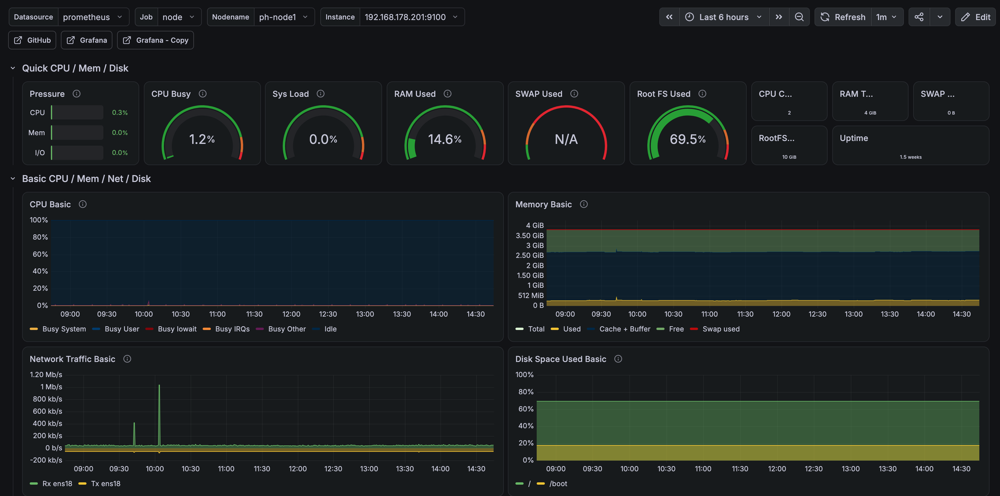

Ablesbar ohne eine einzige Zeile Shell: 2 vCPU kaum ausgelastet, 4 GiB RAM zu knapp 15 % belegt, kein Swap eingerichtet (deshalb `N/A`), und die Root-Partition mit 10 GiB zu **69,5 %** voll.

#### Befund: Die Root-Partition läuft voll

Am 02.10. meldete der Login-Banner von `ph-node2` noch `Usage of /: 53.9% of 9.75GB`, zehn Tage später zeigt das Dashboard für `ph-node1` 69,5 %. Zwei Ursachen liegen nahe: das WAL-Archiv unter `/var/lib/postgresql/wal_archive` wächst mit jeder Änderung, und nach dem Patchen liegen alte Kernel auf der Platte. Ursache genau messen:

```bash
sudo du -sh /var/lib/postgresql/wal_archive /var/lib/postgresql/16/main /boot
dpkg -l 'linux-image-6*' | grep ^ii
```

Gegenmittel in drei Stufen: alte Kernel mit `sudo apt autoremove` entfernen, das logische Volume per `lvextend` auf die volle 20-GB-Platte vergrößern und langfristig eine Aufbewahrungsregel für das WAL-Archiv festlegen. Ohne Regel wächst ein Archiv, bis die Platte voll ist, und dann bleibt PostgreSQL stehen.

> **Merke:** Platte voll ist einer der häufigsten Gründe, warum eine PostgreSQL-Instanz stehen bleibt. Ein Alarm bei 85 % Füllstand gehört zu den ersten, die man einrichtet.

#### Inventur auf `ph-node2`

Erst messen, dann handeln. Wer die Platte vergrößert, ohne die Ursache zu kennen, steht in ein paar Wochen wieder am selben Punkt.

```bash
df -h /
sudo du -xh --max-depth=1 / 2>/dev/null | sort -h | tail -8
sudo grep data_dir /etc/patroni.yml
sudo du -sh /var/lib/postgresql/16/patroni /var/lib/postgresql/wal_archive /var/log /var/cache/apt /usr/src
journalctl --disk-usage
sudo vgs
```

| Bereich | Größe | Anteil an 6,3 GB |
|---|---|---|
| Betriebssystem `/usr` (davon 311 MB Kernel-Header in `/usr/src`) | 3,1 GB | ~49 % |
| Datenbank `/var/lib/postgresql/16/patroni` | 1,2 GB | ~19 % |
| WAL-Archiv | 0,88 GB | ~14 % |
| `/var/log` (davon Journal 390 MB) | 0,51 GB | ~8 % |
| apt-Paket-Cache | 0,2 GB | ~3 % |
| Rest in `/var` | ~0,4 GB | ~6 % |

Drei Erkenntnisse:

- Das eigentliche Datenverzeichnis steht in `data_dir` der `patroni.yml`: `/var/lib/postgresql/16/patroni`. Der Ordner `16/main` mit 39 MB ist ein unbenutztes Überbleibsel der Paketinstallation.
- `/boot` taucht bei `du -x` nicht auf, es ist eine eigene Partition und belastet `/` nicht.
- Fast die Hälfte belegt das Betriebssystem. 10 GB sind für einen Datenbankserver schlicht knapp. Wachsen werden Datenbank und WAL-Archiv.

`sudo vgs` zeigte in der Spalte `VFree` 8,22 GB, die der Ubuntu-Installer ungenutzt gelassen hatte.

#### Erweitern im laufenden Betrieb

```bash
sudo lvextend -r -l +100%FREE /dev/ubuntu-vg/ubuntu-lv
df -h /
```

| Teil | Bedeutung |
|---|---|
| `-l +100%FREE` | den gesamten freien Platz der Volume Group hinzufügen |
| `-r` | das Dateisystem (ext4) gleich mitvergrößern, sonst wäre nur das Volume größer |
| `/dev/ubuntu-vg/ubuntu-lv` | das logische Volume, auf dem `/` liegt |

```
Filesystem                         Size  Used Avail Use% Mounted on
/dev/mapper/ubuntu--vg-ubuntu--lv   18G  6,3G   11G  38% /
```

Kein Neustart, kein Switchover, PostgreSQL hat davon nichts bemerkt. Ein zweiter Aufruf meldet nur `Nothing to do`, der Befehl ist gefahrlos wiederholbar.

Erwartet waren rund 35 % (6,3 von 18 GB), angezeigt werden 38 %. Der Unterschied: ext4 reserviert 5 % der Fläche für root, damit das System auch bei voller Platte arbeitsfähig bleibt. `df` berechnet Use% als Used / (Used + Avail), und die Reserve fehlt im Nenner.

> **Merke:** `lvextend -r` vergrößert Volume und Dateisystem in einem Schritt und im laufenden Betrieb. Platz schafft das nur einmal. Was dauerhaft wächst, braucht eine Regel, beim WAL-Archiv eine Aufbewahrungsfrist.

**Verifiziert 12.10.2026 (ph-node2).**

### 17.4 Patroni-Metriken

Patroni liefert Prometheus-Metriken direkt über seine REST-API:

```bash
for ip in 201 202 203; do
  echo -n "192.168.178.$ip: "
  curl -s http://192.168.178.$ip:8008/metrics | grep -E '^patroni_primary[{ ]'
done
# 192.168.178.201: patroni_primary{scope="postgres-ha",name="ph-node1"} 0
# 192.168.178.202: patroni_primary{scope="postgres-ha",name="ph-node2"} 0
# 192.168.178.203: patroni_primary{scope="postgres-ha",name="ph-node3"} 1
```

Das Suchmuster `[{ ]` ist nötig, weil Prometheus-Metriken **Labels** in geschweiften Klammern tragen. Ein Muster mit festem Leerzeichen nach dem Namen findet nichts. Die Labels `scope` und `name` sind später im Dashboard wertvoll: Eine Abfrage `patroni_primary == 1` liefert automatisch den Namen des aktuellen Leaders — auch nach einem Failover.

### 17.5 postgres_exporter mit eigener Monitoring-Rolle

Der postgres_exporter muss sich bei PostgreSQL anmelden. Dafür bekommt er eine eigene Rolle mit der eingebauten Gruppen-Rolle **`pg_monitor`** — sie darf alle Statistik-Sichten lesen, aber keine Tabellendaten und nichts schreiben. Das Rollen-Muster aus Teil 0 in der Praxis.

#### Installation (alle drei Knoten)

```bash
sudo apt install -y prometheus-postgres-exporter
sudo systemctl enable --now prometheus-postgres-exporter
```

Direkt danach: Exporter erreichbar, aber überall `pg_up 0`. Genau der Unterschied, der fürs Dashboard wichtig ist:

| Metrik | Bedeutung |
|---|---|
| `up` | Prometheus erreicht den Exporter |
| `pg_up` | der Exporter erreicht die Datenbank |

Wird PostgreSQL gestoppt, bleibt `up = 1`, aber `pg_up = 0`. Ein Dashboard, das nur `up` anzeigt, würde einen Datenbankausfall übersehen.

#### Rolle anlegen — einmal, auf dem Leader

```bash
psql -h pg-vip.home.arpa -p 5000 -U postgres
```

```sql
CREATE ROLE postgres_exporter WITH LOGIN;
\password postgres_exporter
GRANT pg_monitor TO postgres_exporter;
```

Nur auf dem Leader — Replicas sind read-only. Rollen gehören zum ganzen PostgreSQL-Cluster, ihre Änderung läuft durchs WAL, und die Streaming-Replikation verteilt sie auf alle Knoten. Über die VIP landet man automatisch beim Leader. Gegenprobe direkt auf einer Replica:

```bash
sudo -u postgres psql -c "\drg postgres_exporter"
#  Role name         | Member of  |   Options    | Grantor
# -------------------+------------+--------------+----------
#  postgres_exporter | pg_monitor | INHERIT, SET | postgres
```

*(Seit PostgreSQL 16 zeigt `\du` keine Spalte „Member of" mehr; Mitgliedschaften stehen bei `\drg`. Neu in 16 sind auch die Optionen pro Mitgliedschaft: `INHERIT` = Rechte gelten automatisch, `SET` = `SET ROLE pg_monitor` erlaubt.)*

> **Merkregel:** Was in der **Datenbank** steht (Rollen, Passwörter, Tabellen), macht man einmal auf dem Leader. Was in einer **Datei auf dem Knoten** steht, macht man auf jedem Knoten selbst.

#### Anmeldung von Hand testen, bevor der Exporter sie nutzt

```bash
psql "host=192.168.178.201 port=5432 user=postgres_exporter dbname=postgres" \
  -c "SELECT current_user, pg_is_in_recovery();"
#  postgres_exporter | t
```

#### Exporter konfigurieren (jeder Knoten mit seiner eigenen IP)

In `/etc/default/prometheus-postgres-exporter`:

```
DATA_SOURCE_NAME='host=192.168.178.201 port=5432 user=postgres_exporter password=<PASSWORT> dbname=postgres sslmode=disable'
```

Jeder Exporter muss **seine lokale** Instanz überwachen. Über die VIP würden alle drei nur den Leader messen.

```bash
sudo chmod 600 /etc/default/prometheus-postgres-exporter
sudo systemctl restart prometheus-postgres-exporter
```

`600` ohne Gruppe reicht, weil systemd die Datei als root einliest, bevor es den Dienst unter dem User `prometheus` startet.

#### Fehlersuche: `pg_up 0` trotz Konfiguration

Das Journal des Exporters zeigte die tatsächlich verwendeten Verbindungsdaten:

```
Error opening connection to database (192.168.178port=5432 user=postgres_eporter … sslmode=disable'):
dial tcp 127.0.0.1:5432: connect: connection refused
```

Drei Fehler in einer Zeile: fehlendes `host=` mit abgeschnittener IP, Tippfehler im Rollennamen, ein Anführungszeichen nur am Ende. Mit der unlesbaren Zeichenkette fiel der Exporter auf seinen Standard `localhost:5432` zurück — dort lauscht PostgreSQL in diesem Cluster aber nicht (Patroni bindet nur an die Knoten-IP, siehe Teil 13.3).

Weitere typische Ursachen:

- `DATA_SOURCE_NAME` steht zweimal in der Datei → die **letzte** Zeile gewinnt
- Zeile auskommentiert
- Sonderzeichen im Passwort (`$`, `\`, `!`, `'`)
- Restart vergessen

Bewährter Weg: Zeile auf node1 sorgfältig schreiben und mit `curl -s http://localhost:9187/metrics | grep '^pg_up'` prüfen, dann als Vorlage für node2/node3 verwenden und nur die IP ändern.

#### Passwort-Rotation

Das Exporter-Passwort war in der Fehlermeldung im Klartext sichtbar (Screenshot, System-Journal). Statt alle Spuren zu löschen, wurde es rotiert — danach ist das alte wertlos.

```sql
\password postgres_exporter
```

`\password` fragt das Passwort verdeckt und doppelt ab und schickt es nur verschlüsselt zum Server — es landet weder in der `psql`-History noch im Klartext im Server-Log (anders als `ALTER ROLE … PASSWORD '…'`). Danach die Datei auf allen drei Knoten anpassen und die Exporter neu starten.

Interessante Zwischenbeobachtung: Nach der Rotation meldeten nur die Knoten `pg_up 0`, deren Exporter bereits mit falscher Datei neu gestartet worden war. Ein Exporter ohne Restart hätte weiter `1` gemeldet — PostgreSQL prüft Passwörter nur beim Verbindungsaufbau, bestehende Verbindungen laufen weiter. Genau diese Falle macht Passwort-Rotation tückisch: Der Fehler zeigt sich erst beim nächsten Neustart.

*(Tipp: Passwörter nur aus Buchstaben und Ziffern, dafür lang — Sonderzeichen machen in Shell und Konfigurationsdateien Ärger.)*

```
192.168.178.201: pg_up 1
192.168.178.202: pg_up 1
192.168.178.203: pg_up 1
```

### 17.6 Prometheus

```bash
sudo apt install -y prometheus
```

*(Die Meldungen von `needrestart` nach der Installation — `Service restarts being deferred` für `dbus`, `systemd-logind`, `unattended-upgrades` — sind harmlos: Diese Dienste startet Ubuntu bewusst nicht im laufenden Betrieb neu, sie werden beim nächsten Reboot aktualisiert.)*

Konfiguration `/etc/prometheus/prometheus.yml` (Original vorher als `.orig` gesichert):

```yaml
global:
  scrape_interval: 15s
  evaluation_interval: 15s

scrape_configs:
  - job_name: 'prometheus'
    static_configs:
      - targets: ['localhost:9090']

  - job_name: 'node'
    static_configs:
      - targets:
          - 'localhost:9100'
          - '192.168.178.201:9100'
          - '192.168.178.202:9100'
          - '192.168.178.203:9100'

  - job_name: 'postgres'
    static_configs:
      - targets:
          - '192.168.178.201:9187'
          - '192.168.178.202:9187'
          - '192.168.178.203:9187'

  - job_name: 'patroni'
    static_configs:
      - targets:
          - '192.168.178.201:8008'
          - '192.168.178.202:8008'
          - '192.168.178.203:8008'
```

Vor dem Neuladen die Syntax prüfen, dann laden:

```bash
promtool check config /etc/prometheus/prometheus.yml   # SUCCESS
sudo systemctl reload prometheus
```

`promtool` prüft nur die Syntax. Ob die Ziele auch erreichbar sind, zeigt erst die Abfrage der laufenden Instanz:

| Job | Ziele |
|---|---|
| node | 4/4 up |
| patroni | 3/3 up |
| postgres | 3/3 up |
| prometheus | 1/1 up |

**11 von 11 Zielen `UP`.** Am übersichtlichsten zeigt das Grafana unter *Explore* mit der Abfrage `up` als Tabelle. Der Wert 1 heißt: Prometheus hat das Ziel beim letzten Scrape erreicht.

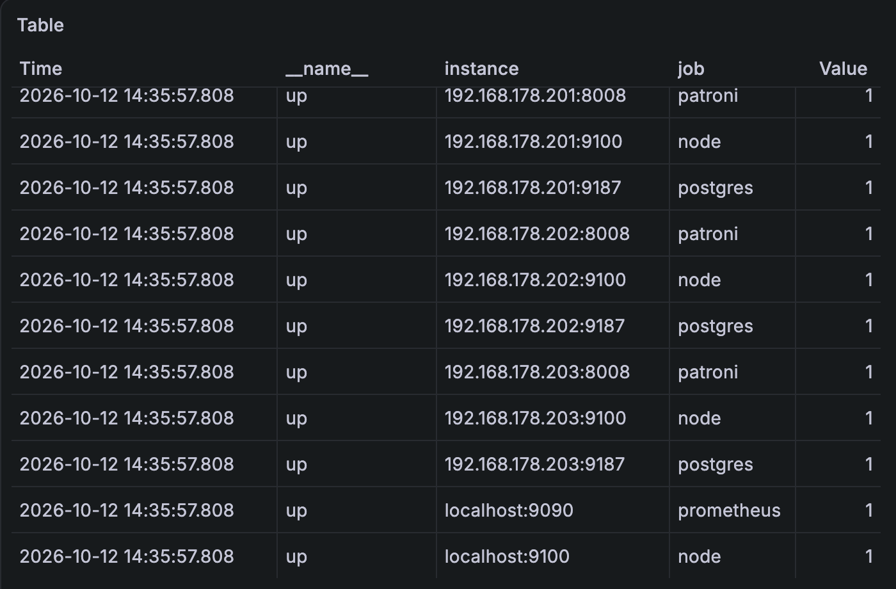

#### Stolperstein: Prometheus ohne Weboberfläche

Der naheliegende Weg über die Prometheus-eigene Seite `http://192.168.178.204:9090/targets` endete mit `404 page not found`, und zwar auf jeder UI-Seite. Prometheus selbst lief einwandfrei. Die Erklärung steckt in der Versionsnummer:

```bash
prometheus --version
# prometheus, version 2.45.3+ds (branch: debian/sid, revision: 2.45.3+ds-2ubuntu0.3)
```

`+ds` steht bei Debian für „dfsg-stripped“: Das Paket wurde neu gebaut, damit es den Debian-Richtlinien (DFSG) entspricht, und dabei ist entfernt worden, was sich nicht aus Quellcode bauen ließ. Bei Prometheus betrifft das die Weboberfläche, eine JavaScript-Anwendung mit Hunderten Abhängigkeiten. Server, Datenbank und API sind vollständig da.

Die API liefert dieselbe Information ohne Oberfläche:

```bash
curl -s http://localhost:9090/api/v1/targets | grep -o '"health":"[a-z]*"' | sort | uniq -c
#      11 "health":"up"
```

| Weg | Funktioniert mit dem Ubuntu-Paket |
|---|---|
| Prometheus-Weboberfläche (`/targets`, `/graph`) | nein, `404` |
| HTTP-API (`/api/v1/...`) | ja |
| Grafana mit Prometheus als Datenquelle | ja |

> **Merke:** Distributionspakete sind nicht immer identisch mit dem, was der Hersteller ausliefert. Ein Kürzel wie `+ds` oder `+dfsg` in der Version ist der Hinweis darauf. Fehlt die Oberfläche, fragt man die API. Wer die Oberfläche braucht, installiert das offizielle Release von prometheus.io, so wie Grafana hier ohnehin aus dem Hersteller-Repository kommt.

**Verifiziert 12.10.2026.**

Die Scrape-Dauer spiegelt die Menge der Metriken: node_exporter ~35 ms, postgres_exporter ~15 ms, Patroni ~1,7 ms.

Erste PromQL-Abfrage:

```
patroni_primary == 1
```

`== 1` wirkt als **Filter**: Es bleiben nur Zeitreihen übrig, deren Wert die Bedingung erfüllt — hier genau eine, ph-node3. Die Labels setzen sich zusammen aus `name`/`scope` (von Patroni) und `instance`/`job` (von Prometheus beim Abholen).

*(Parallele: Auch Prometheus' Zeitreihen-Datenbank hat ein Write-Ahead Log — im Startlog `Replaying WAL … WAL replay completed`. Dasselbe Prinzip wie bei PostgreSQL.)*

### 17.7 Grafana

Grafana kommt aus dem offiziellen Hersteller-Repository:

```bash
sudo mkdir -p /etc/apt/keyrings
wget -q -O - https://apt.grafana.com/gpg.key | gpg --dearmor | sudo tee /etc/apt/keyrings/grafana.gpg > /dev/null
echo "deb [signed-by=/etc/apt/keyrings/grafana.gpg] https://apt.grafana.com stable main" | sudo tee /etc/apt/sources.list.d/grafana.list
sudo apt update
sudo apt install -y grafana
```

Die Installation endet mit:

```
### NOT starting on installation, please execute the following statements to configure grafana to start automatically using systemd
```

Anders als die Ubuntu-Pakete wird Grafana aus dem Hersteller-Repository **bewusst weder aktiviert noch gestartet** — ein Admin soll erst konfigurieren können, bevor ein Webserver im Netz erreichbar ist.

```bash
sudo systemctl daemon-reload
sudo systemctl enable --now grafana-server
systemctl is-enabled grafana-server   # enabled
```

`enable` legt technisch nur einen Symlink an (`multi-user.target.wants/grafana-server.service`) — genau der Verweis, der bei Patroni in Teil 16 gefehlt hatte.

| | Prometheus | Grafana |
|---|---|---|
| Aufgabe | sammelt und speichert Messwerte | zeigt sie als Dashboard an |
| Port | 9090 | 3000 |
| eigene Daten | Zeitreihen-Datenbank (TSDB) | SQLite für Benutzer, Dashboards, Datenquellen |
| RAM im Lab | ~24 MB | ~256 MB |

Erstanmeldung unter `http://192.168.178.204:3000` mit `admin`/`admin`, danach erzwingt Grafana ein neues Passwort.

#### Prometheus als Datenquelle

Grafana speichert selbst keine Messwerte. Es fragt bei jeder Ansicht eine Datenquelle ab, hier Prometheus. Eingerichtet unter *Connections → Data sources → Add data source → Prometheus*, als URL:

```
http://localhost:9090
```

Das wirkt zunächst falsch, weil Grafana im Browser auf dem Mac läuft. Die Abfrage stellt aber der Grafana-Server, und der sitzt zusammen mit Prometheus auf `ph-monitor`. Aus seiner Sicht ist Prometheus tatsächlich `localhost`.

> **Merke:** Adressen immer aus der Perspektive dessen lesen, der die Verbindung aufbaut. Der Browser zeigt nur das Ergebnis an.

#### Fertige Dashboards importieren

Für den Anfang muss man kein Dashboard selbst bauen. Die Community pflegt auf grafana.com Hunderte Vorlagen, die sich über ihre ID importieren lassen (*Dashboards → New → Import → ID eingeben → Datenquelle Prometheus wählen*):

| ID | Dashboard | Zeigt |
|---|---|---|
| 1860 | Node Exporter Full | CPU, RAM, Platte, Netz je Knoten (Daten vom node_exporter) |
| 9628 | PostgreSQL Database | Verbindungen, Transaktionen, Cache, Einstellungen (Daten vom postgres_exporter) |

Beide laufen. Ein eigenes HA-Dashboard mit Leader-Status, Replikations-Lag, Cache-Hit-Ratio und Verbindungen folgt, denn die Fertigvorlagen kennen Patroni nicht.

#### Erster Befund: Der Cluster ist ungetunt

Das PostgreSQL-Dashboard zeigt gleich auf der ersten Seite die wichtigsten Einstellungen. Dort stand:


```
shared_buffers = 128 MiB
```

Auf einer VM mit 4 GB RAM ist das die Werkseinstellung. PostgreSQL wird bewusst sparsam ausgeliefert, damit es auch auf einem Raspberry Pi startet. `shared_buffers` ist der gemeinsame Arbeitsspeicher, in dem PostgreSQL häufig gebrauchte Tabellenblöcke vorhält. Bild dazu: Die Festplatte ist das Lager im Keller, `shared_buffers` die Werkbank. Üblicher Startwert sind rund 25 % des RAM, hier also etwa 1 GB.

Geändert wird der Wert wie alle Cluster-Parameter über `patronictl edit-config`. Weil PostgreSQL den Speicher beim Start reserviert, folgt danach ein rollierender `patronictl restart`. Das Tuning steht als eigener Schritt auf der Liste.

> **Merke:** Ein Monitoring-Dashboard zeigt nicht nur, ob etwas läuft, sondern auch, wie es eingestellt ist. Werkseinstellungen fallen dort oft zuerst auf.

**Verifiziert 01.10.2026:** Datenquelle verbunden, Dashboards 1860 und 9628 zeigen Daten aller drei Knoten.

### 17.8 Praxis: Kernel-Update auf einer Replica

Beim Login auf `ph-node2` erschien:

```
*** Neustart des Systems erforderlich ***
```

Naheliegende Vermutung: Patroni will einen Neustart, etwa wegen eines geänderten Parameters. `patronictl list` zeigte aber keine Spalte *Pending restart*. Patroni blendet sie nur ein, wenn mindestens ein Knoten so ein Flag trägt. Die Meldung kam also von Ubuntu:

```bash
cat /var/run/reboot-required.pkgs
# linux-image-6.8.0-142-generic
# linux-base
```

Ein neuer Kernel war installiert, wird aber erst nach einem Neustart der VM aktiv.

#### Zwei Arten von „Neustart nötig“

| | Patroni „Pending restart“ | Ubuntu „System restart required“ |
|---|---|---|
| Was muss neu starten | nur PostgreSQL | die ganze VM |
| Auslöser | Parameter wie `shared_buffers` oder `archive_mode` geändert | Kernel- oder Bibliotheks-Update |
| Werkzeug | `patronictl restart` | `sudo reboot` |
| Sichtbar in | `patronictl list` | Login-Banner, `/var/run/reboot-required` |

#### Darf man eine Patroni-VM einfach rebooten?

Die Regel aus Teil 13 lautet: PostgreSQL nie an Patroni vorbei anfassen. `sudo reboot` tut das nicht. Beim Herunterfahren stoppt systemd den Dienst `patroni.service`, Patroni fährt seine PostgreSQL-Instanz selbst sauber herunter und gibt seinen Platz in etcd frei. Nach dem Boot startet der Autostart (seit Teil 16 aktiv) Patroni wieder, und der Knoten reiht sich als Replica ein.

| Aktion | Wer stoppt PostgreSQL? | In Ordnung? |
|---|---|---|
| `systemctl restart postgresql` | systemd, an Patroni vorbei | ❌ |
| `patronictl restart` | Patroni | ✅ nur PostgreSQL |
| `sudo reboot` | Patroni, über seinen eigenen Stopp | ✅ ganze VM |

Ob vorher ein Switchover nötig ist, entscheidet allein die Rolle des Knotens:

- **Replica:** `sudo reboot` genügt. Der Leader schreibt weiter, die Anwendung merkt nichts.
- **Leader:** erst `patronictl switchover`, dann rebooten. Sonst läuft der Leader-Lock nach seiner TTL ab, und es folgt ein ungeplanter Failover mit etwa 30 Sekunden ohne Schreibzugriff.

#### Durchgeführt

`ph-node2` war Replica, Leader war `ph-node3`. Also ohne Umweg:

```bash
sudo reboot
```

Nach gut einer Minute war der Knoten zurück, der Login-Banner zeigte den neuen Kernel `6.8.0-142-generic`, und `patronictl list` lieferte:

```
| ph-node1 | 192.168.178.201 | Replica | streaming |  7 | 0/410088E0 | 0 | 0/410088E0 | 0 |
| ph-node2 | 192.168.178.202 | Replica | streaming |  7 | 0/410088E0 | 0 | 0/410088E0 | 0 |
| ph-node3 | 192.168.178.203 | Leader  | running   |  7 |            |   |            |   |
```

Timeline 7 vor und nach dem Reboot: Es gab keinen Failover. `ph-node2` streamt wieder, ohne dass jemand eingegriffen hat. Lag 0 ist hier allerdings kein Kunststück, denn in der Zwischenzeit hat niemand geschrieben (gleiche LSN überall). Aussagekräftiger wird der Test unter Last mit pgbench.

#### Stolperstein: `patronictl` ohne `sudo`

```
Error: Provided config file /etc/patroni.yml not existing or no read rights.
```

Das ist die Härtung aus Teil 16 bei der Arbeit. `/etc/patroni.yml` gehört `root:postgres` mit Rechten `640`, und der Login-User `florian` steht in keiner der beiden Gruppen. Lösung: `sudo patronictl …`. Den User in die Gruppe `postgres` aufzunehmen würde die Härtung wieder aufweichen.

#### Was der Login-Banner sonst noch verrät

- `New release '26.04.1 LTS' available`: kein `do-release-upgrade` auf einem Cluster-Knoten. Ein Release-Upgrade kann die PostgreSQL-Hauptversion aus den Ubuntu-Paketen mitziehen, und Streaming-Replikation funktioniert nur innerhalb derselben Hauptversion.
- `28 Aktualisierungen können sofort angewendet werden`: der Normalfall im Betrieb, gelöst durch rollierendes Patchen (Replicas zuerst, dann Switchover, alter Leader zuletzt).
- `Usage of /: 53.9% of 9.75GB` bei einer 20-GB-Platte: Der Ubuntu-Installer nutzt bei LVM nur etwa die Hälfte, `lvextend` steht auf der Liste.

> **Merksatz:** Vor jedem Reboot eines Patroni-Knotens zuerst `patronictl list` und die Rolle prüfen. Replica: einfach rebooten. Leader: erst Switchover.

**Verifiziert 02.10.2026.**

### 17.9 Der Werkzeugkasten `patronictl`

Der Reboot hat gezeigt, wie viel davon abhängt, das richtige Unterkommando zu kennen. Eine Übersicht, nach Zweck sortiert:

**Schauen**

| Befehl | Wofür |
|---|---|
| `list` | Leader, Replicas, Lag, Timeline, Pending restart |
| `topology` | wie `list`, zeigt zusätzlich, wer von wem repliziert |
| `history` | alle bisherigen Failover und Switchover mit Timeline und Zeitpunkt |
| `show-config` | aktuelle Cluster-Konfiguration aus etcd |

**Konfigurieren**

| Befehl | Wofür |
|---|---|
| `edit-config` | Cluster-weite Parameter in etcd ändern |
| `reload` | Konfiguration neu einlesen, für Parameter ohne Neustart |
| `restart` | PostgreSQL kontrolliert neu starten, für Pending-restart-Parameter |

**Rollen wechseln**

| Befehl | Wofür |
|---|---|
| `switchover` | geplanter Leader-Wechsel, der alte Leader wird sauber Replica |
| `failover` | erzwungener Leader-Wechsel für den Notfall, wenn der Leader nicht mehr sauber abgeben kann |

**Wartung und Reparatur**

| Befehl | Wofür |
|---|---|
| `pause` / `resume` | Wartungsmodus: automatischer Failover aus bzw. wieder an |
| `reinit` | abgehängte Replica komplett neu vom Leader ziehen (frisches Basebackup) |
| `remove` | Cluster-Eintrag aus etcd löschen, nur beim endgültigen Abbau |

Zwei Fallen gehören dazu. `pause` klingt nach dem passenden Befehl für Wartung, schaltet aber den automatischen Failover ab. Für den Reboot eines Leaders wäre das genau verkehrt, denn dann übernimmt niemand. Und ein `patronictl start` gibt es nicht: Patroni selbst startet über systemd, ab dann steuert man es mit `patronictl`.

`reinit` schließt übrigens die Lücke aus Teil 4. Dort blieb offen, wie man einen alten Primary sauber als Replica wieder eingliedert. Patroni erledigt das meist selbst, und wenn nicht, mit einem Befehl.

Vollständige Liste: `patronictl --help`, Details zu einem Kommando: `patronictl switchover --help`.

> **Merksatz:** Switchover heißt „wir wechseln planmäßig“, Failover heißt „der Leader ist weg, wir müssen“.

### 17.10 Praxis: Rollierendes Patchen des ganzen Clusters

Der Login-Banner meldete auf allen Knoten rund 28 ausstehende Updates. Ziel: alle drei Knoten auf denselben Stand bringen, ohne dass die Datenbank länger als ein paar Sekunden für Schreibzugriffe ausfällt. Das Verfahren heißt **rollierendes Patchen**: immer nur ein Knoten auf einmal, und nie der aktuelle Leader.

> **Hinweis zu den Uhrzeiten:** Während des Patchens liefen die VMs noch auf UTC, alle Zeiten in diesem Abschnitt sind daher UTC. 07:18 UTC entspricht im Oktober 09:18 deutscher Sommerzeit. Direkt im Anschluss wurde auf Europe/Berlin umgestellt, siehe 17.11.

#### Grundregel

| Rolle des Knotens | Vorgehen |
|---|---|
| Replica | `apt upgrade`, bei Bedarf `reboot` |
| Leader | erst `patronictl switchover` auf eine bereits gepatchte Replica, dann wie eine Replica behandeln |

Vor jedem Schritt: `patronictl list` und der Blick auf den Hostnamen im Prompt.

#### Stolperstein 1: `needrestart` startet Patroni neu

Nach dem ersten `apt upgrade` auf `ph-node1` (Replica) stand am Ende:

```
Restarting services...
 systemctl restart cron.service packagekit.service patroni.service ssh.service ...
```

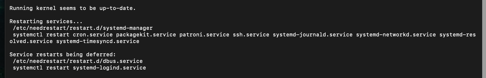

Ubuntus Werkzeug `needrestart` prüft nach jedem Upgrade, welche Dienste noch alte Bibliotheken im Speicher haben, und startet sie automatisch neu, Patroni eingeschlossen. Auf einer Replica ist das harmlos, sie war Sekunden später wieder `streaming`. Auf dem Leader wäre es ein ungeplanter Failover, ausgelöst allein durch `apt upgrade`, ganz ohne Reboot.

Dazu kommt eine zweite Kette: Die Patroni-Unit enthält `Requires=etcd.service`. Startet ein Update `etcd` neu, stoppt systemd Patroni gleich mit.

> **Merksatz:** Auf dem Leader wird nicht gepatcht, auch kein `apt upgrade`. Erst Switchover, dann Updates.

#### Der Switchover

```bash
sudo patronictl -c /etc/patroni.yml switchover
```

```
Primary [ph-node3]: ph-node3
Candidate ['ph-node1', 'ph-node2'] []: ph-node2
When should the switchover take place (e.g. 2026-10-02T08:18 )  [now]: now
Are you sure you want to switchover cluster postgres-ha, demoting current leader ph-node3? [y/N]: y
2026-10-02 07:18:49.70276 Successfully switched over to "ph-node2"
```

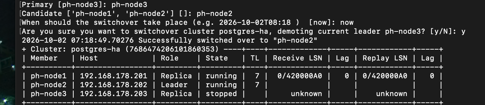

Direkt danach zeigt `patronictl list` einen Zwischenzustand:

```
| ph-node1 | 192.168.178.201 | Replica | running |  7 | 0/420000A0 | 0 | 0/420000A0 | 0 |
| ph-node2 | 192.168.178.202 | Leader  | running |  7 |            |   |            |   |
| ph-node3 | 192.168.178.203 | Replica | stopped |    |    unknown |   |    unknown |   |
```

Der alte Leader wird heruntergefahren und als Replica neu gestartet, `ph-node1` verbindet sich zur neuen Quelle. Zehn Sekunden später:

```
| ph-node1 | 192.168.178.201 | Replica | streaming |  8 | 0/42000AE8 | 0 | 0/42000AE8 | 0 |
| ph-node2 | 192.168.178.202 | Leader  | running   |  8 |            |   |            |   |
| ph-node3 | 192.168.178.203 | Replica | streaming |  8 | 0/42000AE8 | 0 | 0/42000AE8 | 0 |
```

**Timeline 7 → 8.** Jede Beförderung erzeugt eine neue Timeline, egal ob geplant oder nach einem Absturz. Ab diesem Punkt schreibt ein anderer Knoten weiter, und die Replicas müssen eindeutig erkennen, welchem Strang sie folgen.

`patronictl history` ergänzt eine Zeile:

```
| 7 | 1107296416 | no recovery target specified | 2026-10-02T07:18:49.221187+00:00 | ph-node2 |
```


Zwei Details zum Lesen:

- Die LSN steht hier dezimal. `1107296416` ist hexadezimal `0x420000A0`, also `0/420000A0`, genau der Wert aus dem Zwischenzustand oben. An dieser Stelle im WAL zweigt Timeline 8 ab.
- „Reason“ mit `no recovery target specified` ist kein Grund für den Wechsel, sondern die Standardnotiz, die PostgreSQL bei jeder Beförderung schreibt. Ob geplant oder nicht, steht dort nicht.

Später am Vormittag folgte ein zweiter Switchover auf `ph-node1`, damit auch `ph-node2` gepatcht werden konnte: **Timeline 8 → 9.**

#### Stolperstein 2: Kernel-Drift zwischen den Knoten

Nach dem Reboot von `ph-node3` (Start um 07:26:04 UTC, neun Sekunden später schon wieder `streaming`):

```
uname -r   →   6.8.0-146-generic
```

`ph-node2` lief nach seinem ersten Reboot aber mit `6.8.0-142`, und auch `ph-node1` hatte nur `139` und `142` installiert. Drei Knoten, zwei Kernel-Versionen, obwohl alle am selben Vormittag gepatcht wurden.

Die Diagnose lief in drei Schritten. Statt zu raten, `apt` simulieren lassen:

```bash
sudo apt -s upgrade
```

```
The following upgrades have been deferred due to phasing:
  sosreport thermald
Die folgenden Pakete werden aktualisiert (Upgrade):
  linux-generic linux-headers-generic linux-image-generic
```

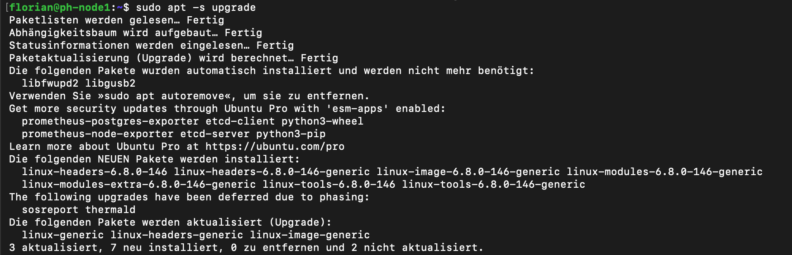

Damit war klar:

- **Phased Updates** gibt es wirklich. Ubuntu verteilt manche Updates stufenweise, ob ein Rechner schon dran ist, entscheidet ein aus seiner `machine-id` berechneter Zufallswert. Hier betraf das `sosreport` und `thermald`.
- Der Kernel `146` war davon nicht betroffen. `ph-node1` kannte ihn beim ersten Upgrade schlicht noch nicht, seine Paketliste war älter als die von `ph-node3`.

> **Merke:** Wer Knoten nacheinander patcht, bekommt nicht automatisch denselben Stand. Im Betrieb friert man deshalb einen geprüften Paketstand auf einem eigenen Spiegel ein (Landscape, aptly, bei SUSE der SUSE Manager), und alle Server ziehen genau diesen.

`apt -s` (Simulation) ist das Werkzeug der Wahl, um zu sehen, was `apt` tun würde und warum, ohne etwas zu verändern.

#### Nebenbefund: Wer liefert Sicherheitsupdates?

```
Get more security updates through Ubuntu Pro with 'esm-apps' enabled:
  prometheus-postgres-exporter etcd-client python3-wheel
  prometheus-node-exporter etcd-server python3-pip
```

| Bereich | Wer pflegt | Sicherheitsupdates |
|---|---|---|
| `main` (Kernel, PostgreSQL, OpenSSH) | Canonical | für alle, kostenlos |
| `universe` (etcd, Exporter, python3-pip) | Community | nur mit Ubuntu Pro (`esm-apps`) |

Ausgerechnet etcd, das Herz des Konsens, bekommt ohne Ubuntu Pro keine Sicherheitsfixes. Ubuntu Pro ist privat auf bis zu fünf Rechnern kostenlos und wird pro Rechner angehängt:

```bash
sudo pro attach <TOKEN>
pro status
```

Pro bringt außerdem **Livepatch**, das kritische Kernel-Fixes im laufenden Betrieb einspielt. Neue Kernel-Versionen brauchen trotzdem einen Reboot, Livepatch verschafft nur Zeit bis zum nächsten Wartungsfenster.

#### Ergebnis

Alle drei Knoten laufen auf Kernel `6.8.0-146-generic`, Leader ist `ph-node1`, beide Replicas `streaming` mit Lag 0, Timeline 9. Zwei geplante Switchover, kein ungeplanter Failover, die Datenbank war zu keinem Zeitpunkt länger als wenige Sekunden ohne Leader.

**Verifiziert 02.10.2026.**

### 17.11 Zeitzone vereinheitlichen

Beim Vergleich der Ausgaben fiel auf: `ph-node2` zeigte Ortszeit, `ph-node1` UTC. Die Uhren selbst stimmten, NTP lief überall (`systemd-timesyncd`). Unterschiedlich war nur die Anzeige. Bei Logs von mehreren Knoten führt das schnell zu falschen Schlüssen: „07:26 Fehler“ auf dem einen und „09:26 Fehler“ auf dem anderen Knoten sind dasselbe Ereignis.

```bash
timedatectl
```

```
               Local time: Fr 2026-10-02 10:15:43 CEST
           Universal time: Fr 2026-10-02 08:15:43 UTC
                 RTC time: Fr 2026-10-02 08:15:43
                Time zone: Europe/Berlin (CEST, +0200)
System clock synchronized: yes
              NTP service: active
          RTC in local TZ: no
```

| Zeile | Bedeutung |
|---|---|
| `System clock synchronized: yes` | NTP hat die Uhr abgeglichen |
| `NTP service: active` | der Zeitdienst läuft |
| `RTC in local TZ: no` | die Hardware-Uhr läuft in UTC, so soll es sein |

Entscheidung: alle vier VMs auf `Europe/Berlin`. Für Server ist UTC verbreiteter (keine doppelte Stunde bei der Zeitumstellung), im Lab mit einem Admin passt Ortszeit besser zur Wanduhr. Entscheidend ist, dass es überall gleich ist.

#### Drei Ebenen, drei Wege

| Was | Wie geändert | Erreicht die anderen Knoten |
|---|---|---|
| Zeitzone des Betriebssystems | `sudo timedatectl set-timezone Europe/Berlin` | gar nicht, jede VM einzeln |
| PostgreSQL-Parameter `timezone`, `log_timezone` | `patronictl edit-config` | über etcd, jeder Patroni liest selbst |
| Daten (`INSERT`, `CREATE ROLE`) | SQL auf dem Leader | über den WAL-Strom |

PostgreSQL übernimmt die System-Zeitzone nicht nachträglich. Sie wird beim Anlegen des Clusters einmal eingetragen und stand danach weiter auf `Etc/UTC`. `log_timezone` steuert die Zeitstempel im Server-Log, `timezone` die Ausgabe von `timestamptz` an Clients. Gespeichert wird intern immer UTC.

Beide sind Reload-Parameter. Nach `edit-config` zeigte `patronictl list` deshalb kein „Pending restart“.

#### Stolperstein: Tippfehler im Diff

Der erste Versuch sah im Diff von `edit-config` so aus:

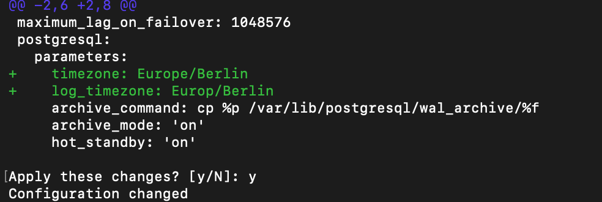

Beim Reload ist ein ungültiger Wert harmlos: PostgreSQL meldet einen Fehler im Log und behält den alten Wert. Beim nächsten **Neustart** dagegen liest es die Konfiguration frisch, stößt auf den ungültigen Wert und startet nicht. Der Fehler wäre also erst beim nächsten Patch-Tag aufgefallen, als Knoten, der nach dem Reboot nicht mehr hochkommt. Sofort korrigiert per zweitem `edit-config`, danach verifiziert:

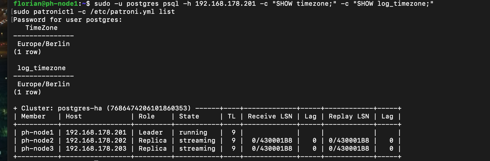

> **Merksatz:** Den Diff von `edit-config` Zeichen für Zeichen lesen, bevor man `y` drückt, und danach mit `SHOW` verifizieren. Ein ungültiger Reload-Parameter fällt nicht beim Reload auf, sondern erst beim nächsten Neustart.

**Verifiziert 02.10.2026.**

### 17.12 Eigenes HA-Dashboard

Die importierten Dashboards (1860, 9628) zeigen Knoten und Datenbanken einzeln. Für einen HA-Cluster braucht man vor allem die Antwort auf die Frage, ob **genau ein** Leader da ist. Das beantwortet ein eigenes Dashboard `PostgreSQL HA-Cluster`.

#### Panel 1: Anzahl Primaries

Patroni liefert auf jedem Knoten `patroni_primary` (1 = Leader, 0 = Replica). Die Summe über alle Knoten ist die eigentliche Gesundheitsaussage:

```promql
sum(patroni_primary)
```

| Wert | Bedeutung | Farbe | Value Mapping |
|---|---|---|---|
| 0 | kein Leader (Lücke während Failover, TTL in etcd läuft ab) | rot | `KEIN LEADER` |
| 1 | gesund | grün | `OK` |
| ≥ 2 | Split-Brain, zwei Primaries schreiben auseinander | rot | `SPLIT-BRAIN` |
| keine Daten | kein Knoten antwortet dem Scrape | rot | `KEINE DATEN` |

Visualisierung **Stat**, Thresholds: Base rot, 1 grün, 2 rot.

> **Merksatz:** Ein ausgefallener Knoten meldet nicht 0, sondern gar nichts — seine Zeitreihe fehlt. Die Summe bleibt trotzdem aussagekräftig, solange mindestens ein Knoten antwortet. Deshalb braucht das Panel zusätzlich ein Mapping für „keine Daten“.

#### Warum ein eigenes Dashboard? Zielgruppe statt Vollständigkeit

| Zielgruppe | Braucht | Dashboard |
|---|---|---|
| Operator / Bereitschaft | „Ist alles gut? Wenn nein, was?“ in zwei Sekunden | wenige große Ampel-Kacheln (OK / KEIN LEADER / SPLIT-BRAIN), keine Query nötig |
| DBA / Admin | „Warum? Wo genau?“ | Detailkurven: Lag, WAL-Durchsatz, Connections, Cache-Hit |
| Community-Dashboards (9628, 1860) | „Alles über alles“ | Dutzende Panels — gut zum Stöbern, schlecht im Ernstfall nachts um drei |

Die Daten sind überall dieselben (die Targets in Prometheus), nur die Sicht wird je Rolle zugeschnitten — eine Quelle, viele Views, wie `CREATE VIEW` in SQL.

> **Merksatz:** Ein Dashboard beantwortet die Frage seiner Zielgruppe, nicht alle Fragen auf einmal.

#### Panel 1 in Grafana bauen — Schritt für Schritt (Grafana 12/13)

Begriffe vorab: Ein **Dashboard** ist die ganze Seite (das Armaturenbrett), ein **Panel** eine einzelne Kachel darauf (ein Instrument). Eigene Panels gehören in ein **eigenes** Dashboard, nicht in importierte (9628, 1860): Beim Re-Import wären Änderungen weg, und fürs Portfolio zählt, was man selbst gebaut hat.

1. **Dashboards → New → New dashboard.** Layout *Auto grid* belassen.
2. Rechts in der schmalen Leiste das blaue **➕** → **Panel**. Achtung: Das Menü *Choose variable type* ist für Dashboard-Variablen (Dropdowns) — mit ✕ schließen.
3. **Title:** `Leader-Status (Anzahl Primaries)` → **Edit visualization**.
4. Datenquelle *prometheus*, Editor auf **Code**, Query `sum(patroni_primary)` → **Run queries**. Vorschau: Linie bei 1.
5. Visualisierung **Stat** wählen (rechts *Suggestions* oder *All visualizations* → `stat`).
6. Früh speichern: **Save**, Titel `PostgreSQL HA-Cluster`. Grafana führt eine Versionshistorie mit Kommentar (*Dashboard settings → Versions*, inkl. Diff) — ähnlich wie Git.
7. **Thresholds** (Lupe 🔍 rechts oben → `thresholds`): Base 🔴, `1` 🟢, `2` 🔴, Modus **Absolute**.
8. **Value mappings** → *Add value mappings* → Typ **Value**: `1` → `OK` (grün), `0` → `KEIN LEADER` (rot). Für Split-Brain Typ **Range** `2`–`99` → `SPLIT-BRAIN`, für fehlende Daten Typ **Special** (*Null/NaN*) → `KEINE DATEN`.

| Mapping-Typ | Wofür |
|---|---|
| Value | genau eine Zahl übersetzen |
| Range | einen Zahlenbereich übersetzen |
| Regex | Text per Muster umschreiben |
| Special | null, NaN, leer, boolesche Werte |

#### Stolpersteine beim Bauen

- **Die Standard-Thresholds sind eine Falle.** Grafana setzt *Base grün, 80 rot*. Für `sum(patroni_primary)` hieße das: 0 (kein Leader) und 2 (Split-Brain) leuchten **grün**. Eine Ampel, die immer grün ist, ist schlimmer als keine.
- **Thresholds liest man von unten nach oben:** Jeder Eintrag gilt ab seinem Wert bis zum nächsthöheren.
- **Absolute vs. Percentage:** Absolute = echte Messwerte; Percentage = Prozent zwischen Min und Max des Panels.
- **Value mapping: Text im falschen Feld.** Die linke Spalte *Value* ist die **Bedingung** (der Messwert, z. B. `1`), die mittlere *Display text* die Anzeige (`OK`). Steht `OK` links, sucht Grafana nach einem Messwert „OK“, den Prometheus nie liefert — die Kachel zeigt weiter `1`. Denkhilfe: `CASE WHEN wert = 1 THEN 'OK'`.
- **Special-Mapping für fehlende Daten:** Nicht als *Value* „keine Daten“ eintippen (gleicher Fehler wie oben), sondern Typ **Special** wählen — links erscheint dann ein Auswahlmenü, dort **Null + NaN**. Bei Value/Range tippt man links eine Zahl, bei Special wählt man einen *Zustand*.
- **Mapping-Farben schlagen Thresholds.** Eine rote Farbe am Mapping `OK` färbt die Kachel rot, egal was die Thresholds sagen. Farben deshalb bewusst setzen (OK grün, KEIN LEADER rot) oder leer lassen.
- **Versehentliche leere Query B** (Zähler bei *Queries* steht auf 2) mit dem Mülleimer der Zeile löschen.

#### Optional: Wer ist Leader?

```promql
patroni_primary == 1
```

Display name `{{name}}` — das Label `name` trägt den Patroni-Knotennamen (`ph-node2`), `instance` nur IP und Port. Nach einem Failover wechselt der angezeigte Name automatisch.

#### PromQL-Spickzettel für Explore

In Grafana unter **Explore** (Datenquelle Prometheus, Ansicht **Table**) lassen sich Abfragen ausprobieren, bevor sie in ein Panel wandern.

| Abfrage | Was sie zeigt | Erwartung im Lab |
|---|---|---|
| `up` | Ist jeder Exporter erreichbar? (1/0 je Target) | 11 Zeilen, alle 1 |
| `up == 0` | Nur die Targets, die gerade ausgefallen sind | leer |
| `pg_up` | Kann der postgres_exporter die Datenbank erreichen? | 3 Zeilen, alle 1 |
| `patroni_primary` | Rolle je Knoten | 0 / 1 / 0 |
| `patroni_primary == 1` | Nur der aktuelle Leader (Filter) | 1 Zeile, z. B. `ph-node2` |
| `sum(patroni_primary)` | Anzahl Leader im Cluster | 1 |
| `count(up{job="patroni"} == 1)` | Wie viele Patroni-Knoten antworten | 3 |
| `sum by (name) (patroni_primary)` | Summe gruppiert nach Label | eine Zeile je Knoten |
| `changes(patroni_primary[24h])` | Wie oft hat sich die Rolle je Knoten in 24 h geändert | > 0 nach einem Wechsel |

Bausteine, die in den Abfragen stecken:

| Baustein | Bedeutung |
|---|---|
| `metrik{label="wert"}` | Auf Label filtern (z. B. `{job="patroni"}`) |
| `== 1`, `> 0` | Vergleich als Filter: nur passende Zeitreihen bleiben übrig |
| `sum(...)`, `count(...)` | Über alle Zeitreihen zusammenfassen |
| `sum by (label) (...)` | Zusammenfassen, aber je Label-Wert getrennt |
| `[24h]` | Zeitfenster (Range Vector) statt aktuellem Wert |
| `changes(...)`, `rate(...)` | Funktionen über ein Zeitfenster: Anzahl Änderungen bzw. Zuwachs pro Sekunde |

> Der Job-Name (`job="patroni"`) hängt von der eigenen `prometheus.yml` ab; mit `up` in Explore sieht man, wie die Jobs heißen.

#### Query für Query

**1. `up` — sind alle Targets da?**

`up` liefert kein Exporter, Prometheus erzeugt die Metrik bei jedem Scrape selbst: `1` = Target hat geantwortet, `0` = nicht erreichbar (Timeout, Dienst gestoppt, VM aus). Deshalb meldet `up` auch dann noch etwas, wenn der Exporter selbst tot ist — genau das macht es zur ersten Anlaufstelle.

Erwartung im Lab: **11 Zeilen**, alle `1`.

| Wo | Targets | Anzahl |
|---|---|---|
| ph-node1..3 | node_exporter (9100), postgres_exporter (9187), Patroni-REST-API (8008) | 3 × 3 = 9 |
| ph-monitor | Prometheus selbst (9090), node_exporter (9100) | 2 |
| **Summe** | | **11** |

Lesen der Tabelle: Die Labels `job` und `instance` sagen, *welcher* Dienst auf *welchem* Rechner gemeint ist. Eine `0` bei `job="postgres"` auf einem Knoten heißt: Exporter weg — nicht zwingend die Datenbank. Ob die Datenbank selbst läuft, verrät erst `pg_up`.

> **Merksatz:** `up` prüft den Draht zum Exporter, nicht den Dienst dahinter. Erst `up` ansehen, dann die Fachmetrik.

**Verifiziert 17.10.2026:** alle Targets `1`.

**2. `up == 0` — nur die Ausfälle**

`== 0` ist in PromQL kein Ja/Nein-Test, sondern ein **Filter**: Von allen Zeitreihen bleiben nur die mit Wert 0 übrig. Im gesunden Zustand ist das Ergebnis deshalb **leer** („No data“).

Genau das macht die Abfrage ideal für Alarme: leer = alles gut, jede Zeile = ein Problem, und die Labels `job` und `instance` der Zeile sagen sofort, *welcher* Dienst auf *welchem* Rechner fehlt. Alertmanager-Regeln (Roadmap Punkt 1) funktionieren nach demselben Prinzip.

> **Merksatz:** Vergleichsoperatoren filtern. Eine gute Alarm-Abfrage ist im Normalbetrieb leer.

**Verifiziert 17.10.2026:** Ergebnis leer, alle Targets erreichbar.

**3. `pg_up` — läuft die Datenbank hinter dem Exporter?**

`pg_up` liefert der postgres_exporter selbst: Er versucht bei jedem Scrape eine Verbindung zu PostgreSQL. Typ **gauge** (Grafana zeigt das im Tooltip beim Eintippen der Metrik).

Zusammen mit `up` lassen sich drei Fälle sauber trennen:

| Situation | `up{job="postgres"}` | `pg_up` | Diagnose |
|---|---|---|---|
| alles läuft | 1 | 1 | gesund |
| nur PostgreSQL gestoppt | 1 | **0** | Datenbank-Problem |
| nur Exporter gestoppt | **0** | *keine Daten* | Monitoring-Problem, DB evtl. gesund |

Im dritten Fall fehlt `pg_up` ganz, weil ohne erfolgreichen Scrape auch keine Exporter-Metrik ankommt — nur `up` meldet sich noch, denn das erzeugt Prometheus selbst.

> **Merksatz:** `up` = Draht zum Exporter, `pg_up` = Draht vom Exporter zur Datenbank. Erst beide zusammen sagen, wo die Kette reißt.

**Metriktypen:** Ein **Gauge** ist ein Momentwert, der steigen und fallen darf (Thermometer: `pg_up`, `patroni_primary`, Anzahl Verbindungen). Ein **Counter** zählt nur hoch und springt nur beim Neustart auf 0 (z. B. `pg_stat_database_xact_commit`). Auf Counter wendet man `rate()` an, um „pro Sekunde“ zu bekommen; auf Gauges nicht.

**Tipp:** Der Schalter **Explain** im Query-Editor zerlegt jede PromQL-Abfrage in ihre Bausteine und erklärt sie in Worten — gut zum Lernen.

**4. `count by (job) (up)` — Targets je Dienst zählen**

`count(...)` zählt Zeitreihen, `by (job)` trennt das Ergebnis je Wert des Labels `job`. Erwartet: eine Zeile je Job, die Zahlen ergeben zusammen 11.

#### Stolperstein: Label-Wert statt Label-Name in `by (...)`

`count by (postgres) (up)` liefert **eine** Zeile mit leeren Labels `{}` und dem Wert 11 — ohne Fehlermeldung. Ein Label namens `postgres` gibt es nicht, also landen alle Zeitreihen in derselben Gruppe.

```promql
up{job="postgres"}      # Filter:     Label-NAME = Label-WERT
count by (job) (up)     # Gruppieren: nur der Label-NAME
```

> **Merksatz:** In `by (...)` steht der Name des Labels, nie sein Wert. Ein Ergebnis mit `{}` heißt: Die Gruppierung hat nichts gefunden.

Ergebnis im Lab (verifiziert 17.10.2026):

| job | Anzahl | Was dahinter steckt |
|---|---|---|
| `node` | 4 | node_exporter auf ph-node1..3 und ph-monitor |
| `patroni` | 3 | Patroni-REST-API (8008) auf ph-node1..3 |
| `postgres` | 3 | postgres_exporter auf ph-node1..3 |
| `prometheus` | 1 | Prometheus überwacht sich selbst |
| **Summe** | **11** | = alle Targets aus `up` |

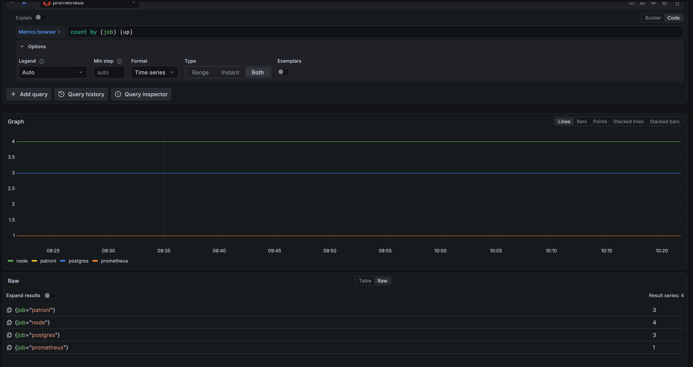

Im Graphen sind nur drei Linien zu sehen, obwohl die Legende vier Jobs nennt: `patroni` und `postgres` haben beide den Wert 3, die Linien liegen deckungsgleich übereinander. Die Raw-Ansicht darunter zeigt alle vier Zeilen („Result series: 4“).

Zum Vergleich: Der Filter `up{job="postgres"}` liefert dagegen drei Zeilen *mit* IP — Filtern behält die einzelnen Zeitreihen, Zählen fasst sie zusammen.

#### Panel 2: Replikations-Lag — Bytes oder Sekunden?

Zwei Messarten:

| Messart | Berechnung | Leader schreibt 1 h lang nichts, Replikation gesund |
|---|---|---|
| **Bytes** | WAL-Position Leader − eingespielte WAL-Position Replica | bleibt **0** — korrekt |
| **Sekunden** | `now() − pg_last_xact_replay_timestamp()` auf der Replica | wächst auf **3600 s** — Fehlalarm |

Der Grund: Die Sekunden-Messung liefert das Alter der zuletzt eingespielten *Transaktion*, nicht den Zeitpunkt der letzten erfolgreichen Replikationsprüfung. Ohne neue Transaktionen bleibt der Zeitstempel stehen, während `now()` weiterläuft.

> **Merksatz:** Lag in Sekunden misst „wie alt ist die letzte Änderung“, nicht „wie weit hinkt die Replica hinterher“. Für Alarme auf einem ruhigen Cluster ist der Byte-Lag die ehrliche Größe.

#### Die `patroni_xlog_*`-Metriken („xlog“ = alter Name für WAL)

| Metrik | Bedeutung | sinnvoll auf |
|---|---|---|
| `patroni_xlog_location` | aktuelle Schreibposition im WAL (Byte-Offset) | Leader |
| `patroni_xlog_received_location` | bis wohin WAL **empfangen** wurde | Replicas |
| `patroni_xlog_replayed_location` | bis wohin WAL **eingespielt** wurde (erst dann sichtbar für Leser) | Replicas |
| `patroni_xlog_replayed_timestamp` | Zeitstempel der zuletzt eingespielten Transaktion (→ Sekunden-Falle) | Replicas |
| `patroni_xlog_paused` | Einspielen pausiert? (1/0) | Replicas |

Patroni liefert alle fünf Metriken auf **allen** Knoten und füllt die für die aktuelle Rolle sinnlosen mit **0**. Im Lab (Leader ph-node2) spiegeln sich die beiden Abfragen exakt:

| Knoten | `patroni_xlog_location` | `patroni_xlog_replayed_location` |
|---|---|---|
| ph-node1 (Replica) | 0 | 2 231 406 13x |
| ph-node2 (Leader) | 2 231 406 13x | 0 |
| ph-node3 (Replica) | 0 | 2 231 406 13x |

Die Position ist ein Kilometerzähler: rund 2,2 GB WAL seit Cluster-Initialisierung. Gleiche Zahlen bei Leader und Replicas heißen Lag 0. Grafana markiert die Metriken als **Counter** und schlägt `rate()` vor — `rate(patroni_xlog_location[5m])` ergibt den WAL-Schreibdurchsatz in Bytes/s (Panel für den Lasttest). Für den Lag braucht man die Rohwerte.

#### Die Lag-Query

```promql
scalar(max(patroni_xlog_location)) - (patroni_xlog_replayed_location > 0)
```

| Baustein | Aufgabe |
|---|---|
| `max(patroni_xlog_location)` | holt die Leader-Position heraus (alle anderen sind 0) — egal, wer gerade Leader ist |
| `scalar(...)` | macht aus dem einzeiligen Ergebnis eine Zahl, die von jeder Zeile abgezogen werden kann |
| `> 0` | Filter: wirft den Leader (replayed = 0) raus, sonst entstünde ein Fake-Lag von 2 GB |

> **Bild zum Merken — das Tonband:** Das WAL ist ein endloses Tonband. Der Leader schreibt jede Änderung darauf, die Position seines Schreibkopfs ist `patroni_xlog_location`. Die Replica spielt das Band ab, ihr Lesekopf steht bei `patroni_xlog_replayed_location`. Die Differenz ist der Lag — **in Bytes, nicht in Zeit**. Ob 1 MB Lag eine Millisekunde oder eine Minute bedeutet, hängt davon ab, wie schnell gerade geschrieben wird. In PostgreSQL heißt die Bandposition **LSN** (Log Sequence Number), dort meist hexadezimal geschrieben (`0/8500ABCD`); Patroni rechnet sie in eine Dezimalzahl um.

**Gegenprobe in SQL** (auf dem Leader, z. B. `psql -h 192.168.178.200 -p 5000 -U postgres`):

```sql
SELECT pg_current_wal_lsn()                        AS lsn_hex,
       pg_wal_lsn_diff(pg_current_wal_lsn(), '0/0') AS bytes_seit_start;
--   lsn_hex   | bytes_seit_start
-- ------------+------------------
--  0/85008E38 |       2231406136
```

Exakt Patronis Wert. `0x85008E38` = 2 231 369 728 + 36 408 = 2 231 406 136; das `0/` ist der obere 32-Bit-Teil und springt erst nach 4 GB WAL auf `1/`. `pg_wal_lsn_diff(a, b)` rechnet die Differenz zweier LSNs in Bytes — dieselbe Rechnung wie die Lag-Query, nur in SQL.

#### Stolperstein: `SHOW TABLES` (MySQL-Reflex)

```
postgres=# SHOW TABLES;
ERROR:  unrecognized configuration parameter "tables"
```

In PostgreSQL zeigt `SHOW` nur Konfigurationsparameter. Die MySQL-Befehle haben in `psql` Meta-Befehle als Gegenstück:

| MySQL | PostgreSQL (psql) |
|---|---|
| `SHOW DATABASES;` | `\l` |
| `USE titanic;` | `\c titanic` |
| `SHOW TABLES;` | `\dt` |
| `DESCRIBE tabelle;` | `\d tabelle` |
| `SHOW VARIABLES LIKE 'max%';` | `SHOW max_connections;` bzw. `\dconfig max*` |

**Verifiziert 17.10.2026.**

> **Merksatz:** Metriken mit rollenabhängiger 0 nie blind verrechnen — erst die sinnlosen Zeilen herausfiltern.

#### Panel 2 im Dashboard

> **Update 19.10.2026:** Die Query unten (Differenz zweier Patroni-Metriken) liefert unter Last falsche, sogar negative Werte. Das Panel nutzt jetzt `pg_stat_replication_pg_wal_lsn_diff` — Begründung und Umbau im Abschnitt *„Lösung: ein Foto mit beiden Autos“* weiter unten.

- Query (ursprünglich): Lag-Query von oben, Visualisierung **Time series**, Titel `Replikations-Lag (Bytes)`
- Legend: Custom `{{name}}`
- Unit: `Data → bytes(IEC)` (zeigt `0 B`, `16 MiB` statt Rohzahlen)
- Thresholds: Basis grün, rot ab `16777216` (16 MiB = ein WAL-Segment), *Show thresholds: As lines*

- Axis → **Soft max** `20971520` (20 MiB), damit die Warnlinie sichtbar ist

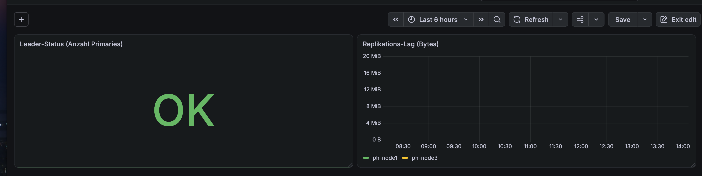

**Panel 2 verifiziert 17.10.2026:** Lag beider Replicas konstant 0 B, Warnlinie bei 16 MiB sichtbar.

**Stolperstein: Warnlinie unsichtbar.** Grafana skaliert die Y-Achse nur nach den Daten (hier 0 bis 96 B), Thresholds zieht es nicht mit ein — die Linie bei 16 MiB lag rund 175 000-mal über dem Achsenende. Lösung **Soft max** statt **Max**:

| Option | Verhalten |
|---|---|
| Max (hart) | Achse endet immer dort, größere Werte werden abgeschnitten — gefährlich |
| Soft max | Achse reicht *mindestens* bis dort und wächst bei größeren Werten mit |

Weitere Kleinigkeiten aus der Praxis: Die Lupe in den Panel-Optionen ist ein **Filter** („Matched 2/53 options“) — mit *Clear* kommen alle Abschnitte zurück. Werte übernimmt Grafana zuverlässig, wenn man danach außerhalb des Feldes klickt. Speicher-Messages wie Commit-Messages formulieren (*was* hat sich geändert), z. B. `Lag-Panel hinzugefügt (Bytes, Warnlinie 16 MiB)`.

**Die orange Warnung „Selected metric is a counter. Consider rate()“** ist nur ein Hinweis. Patroni deklariert die Positionen als Counter, und meist will man bei Countern die Änderungsrate. Für den Lag zieht man aber bewusst zwei Stände voneinander ab — wie der Abstand zweier Autos aus ihren Kilometersteinen, nicht aus ihren Tachos. `rate()` braucht man erst für den WAL-Durchsatz.

#### Lag lesen: Trend statt Größe

Bild aus der Physik — ein Behälter mit Zu- und Ablauf: Zulauf = Leader schreibt WAL, Ablauf = Replica spielt ein, Füllstand = Lag.

| Verlauf | Bedeutung |
|---|---|
| zappelt um einen kleinen Wert | Pipeline-Latenz (Netz, Platte, Einspielen) — Zulauf ≈ Ablauf, gesund |
| Spitze, die wieder abfällt | kurzer Lastschub, Replica holt auf — okay |
| **steigt stetig**, auch wenn noch klein | Ablauf < Zulauf — Replica holt nie auf; Failover verliert Daten, Leser sehen Altes, Leader hält WAL zurück (Replication Slot) bis zur vollen Platte |

> **Merksatz:** Beim Lag zählt die Richtung, nicht die Höhe. Alarme deshalb als „Lag > X **für 5 Minuten**“, damit kurze Spitzen nicht auslösen.

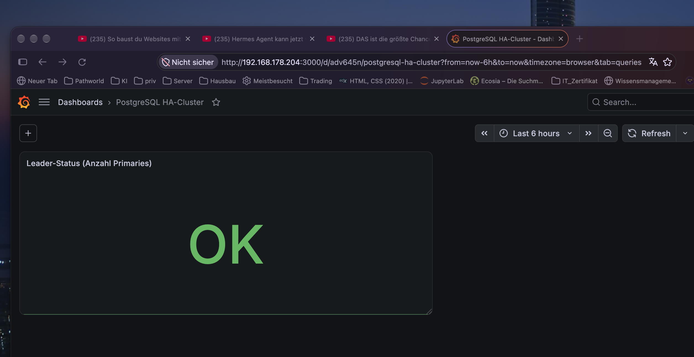

**Panel 1 verifiziert 17.10.2026:** Leader ph-node2, Kachel zeigt grün `OK`; Mappings `1`→OK, `0`→KEIN LEADER, `[2-99]`→SPLIT-BRAIN, `Null + NaN`→KEINE DATEN.

#### Panel 3: Cache-Hit-Ratio — Vorarbeit in Explore

PostgreSQL hält Datenblöcke (je 8 KB) in den `shared_buffers`. Jeder benötigte Block ist entweder ein **Treffer** (`blks_hit`, liegt im RAM — Werkbank) oder muss **gelesen** werden (`blks_read`, von Platte bzw. OS-Cache — Keller). Gesund gilt eine Hit-Ratio über 99 %:

```
Hit-Ratio = blks_hit / (blks_hit + blks_read)
```

Nach einem Neustart ist der Cache **kalt** (leere Werkbank), die Ratio sinkt und erholt sich, während der Cache warm läuft (`pg_prewarm` kann vorwärmen). Weil `pg_stat_database_blks_hit/read` **Counter** mit Lebenszeit-Summen sind, würde ein kalter Cache in der Gesamt-Ratio kaum auffallen — deshalb `rate(...[5m])`: aktueller Verbrauch statt Kilometerstand.

`rate(pg_stat_database_blks_hit[5m])` liefert eine Zeile je Datenbank und Knoten (im Lab 5–6 DBs × 3 Knoten). Zwei Beobachtungen, obwohl niemand Abfragen stellt:

| Zeile | Wert | Ursache |
|---|---|---|
| `postgres` auf allen Knoten | ~100 Treffer/s | Der **postgres_exporter selbst** fragt bei jedem Scrape Statistiken ab — Beobachter-Effekt: Die Messung erzeugt Last, die sie misst. |
| `titanic`, `pgbench_test` nur auf dem Leader (.202) | ~1,3 Treffer/s | **Autovacuum**: Der Launcher schickt regelmäßig (`autovacuum_naptime`, Standard 1 min) einen Worker in jede Datenbank. Replicas sind read-only und räumen nicht auf — sie bekommen die aufgeräumten Blöcke per WAL. |

> **Merksatz:** Eine „leere“ Datenbank ist nie ganz still — Exporter und Autovacuum lesen mit. Und wo Autovacuum arbeitet, sitzt der Leader.

#### Panel 3 im Dashboard

```promql
sum by (instance) (rate(pg_stat_database_blks_hit[5m]))
/
(
  sum by (instance) (rate(pg_stat_database_blks_hit[5m]))
+ sum by (instance) (rate(pg_stat_database_blks_read[5m]))
)
```

`sum by (instance)` fasst alle Datenbanken eines Knotens zusammen → drei Kacheln. Visualisierung **Stat** (große Zahl + Sparkline), Unit **Percent (0.0-1.0)** — nicht *Percent (0-100)*, sonst erscheint der Rohwert 1 als „1 %“.

| Threshold (Rohwert) | Anzeige | Farbe |
|---|---|---|
| Base | < 95 % | rot |
| `0.95` | 95–99 % | orange |
| `0.99` | ≥ 99 % | grün |

**Stolperstein: Thresholds vergleichen mit dem Rohwert, nicht mit der Anzeige.** Mit den Standard-Schwellen (Base grün, 80 rot) wäre ein Cache-Einbruch auf 50 % (Rohwert 0,5) grün. Und **Thresholds mode „Percentage“** heißt nicht „Werte in Prozent“, sondern „relativ zu Min/Max des Panels“ — bei konstanten Werten unberechenbar. Deshalb: Absolute, Schwellen im Rohwert (`0.95`, Dezimalpunkt).

**Verifiziert 17.10.2026:** alle drei Knoten 100 %. Kachel-Titel mit Knotennamen statt `IP:9187` (der postgres_exporter hat kein `name`-Label wie Patroni):

1. Query-Options → Legend **Custom** `{{instance}}` — damit der Feldname feststeht.
2. Reiter **Transformations** (rechts neben *Queries*) → **Rename fields by regex**:
   - Match: `.*\.20(\d):9187.*`
   - Replace: `ph-node$1`

Die letzte IP-Ziffer ist die Knotennummer; `(\d)` merkt sie sich, `$1` setzt sie ein — in Python `re.sub(r".*\.20(\d):9187.*", r"ph-node\1", name)`.

**Stolperstein:** Beim Kopieren rutschte das Wort „Match: “ mit ins Feld. Regex nimmt alles wörtlich — es wurde nichts umbenannt, ohne Fehlermeldung.

#### Panel 4: Connections — und warum der Leader nicht mehr hat

Jede Verbindung ist in PostgreSQL ein eigener **Prozess** (der postmaster forkt pro Verbindung ein Backend; MySQL nutzt Threads). Grenze: `max_connections` (Standard 100).

```promql
sum by (instance) (pg_stat_database_numbackends)
```

`numbackends` ist ein **Gauge** — kein `rate()`. Vermutung vorher: Der Leader hat mehr Verbindungen (WAL-Sender, Autovacuum). **Messung: alle drei Knoten gleich.**

Der Grund: `numbackends` zählt pro Datenbank nur Prozesse, die **an diese Datenbank gebunden** sind. Bild: ein Hotel — Datenbanken sind Zimmer, `numbackends` zählt die Gäste pro Zimmer. Die WAL-Sender sind Lieferwagen im Hof (streamen das ganze WAL, wohnen in keinem Zimmer); der Autovacuum-Worker schaut nur Sekunden in ein Zimmer und wird beim 15-s-Scrape meist verpasst. Übrig bleiben auf jedem Knoten dieselben Dauergäste: Exporter und Patroni.

Gegenprobe auf dem Leader:

```sql
SELECT backend_type, datname, count(*)
FROM pg_stat_activity
GROUP BY backend_type, datname
ORDER BY backend_type;
--         backend_type         | datname  | count
-- -----------------------------+----------+-------
--  archiver                     |          |     1
--  autovacuum launcher          |          |     1
--  background writer            |          |     1
--  checkpointer                 |          |     1
--  client backend               | postgres |     4
--  logical replication launcher |          |     1
--  walsender                    |          |     2
--  walwriter                    |          |     1
```

Zwei `walsender` ohne `datname` (je Replica einer), `client backend` = Exporter, Patroni und die eigene psql-Sitzung (Beobachter-Effekt), `archiver` aus der WAL-Archivierung (Teil 13). Auf einer Replica erscheint statt der WAL-Sender ein `walreceiver`.

**Live-Beweis im Dashboard:** Die ph-node2-Linie sprang um 16:22 von 4 auf 5 — genau als die psql-Sitzung auf dem Leader geöffnet wurde. Nach `\q` und Refresh fiel sie zurück auf 4. Man sieht sich selbst.

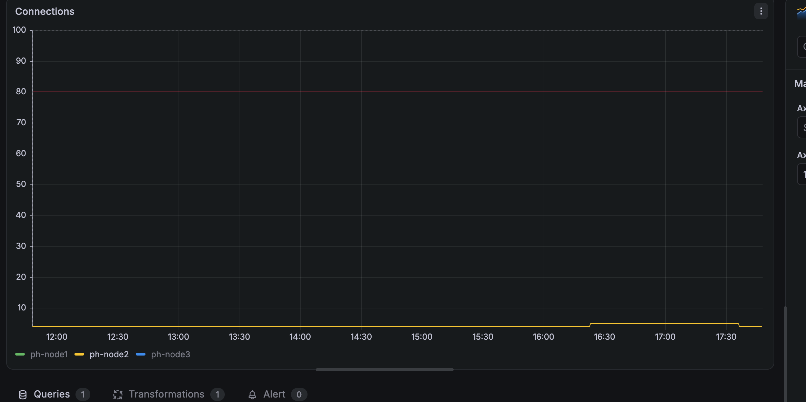

Panel-Einstellungen: Time series, Legend Custom `{{instance}}` + dieselbe Regex-Transformation wie beim Cache-Panel, Thresholds **Absolute** (Base grün, 80 rot — 80 % von `max_connections` = 100), *Show thresholds: As lines*, Soft max 100. Ab `max_connections` antwortet PostgreSQL mit *„too many clients already“*, deshalb die Warnung vorher. Tipp: Ein Klick auf einen Legenden-Eintrag blendet alle anderen Linien aus.

**Panel 4 verifiziert 17.10.2026.**

**Zwei Takte bestimmen die Frische der Anzeige:**

| Takt | Wer | Intervall |
|---|---|---|
| Scrape | Prometheus holt Werte von den Exportern | 15 s |
| Refresh | Grafana holt Werte von Prometheus | Auto-Refresh oben rechts (Off / 10s / 30s …) |

Die Anzeige ist nur so frisch wie das langsamere Zahnrad. Für ein Operator-Dashboard Auto-Refresh z. B. auf 10 s stellen; steht er auf *Off*, ändert sich nichts, bis man selbst auf Refresh klickt.

> **Merksatz:** Messen schlägt Vermuten — aber nur, wenn man weiß, was die Metrik zählt. Für das vollständige Bild `pg_stat_activity` nach `backend_type` gruppieren.

Formulierung fürs Gespräch: „`numbackends` zählt nur an eine Datenbank gebundene Sessions. Die WAL-Sender der physischen Replikation hängen an keiner Datenbank, deshalb sieht der Leader dort nicht mehr Verbindungen als die Replicas.“

#### Panel 5: Transaktionen pro Sekunde (TPS) — Sensor für den Lasttest

Vor einem Versuch die Sensoren anbringen: Die vier Zustands-Panels zeigen nicht, wie viel Arbeit geleistet wird. Für Lasttest und Failover unter Last kommen deshalb TPS und „Wer ist Leader?“ dazu.

```promql
sum by (instance) (rate(pg_stat_database_xact_commit[1m]))
```

`xact_commit` ist ein Counter → `rate()`. Fenster `[1m]` statt `[5m]`, damit ein Failover von wenigen Sekunden nicht weggemittelt wird. Jede Anweisung ist eine Transaktion (Autocommit), auch ein `SELECT`. Replikation zählt **nicht** — der WAL-Sender streamt Bytes, keine Transaktionen. Unit *ops/sec*, keine Thresholds (viel TPS ist Leistung, kein Fehler).

Ruhezustand im Lab (Hypothese vorher: „der Leader hat die meisten“ — bestätigt):

| Knoten | TPS | Ursache |
|---|---|---|
| ph-node1, ph-node3 | ~2,0 | Dauergäste (Exporter, Patroni) |
| ph-node2 (Leader) | ~3,2 | Dauergäste + vermutlich Autovacuum (~1,2) |

**Stolperstein: abgeschnittene Achse.** Grafana zoomt auf den Datenbereich (hier 1,8–3,4) — Unterschiede und Rauschen von ±0,1 wirken dramatisch. Für ehrliche Proportionen Axis → Soft min `0`.

**Begriff:** Statt „Master“ heißt es heute *Primary* (PostgreSQL) bzw. *Leader* (Patroni).

#### Panel 6: Aktueller Leader

```promql
patroni_primary == 1
```

Visualisierung **Stat**, Legend **Custom** `{{name}}` (Patroni liefert das Label `name` direkt, kein Regex nötig), Stat styles → **Text mode: Name**. Beim Failover springt der angezeigte Name auf den neuen Leader.

**Stolperstein:** Text mode *Name* allein zeigt die komplette Label-Liste `{__name__="patroni_primary", instance=…, name="ph-node2", …}`. Text mode bestimmt, *dass* der Name erscheint; die Legend bestimmt, *welcher* Name das ist.

**Verifiziert 17.10.2026:** zeigt `ph-node2`.

**Korrektur 19.10.2026 — Query-Typ Instant statt Range.** Beim ersten echten Leader-Wechsel zeigte das Panel **zwei** Namen (Geister-Leader, siehe 17.13). Ursache: Eine **Range**-Query liefert den Verlauf über den ganzen Zeitraum; `patroni_primary == 1` filtert jeden Zeitpunkt, an dem ein Knoten Leader war. Der alte Leader hat im Zeitraum noch Punkte, danach keine mehr — die Stat-Berechnung nimmt seinen letzten vorhandenen Wert. Lösung: Query → *Options* → **Type: Instant** — nur der aktuelle Wert.

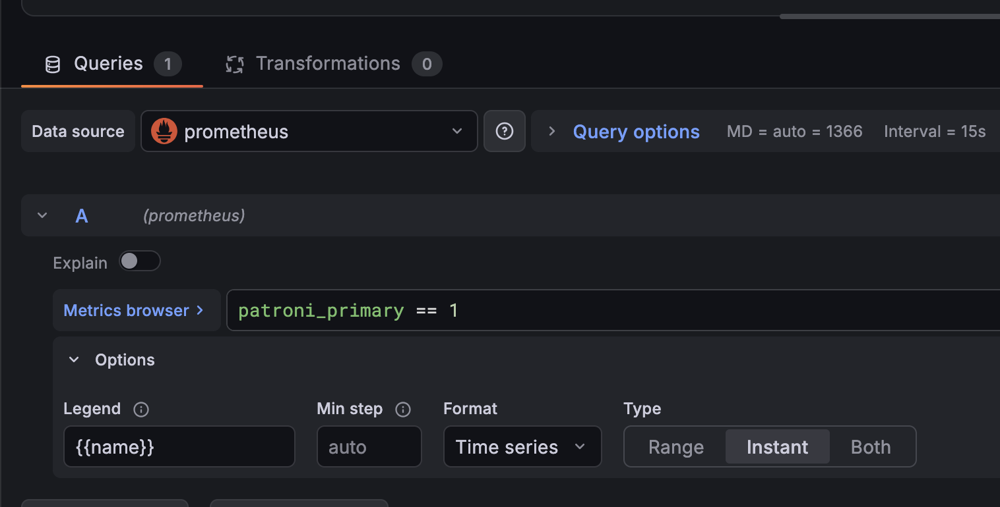

Ergebnis: Das Panel zeigt nur noch `ph-node2`.

| Query-Typ | Bild | Gut für |
|---|---|---|
| **Range** | Film über den Zeitraum 🎞️ | Zeitreihen (TPS, CPU, Lag) und Sparklines |
| **Instant** | Foto vom Jetzt 📸 | „Wer ist **jetzt** …?“, aktuelle Zustände |

Warum stand es auf Range? **Range ist Grafanas Standard** für jede neue Query, weil die meisten Panels Zeitreihen zeigen. Beim Bauen am 17.10. gab es im Zeitfenster keinen Leader-Wechsel, Range und Instant lieferten dasselbe — der Unterschied zeigt sich erst, wenn sich *innerhalb* des Zeitfensters etwas ändert. Das Leader-Status-Panel (`sum(patroni_primary)`) bleibt bewusst auf Range: Die Summe wird je Zeitpunkt gebildet, ist also immer aktuell, und die Hintergrund-Sparkline zeigt den Einbruch beim Failover.

**20.10.2026:** Auch die **Cache-Hit-Ratio-Kacheln** auf Instant umgestellt — vorher zeigte die Kachel eines toten Knotens weiter seinen letzten Wert (94 % bzw. „100 %“). Preis: Ein Stat-Panel mit Instant-Query hat keine Hintergrund-Sparkline mehr; für den Verlauf gibt es Explore.

> **Merksatz:** Standardwerte passen zum Normalfall. Ob ein Panel stimmt, zeigt erst der Sonderfall — deshalb Failover-Tests auch für das Monitoring.

#### Panel 7: CPU-Auslastung — PromQL von innen nach außen lesen

Der node_exporter zählt je CPU-Kern, wie viele Sekunden er in jedem Modus verbracht hat (`idle`, `user`, `system`, `iowait` …). Die Auslastung ist „alles außer Leerlauf“:

```promql
100 * (1 - avg by (instance) (rate(node_cpu_seconds_total{mode="idle", instance=~".*20[1-3]:9100"}[1m])))
```

Verschachtelte PromQL-Ausdrücke liest man **von innen nach außen** — wie eine mathematische Formel mit Klammern:

| Schritt | Ausdruck | Ergebnis |
|---|---|---|
| 1 | `node_cpu_seconds_total{mode="idle", instance=~".*20[1-3]:9100"}` | Counter: Leerlauf-Sekunden je Kern, nur für ph-node1–3 (`=~` = Regex-Filter, ph-monitor bleibt draußen) |
| 2 | `rate(…[1m])` | Anteil Leerlauf pro Sekunde, je Kern zwischen 0 und 1 (1 = völlig untätig) |
| 3 | `avg by (instance) (…)` | Mittelwert über alle Kerne eines Knotens (hier je 2 vCPU) → eine Zeile pro Knoten |
| 4 | `1 - …` | aus Leerlauf wird Auslastung (0 = untätig, 1 = voll) |
| 5 | `100 * …` | in Prozent |

| Label-Filter | Bedeutung |
|---|---|
| `{label="wert"}` | exakt gleich |
| `{label!="wert"}` | ungleich |
| `{label=~"regex"}` | passt auf regulären Ausdruck |
| `{label!~"regex"}` | passt nicht auf regulären Ausdruck |

> **Merksatz:** PromQL von innen nach außen lesen: erst *was* (Metrik + Filter), dann *wie schnell* (`rate`), dann *zusammenfassen* (`avg/sum by`), zuletzt *umrechnen* (`1 -`, `100 *`).

Panel-Einstellungen: Time series, Legend Custom `{{instance}}` + Regex-Transformation (Port **9100** statt 9187: `.*\.20(\d):9100.*` → `ph-node$1`), Unit *Percent (0-100)*, Soft max 100, Thresholds Base grün / 80 orange / 90 rot als Linien.

**Stolperstein: Werte über 100 %.** In Explore stand die Darstellung noch auf *Stacked lines* — die Achse reichte bis 200. Eine Auslastung über 100 % ist ein sicheres Zeichen für gestapelte Kurven.

Erwartung bei pgbench (Generator auf ph-node1, Leader ph-node2): ph-node2 am höchsten (Transaktionen, WAL), ph-node1 deutlich (pgbench + Replay), ph-node3 gering (nur Replay).

**Messung 19.10.2026 (zwei pgbench-Läufe, `-c 10 -T 60`):**

| Knoten | Vorhersage | Spitzen | |
|---|---|---|---|
| ph-node2 (Leader) | am höchsten | ~74 % / ~67 % | ✅ |
| ph-node1 (pgbench + Replay) | deutlich | ~64 % / ~60 % | ✅ |
| ph-node3 (nur Replay) | gering | ~55 % / ~58 % | ❌ Überraschung |

#### Befund: ph-node3 wartet auf die Platte — `iowait`

Aufschlüsselung nach CPU-Modus (Darstellung *Stacked lines* ist hier richtig, weil die Modi Teile eines Ganzen sind):

```promql
avg by (instance, mode) (rate(node_cpu_seconds_total{mode!="idle", instance=~".*203:9100"}[1m])) * 100
```

| Modus | Spitze 08:22 | Spitze 08:27 | Bedeutung |
|---|---|---|---|
| **iowait** | **46,1 %** | **52,7 %** | CPU untätig, wartet auf Platten-I/O |
| system | 4,5 % | 2,3 % | Kernel-Arbeit |
| user | ~2 % | ~2 % | PostgreSQL rechnet |

Rund 90 % der „Auslastung“ von ph-node3 sind Warten. Bild: ein Handwerker, der auf eine Lieferung wartet, wird als „arbeitet“ gezählt. Ursache: Alle drei VMs schreiben auf **dieselbe physische Platte des Proxmox-Hosts** — der Leader WAL und Daten, beide Replicas spielen dasselbe WAL ein und schreiben dieselben Datenblöcke. Drei Schreiber an einer Kasse.

Konsequenzen:

- **Flaschenhals ist die Platte, nicht die CPU.** Im Laststufen-Test ist zu erwarten, dass I/O vor der CPU sättigt.
- **Das CPU-Panel übertreibt**, weil „alles außer `idle`“ auch `iowait` zählt. Ehrlicher: echte Rechenarbeit `mode!~"idle|iowait"` und `iowait` getrennt zeigen.
- **Lab-Einschränkung:** Drei HA-Knoten auf einem Host mit einer Platte teilen sich Ressourcen. In Produktion stehen die Knoten auf getrennter Hardware (und getrennten Storage-Pfaden); im Lab ist das bewusst vereinfacht.

> **Merksatz:** Hohe CPU-„Auslastung“ ist nicht gleich Rechenarbeit — erst nach Modus aufschlüsseln. `iowait` heißt: Die CPU wartet auf die Platte.

#### Ausblick: Failure Domains — warum ein vierter Knoten allein nicht reicht

Ein PostgreSQL-Knoten auf eigener Hardware (z. B. i7) wäre der Gegenversuch zum `iowait`-Befund. Für Ausfallsicherheit über Hardware-Grenzen kommt es aber auf **etcd** an, nicht auf die Zahl der Datenknoten:

| Rolle | Wer | ungerade Zahl nötig? |
|---|---|---|
| Stimmberechtigte (Gemeinderat) | etcd-Mitglieder | ja |
| Datenknoten (Bürger, können Bürgermeister werden) | PostgreSQL + Patroni | nein |

Fällt der Proxmox-Host mit allen drei etcd-Mitgliedern aus, wird eine Replica auf dem i7 **nicht** Leader — ohne Rat kein Leader-Schlüssel. Absicht: Der i7 kann einen toten Host nicht von einem gezogenen Netzwerkkabel unterscheiden. **Lieber kein Leader als zwei.**

| Variante | Proxmox fällt aus | Ergebnis |
|---|---|---|
| 3 etcd auf Proxmox + i7 + Pi (5 Stimmen) | 2 von 5 übrig | keine Mehrheit, kein Leader |
| je 1 etcd auf Proxmox, i7, Pi (3 Stimmen) | 2 von 3 übrig | neuer Leader auf dem i7 |

> **Merksatz:** Kein einzelnes Gerät darf die Mehrheit der etcd-Stimmen halten. Ungerade Zahl allein reicht nicht — die Verteilung entscheidet. Deshalb haben Rechenzentren oft drei Verfügbarkeitszonen.

Hilfsmittel, um Werte an einem bestimmten Zeitpunkt abzulesen: Zeitbereich so wählen, dass er genau am gesuchten Moment endet, Query-Typ **Instant**, Ansicht **Table**.

#### Laststufen-Test mit dem Dashboard (19.10.2026)

Ablauf: von **ph-node1** über die VIP, vier Stufen à 60 s mit Pausen, pro Stufe ändert sich nur `-c`:

```bash
pgbench -h 192.168.178.200 -p 5000 -U postgres -c <10|25|50|75> -j 2 -T 60 pgbench_test
```

Vorab Platz-Check (`df -h /`, `du -sh /var/lib/postgresql/wal_archive`): genug Reserve, siehe Betriebslog.

| Clients | TPS | Latenz Ø | Zuwachs TPS | Zuwachs Latenz | Fehler |
|---|---|---|---|---|---|
| 10 | 1 056 | 9,5 ms | – | – | 0 |
| 25 | 2 124 | 11,8 ms | +101 % | +24 % | 0 |
| 50 | 2 977 | 16,8 ms | +40 % | +43 % | 0 |
| 75 | 3 038 | 24,7 ms | **+2 %** | **+47 %** | 0 |

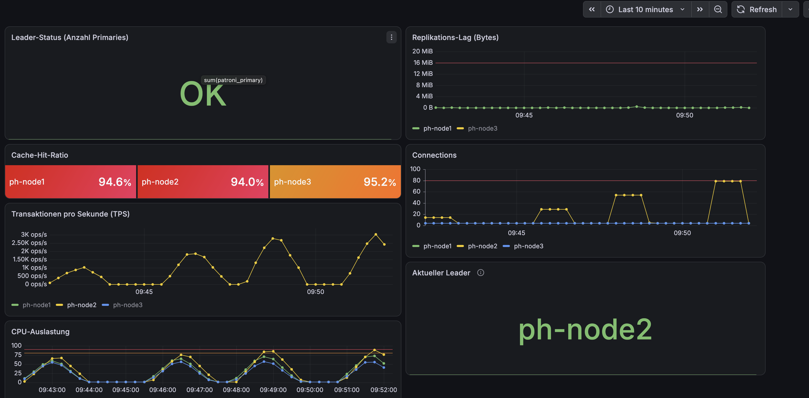

**Sättigung ab ~50 Clients:** Von 50 auf 75 Clients steigt der Durchsatz nur noch um 2 %, die Latenz um 47 %. Bestätigt Teil 14 (Peak ~50), jetzt mit Live-Bild. Im Dashboard: Connections 14 → 29 → 54 → 79 (Clients + 4 Dauergäste) — bei 75 Clients knapp unter der 80er-Warnlinie; CPU ph-node2 bei 75 Clients ~85 %; Lag flach (Replicas halten auch bei 3 000 TPS mit); Cache-Hit-Ratio 93–95 % auf allen Knoten.

**Little'sches Gesetz** (Warteschlangentheorie): Clients = Durchsatz × Latenz, also TPS = Clients ÷ Latenz. Check: 10 ÷ 0,00947 s = 1 056; 75 ÷ 0,02469 s = 3 038 — exakt die pgbench-Werte. Wenn der Durchsatz gesättigt ist, *muss* jede weitere Verbindung die Latenz erhöhen: ein Supermarkt mit fester Kassenleistung.

#### Der Engpass wandert: von der Platte zur CPU

CPU-Modi des Leaders ph-node2 über alle Stufen (Darstellung *Lines*):

```promql
avg by (instance, mode) (rate(node_cpu_seconds_total{mode!="idle", instance=~".*202:9100"}[1m])) * 100
```

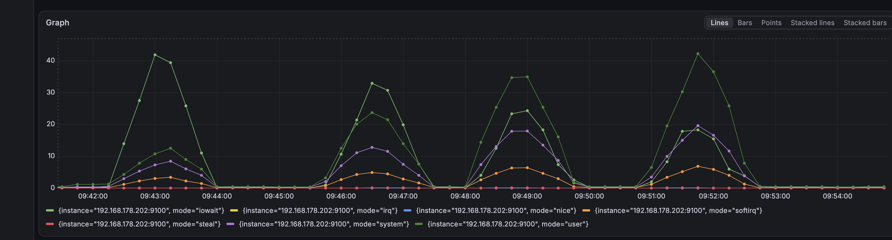

| Stufe | iowait | user | system | Engpass |
|---|---|---|---|---|
| 10 Clients | ~42 % | ~12 % | ~8 % | Platte |
| 25 Clients | ~33 % | ~24 % | ~13 % | Platte |
| 50 Clients | ~24 % | ~35 % | ~18 % | CPU übernimmt |
| 75 Clients | ~18 % | ~42 % | ~19 % | CPU |

Vorhersage war „die Platte macht dicht“ — stimmt nur für wenig Last. Am Sättigungspunkt ist die CPU (2 vCPU) der Engpass.

Erklärung: **Group Commit.** Bei jedem `COMMIT` muss das WAL per `fsync` sicher auf der Platte liegen, bevor PostgreSQL „fertig“ meldet. Bei wenigen Clients kommt fast jeder Commit allein — ein teures `fsync` pro Transaktion, die CPU wartet. Bei vielen Clients warten mehrere Commits gleichzeitig, ein `fsync` schreibt die WAL-Einträge mehrerer Transaktionen. Bild: Sammeltaxi statt Einzelfahrten — die Fahrt kostet gleich viel, transportiert aber mehr. Das Warten pro Transaktion sinkt, die CPU wird zum Flaschenhals.

> **Merksatz:** Der Engpass wandert mit der Last. Wenig Last: Platte (fsync pro Commit). Viel Last: CPU, weil Group Commit die Platte entlastet. Ein Lasttest misst deshalb nie „die“ Grenze, sondern die Grenze bei einer bestimmten Last — und auf diesem Lab einen gemeinsamen Proxmox-Host (CPU und Platte geteilt).

#### Gegenprobe: Lastgenerator auf eigener VM (ph-monitor, 19.10.2026)

Frage: Hat pgbench auf ph-node1 die Messung verfälscht, weil es dort CPU mitfrisst? Gegenprobe mit identischem Befehl, diesmal von **ph-monitor** (pgbench installiert ohne Datenbank-Cluster, siehe Betriebslog):

```bash
pgbench -h 192.168.178.200 -p 5000 -U postgres -c 50 -j 2 -T 60 pgbench_test
```

| | von ph-node1 | von ph-monitor | Unterschied |
|---|---|---|---|
| TPS | 2 977 | **2 831** | −5 % |
| Latenz Ø | 16,8 ms | **17,7 ms** | +0,9 ms |
| Transaktionen | – | 169 546 | – |
| Fehler | 0 | **0** | – |

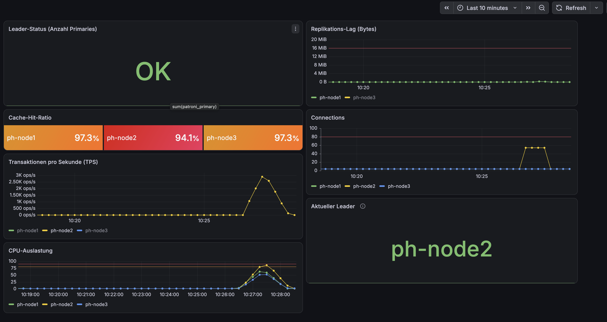

Little-Check: 50 ÷ 0,01766 s = 2 831 TPS. **Ergebnis:** pgbench war kein Bremsklotz — wäre es einer gewesen, müsste der Test von außen *schneller* sein. 5 % liegen im Rauschen zweier Läufe auf einem geteilten Proxmox-Host, dazu kommt ein zusätzlicher Netzwerk-Hop. Die Werte vom Laststufen-Test bleiben gültig.

**Befund: Die VIP kostet CPU.** Auch ohne pgbench lag ph-node1 unter Last ~10 Punkte über ph-node3 (CPU ~62 % vs. ~52 %, Leader ph-node2 ~85 %). Ursache:

```bash
florian@ph-node1:~$ ip -br a | grep 192.168.178.200
ens18   UP   192.168.178.201/24 192.168.178.200/24 ...
```

ph-node1 trägt die VIP (keepalived). Jedes Paket aller 50 Clients läuft über das HAProxy auf ph-node1 und wird von dort zum Leader ph-node2 weitergereicht — Hin- und Rückweg. Bild: der Pförtner am Eingang, der jedem Gast die Tür aufhält und die Taschen bis zum richtigen Büro trägt. Er arbeitet nicht in der Abteilung, ist aber trotzdem außer Atem.

> **Merksatz:** VIP und Leader müssen nicht auf demselben Knoten liegen — HAProxy fragt per Patroni-REST-API (`/primary`), wer gerade schreibt, und leitet weiter. Der Preis ist ein Extra-Hop und CPU auf dem VIP-Knoten. Wer „gleiche Replicas, ungleiche CPU“ sieht, prüft zuerst, wer die VIP trägt.

**Cache-Hit-Ratio unter Last:** ph-node2 ~94 % (rot), die Replicas ~97–98 % (orange), im Leerlauf wieder 100 %. Einordnung:

| Beobachtung | Erklärung |
|---|---|
| ~94 % trotz winziger Werkbank | pgbench Scale 50 ≈ 750 MB Daten, `shared_buffers` nur 128 MiB. Die „heißen“ Zeilen (`pgbench_branches`, `pgbench_tellers`) passen trotzdem auf die Werkbank. |
| `blks_read` ist nicht immer Platte | gezählt wird nur „nicht in `shared_buffers`“ — oft liegt der Block noch im **Linux-Page-Cache** (RAM): eher Nebenzimmer als Keller. |
| Replicas sinken auch | Sie lesen nicht für Kunden, spielen aber das WAL nach: Um eine Änderung einzutragen, muss der Block erst auf die Werkbank — der Handwerker legt das Werkstück auf die Bank, bevor er es repariert. |
| Richtwert OLTP > 99 % | Die ~94 % sind die **Ausgangslage vor dem Tuning** von `shared_buffers`. |

#### Das fertige Dashboard


Sechs Panels, zwei Zielgruppen und ein Zweck: die Ampel oben links für den Operator, Lag, Cache-Hit-Ratio und Connections für den DBA, TPS und aktueller Leader als Sensoren für Lasttest und Failover. **Fertiggestellt 17.10.2026.**

#### Erster Kurztest unter Last (17.10.2026, 19:48)

`pgbench -h 192.168.178.200 -p 5000 -U postgres -c 10 -j 2 -T 60 pgbench_test` von **ph-node1** (Replica) aus — nicht auf dem Leader, sonst konkurrieren Lastgenerator und Datenbank um dieselbe CPU. Dashboard auf *Last 15 minutes*, Auto-Refresh 5–10 s.

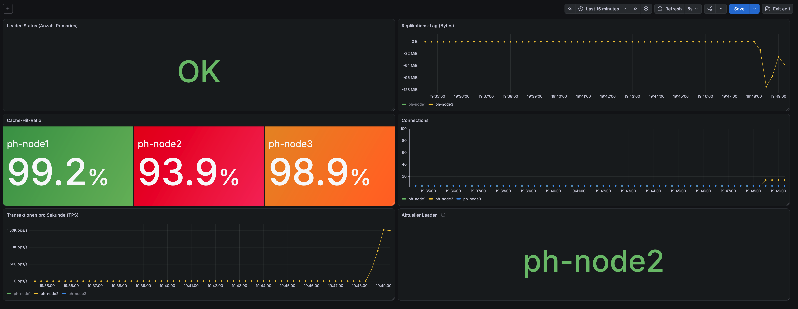

| Panel | Beobachtung | Deutung |
|---|---|---|
| TPS | ph-node2 von ~3 auf ~1 500 ops/s | Schreiblast landet über VIP/HAProxy beim Leader |
| Connections | ph-node2 von 4 auf ~14 | 10 pgbench-Clients + 4 Dauergäste — geht exakt auf |
| Cache-Hit-Ratio | ph-node2 93,9 % (rot), ph-node3 98,9 % (orange) | Zufallszugriffe von pgbench passen nicht in `shared_buffers` = 128 MiB (Werkseinstellung) → Vorher-Wert fürs Basis-Tuning |
| Leader-Status / Aktueller Leader | OK / ph-node2 | kein Wechsel, wie erwartet |
| Replikations-Lag | **negativ, bis −128 MiB** | Messartefakt, siehe unten |

#### Stolperstein: negativer Lag — nicht gleichzeitige Abtastung

Eine Replica kann nie vor dem Leader liegen. Der negative Wert entsteht, weil Prometheus jeden Knoten einzeln und zu leicht verschiedenen Zeitpunkten abfragt. In Ruhe steht das WAL-Band still, der Versatz fällt nicht auf. Unter Last läuft es mit mehreren MB/s: Wird der Leader um 19:48:00 abgefragt und die Replica erst Sekunden später, ist die Replica in der Zwischenzeit weitergelaufen — `Leader-Position − Replica-Position` wird negativ.

Bild: Zwei Autos auf der Autobahn, von zwei Fotografen zu verschiedenen Zeitpunkten fotografiert. Aus den Kilometersteinen auf den Fotos lässt sich kein Abstand berechnen. Messtechnisch: zwei bewegte Größen nicht gleichzeitig abgetastet — die Differenz misst vor allem den Zeitversatz.

> **Merksatz:** Eine Differenz ist nur so gut wie die Gleichzeitigkeit ihrer beiden Messwerte.

#### Lösung: ein Foto mit beiden Autos (umgesetzt 19.10.2026)

Zur Erinnerung, was die Zahlen sind: Das WAL ist ein Tonband, die **WAL-Position (LSN)** ist ein Byte-Zähler — wie weit der Schreibkopf des Leaders bzw. der Lesekopf der Replica auf dem Band steht. Der **Lag in Bytes** ist der Abstand zwischen beiden Köpfen.

Das Problem der alten Query, im Bild: Leader und Replica fahren als zwei Autos hintereinander auf der Autobahn. Fotograf A fotografiert den **Leader** um 19:48:00 bei Kilometerstein 100. Fotograf B fotografiert die **Replica** erst Sekunden später — inzwischen ist sie bei Kilometerstein 108. Rechnung `100 − 108 = −8`: Die Replica scheint *vor* dem Leader zu fahren. In Wahrheit liegen nur die Fotos zeitlich auseinander. Im Stillstand (keine Schreiblast) fällt das nicht auf, weil beide Autos stehen; unter Last laufen sie mit mehreren MB/s, und wenige Sekunden Versatz ergeben Dutzende MiB „Fake-Lag“ — positiv **oder negativ**.

| | alte Query | neue Query |
|---|---|---|
| PromQL | `scalar(max(patroni_xlog_location)) - (patroni_xlog_replayed_location > 0)` | `pg_stat_replication_pg_wal_lsn_diff` |
| Quelle | zwei Scrapes, zwei Knoten, zwei Zeitpunkte | **eine** Abfrage auf dem Leader (`pg_stat_replication`) |
| Bild | zwei Fotos zu verschiedenen Zeiten | **ein Foto mit beiden Autos** |
| unter Last | Messartefakt bis −128 MiB | konsistent, nie negativ |

Der Leader kennt in `pg_stat_replication` je Replica seine eigene WAL-Position und die eingespielte Position der Replica und berechnet die Differenz in derselben Abfrage. Der postgres_exporter stellt das als `pg_stat_replication_pg_wal_lsn_diff` bereit („Lag in bytes between master and slave“ in der Metrikbeschreibung; daneben `pg_stat_replication_pg_current_wal_lsn_bytes` und `pg_stat_replication_reply_time`).

Eigenschaften der neuen Metrik:

- Sie existiert **nur auf dem Leader** — nur dort laufen WAL-Sender. Im Lab: zwei Zeilen, `instance` 192.168.178.202.
- Das Label `application_name` nennt die Replica: `ph-node1`, `ph-node3`. Weitere Labels: `client_addr` (IP der Replica), `slot_name`, `state="streaming"`.
- Nach einem Failover kommt sie automatisch vom neuen Leader; die Replica-Namen in der Legende bleiben aussagekräftig.

Panel-Umbau: Query ersetzen, Legend **Custom** `{{application_name}}`, Unit/Warnlinie/Soft max unverändert.

**Verifiziert 19.10.2026** mit demselben Lauf wie am 17.10. (`-c 10 -j 2 -T 60`, zweimal): keine negativen Werte mehr; das Panel bleibt auf der 20-MiB-Achse flach. Den echten Spitzenwert zeigt Explore:

```promql
max_over_time(pg_stat_replication_pg_wal_lsn_diff[10m])
```

Ergebnis: **~125 KB je Replica** — rund 1/130 der Warnlinie. Die −128 MiB vom 17.10. waren reines Messartefakt. Ein flaches Lag-Panel unter Last ist ein gutes Lag-Panel.

**Stolperstein: Stacked lines.** In Explore war die Darstellung *Stacked lines* aktiv — die Kurven werden aufeinandergestapelt, die Achse zeigt die Summe (250 K), nicht den Einzelwert. Für Vergleiche *Lines* wählen. Wie die abgeschnittene Achse: Die Darstellung kann täuschen, auch wenn die Daten stimmen.

**Nebenbefund:** Die Cache-Hit-Ratio fiel während des Tests auch auf den Replicas (bis 90,8 %), obwohl dort nicht geschrieben wird — beim Einspielen des WAL werden dieselben Datenblöcke angefasst wie auf dem Leader. Nach dem Test erholten sich die Replicas schnell auf 99,6 %.

> **Merksatz:** Eine Differenz ist nur so gut wie die Gleichzeitigkeit ihrer beiden Messwerte. Lag deshalb dort messen, wo beide Positionen im selben Moment bekannt sind — auf dem Leader in `pg_stat_replication`.

### 17.13 Failover unter Last

Ziel: den Leader mitten unter pgbench-Last **hart abschalten** (Stromausfall) und messen, wie lange der Cluster ohne Primary ist, was die Clients merken und wie der alte Leader zurückkehrt.

#### Wie ein Failover abläuft — die Gemeinderat-Metapher

| Im Cluster | Im Bild |
|---|---|
| **etcd** (3 Mitglieder) | der **Gemeinderat**, führt das amtliche Register |
| **Leader-Schlüssel** in etcd | die **Bürgermeister-Schärpe**, gültig nur **30 Sekunden** (`ttl`) |
| **Patroni** auf jedem Knoten | der **Bürger**, der regelmäßig beim Rat vorbeischaut |
| **der Leader** (beim Test ph-node2) | der amtierende **Bürgermeister** |

Im Normalbetrieb läuft der Bürgermeister **alle 10 Sekunden** (`loop_wait`) zum Rat: *„Ich lebe noch, verlängert meine Schärpe um 30 Sekunden.“* Solange er das tut, bleibt er im Amt.

**Was nach dem Stecker-Ziehen passiert:**

| Zeit | Was passiert | Bild |
|---|---|---|
| **0 s** | `qm stop 202`: ph-node2 ist schlagartig weg | Der Bürgermeister fällt um ⚡ |
| 0 bis ~30 s | Niemand verlängert den Schlüssel. Die Replicas merken, dass der WAL-Strom abgerissen ist, **dürfen aber noch nicht** übernehmen | Die Schärpe ist noch gültig — man wartet ab |
| **~20–30 s** | Der Schlüssel **läuft ab** (je nachdem, wann er zuletzt verlängert wurde), etcd löscht ihn | Das Amt ist offiziell frei |
| +1–2 s | Die Replicas vergleichen ihre WAL-Position: Nur wer aktuell genug ist (`maximum_lag_on_failover`), darf kandidieren | Wer hat das vollständigste Protokoll? 📜 |
| | Beide versuchen, den Schlüssel anzulegen — etcd lässt **genau einen** gewinnen (atomare Operation) | Wer zuerst unterschreibt, ist gewählt ✍️ |
| +2–3 s | Der Gewinner führt `promote` aus: Replica → Primary, **neue Timeline** | Vereidigung |
| | Der Verlierer hängt sich als Replica an den neuen Leader | Der andere Bürger erkennt das Ergebnis an |
| +einige s | **HAProxy** fragt jeden Knoten per Patroni-REST-API (`/primary`), der neue antwortet mit 200 → ab jetzt wird dorthin weitergeleitet | Der Pförtner schickt die Gäste ins neue Büro 🚪 |

**Warum nicht sofort?** Der Rat weiß nicht, ob der Bürgermeister tot ist oder nur im Stau steht. Würde man sofort neu wählen und der alte käme zurück, gäbe es **zwei Bürgermeister** — Split-Brain. Die `ttl` ist der bewusst bezahlte Preis: **lieber ~30 Sekunden kein Leader als einen Moment lang zwei.**

**Die Rückkehr des alten Leaders:** Fährt ph-node2 wieder hoch, schaut Patroni beim Rat vorbei, sieht *„Schärpe gehört jemand anderem“* und reiht sich als **Replica** ein. Hat er kurz vor dem Absturz noch WAL geschrieben, das die anderen nie bekommen haben, spult Patroni ihn mit **`pg_rewind`** auf die gemeinsame Geschichte zurück — er wirft seine nie verkündeten Notizen weg und übernimmt das offizielle Protokoll.

**Was die Clients merken:** Ihre Verbindungen zum alten Leader **reißen ab**. Ob und wie sie sich neu verbinden, entscheidet die Anwendung, nicht der Cluster.

> **Merksatz:** Ein ungeplanter Failover dauert mindestens so lange, bis der Leader-Schlüssel abläuft (`ttl`), plus Wahl, `promote` und HAProxy-Check. Ein geplanter Switchover ist schneller, weil der alte Leader die Schärpe freiwillig übergibt.

#### Versuchsaufbau

| Fenster | Wo | Befehl / Zweck |
|---|---|---|
| A | ph-node1 | `watch -n 1 sudo patronictl -c /etc/patroni.yml list` — Cluster live, jede Sekunde |
| B | ph-monitor | `pgbench -h 192.168.178.200 -p 5000 -U postgres -c 50 -j 2 -T 180 -P 5 pgbench_test` — Last, `-P 5` meldet alle 5 s TPS und Latenz |
| C | Proxmox-Host | `date; qm stop 202` — Stromausfall mit Zeitstempel |
| Grafana | Browser | eigenes Dashboard, *Last 15 minutes*, Refresh 5 s |

`qm stop` statt `qm shutdown`: `shutdown` fährt sauber herunter (Patroni gibt den Schlüssel freiwillig zurück), `stop` ist der Stromausfall — so wie ein echter Ausfall auch nicht vorher Bescheid sagt.

Vorab-Check: `patronictl list` → ein Leader (ph-node2, TL 12), zwei Replicas `streaming`, Lag 0. VMID von ph-node2 per `qm list` bestätigt: **202**.

#### Durchgang 1: Failover im Leerlauf (Nullmessung, 19.10.2026)

Geplant war der Test unter Last — im Eifer mit drei Fenstern lief pgbench beim Stecker-Ziehen aber nicht (TPS-Achse nur bis 3,5 ops/s = Grundrauschen von Exporter und Autovacuum, Connections ohne Sprung). Ergebnis ist damit eine saubere **Nullmessung**: Failover ohne Last. Wie im Labor: erst ohne Probe messen, dann mit.

**Ablauf:**

| Uhrzeit (CEST) | Ereignis |
|---|---|
| 12:07:21–12:07:32 | `qm stop 202` — Stromausfall ph-node2 (Leader, TL 12). Zeitfenster statt Zeitpunkt, weil `date` und `qm stop` getrennt eingegeben wurden → Lehre: `date; qm stop 202` in **einer** Zeile |
| ~12:08 | ph-node1 ist Leader, **TL 13**; ph-node3 folgt als Replica, `streaming`, **Lag 0** |
| 12:09:58 | `patronictl list` zeigt nur noch ph-node1 und ph-node3 — ph-node2 ist komplett verschwunden |
| 12:12:45 | `date; qm start 202` — Strom wieder an |
| 12:15:15 | ph-node2 wieder im Register: `Replica`, `starting`, TL leer, LSN `unknown` |

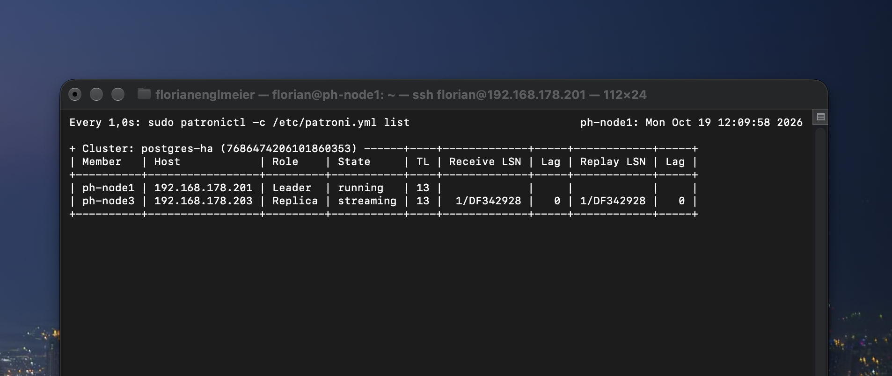

**Warum ist ph-node2 ganz aus der Liste verschwunden?** Nicht nur die Schärpe (Leader-Schlüssel) hat ein Ablaufdatum: Jeder Knoten steht mit einem eigenen **Member-Eintrag** in etcd, den Patroni regelmäßig erneuert. Ein toter Knoten erneuert nichts, der Rat streicht ihn nach Ablauf aus dem **Einwohnerregister**. Beim Neustart meldet er sich neu an.

#### Das Dashboard während des Failovers

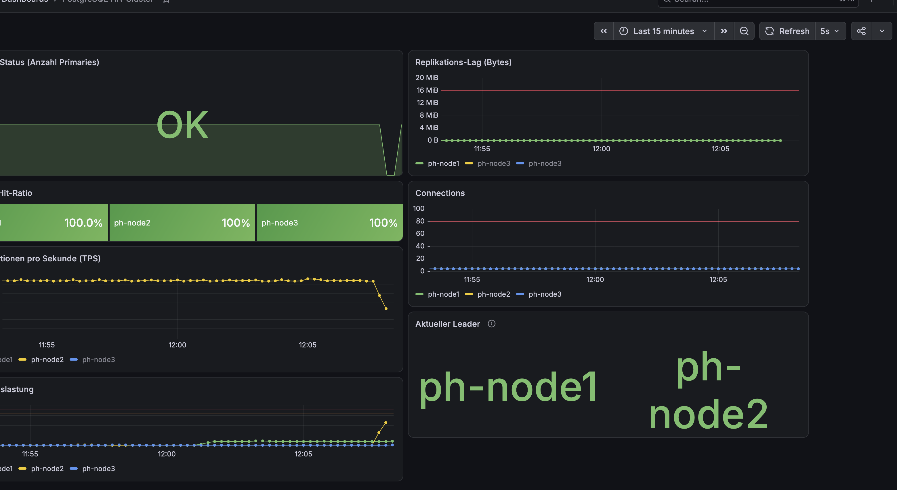

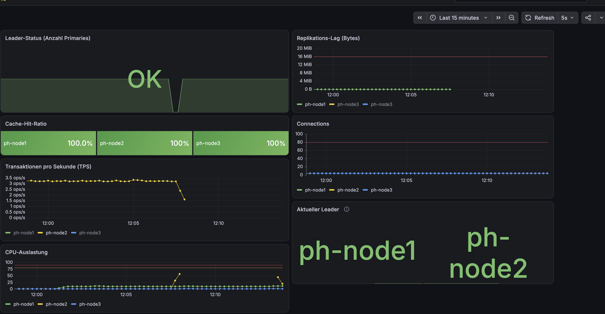

| Panel | Beobachtung | Erklärung |
|---|---|---|
| Leader-Status | Zahl zeigt `OK`, aber die **Hintergrundkurve bricht als „V“ auf 0 ein** | Das ist die Zeit **ohne Bürgermeister** — etwa ein bis zwei Scrape-Intervalle (je 15 s), passend zur `ttl`. Die exakte Dauer liefert das Patroni-Log, nicht die Kurve |
| Aktueller Leader | zeigt **zwei** Namen: ph-node1 **und** ph-node2 | **Kein Split-Brain** — die Ampel daneben sagt `OK` (`sum(patroni_primary)` = 1). Das Stat-Panel zeigt pro Knoten den **letzten Wert im Zeitraum** (*Last \**). ph-node2 lieferte als letzten Wert vor dem Tod eine 1, danach nichts mehr — Grafana hält daran fest |
| TPS | gelbe Linie (ph-node2) bricht ab | Grundrauschen verschwindet mit dem Knoten |
| CPU | gelbe Spitze ~45 % um 12:13, dann abfallend | ph-node2 **bootet** — node_exporter liefert wieder Daten. Heißt nur „VM lebt“, nicht „Patroni spielt mit“ |
| Replikations-Lag | **leer seit ~12:07** | **Kein Datenproblem, sondern ein Grafana-Effekt (bestätigt 15:15, siehe Kasten unten):** In TPS- und Lag-Panel war per Klick in die Legende je *eine* Serie isoliert und mit dem Dashboard gespeichert (graue Legenden-Einträge = ausgeblendet). TPS zeigte nur ph-node2 → nach dessen Ausfall leer; Lag zeigte nur die Replica „ph-node1“ → seit ph-node1 Leader ist, leer. Bild: festgeschraubtes Fernglas auf ein Haus, dessen Bewohner umgezogen ist 🔭 |

**Stolperstein: das festgeschraubte Fernglas (Legenden-Isolation wird mitgespeichert).** Ein Klick auf einen Legenden-Eintrag zeigt nur noch diese Serie, die anderen werden grau. Speichert man danach das Dashboard, legt Grafana dafür still einen **Override** an:

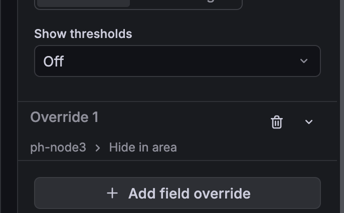

Gefunden unter Panel → *Edit* → ganz unten *Overrides*: `ph-node3 › Hide in area` (vormittags stand dort ph-node2). Gelöscht mit dem Mülleimer, danach zeigt das TPS-Panel wieder alle drei Linien: **ph-node1 (Leader) ~3,2 ops/s**, die Replicas je ~2 ops/s — auch im Leerlauf zählt der Leader mehr Transaktionen (Patroni-Heartbeat, Autovacuum), die Replicas nur die Abfragen des Exporters. Gleiches Muster im Lag-Panel.

Am 20.10.2026 im **Lag-Panel** ebenso entfernt: danach beide Replicas (ph-node1, ph-node3) in der Legende, beide bei 0 B — die grüne Linie liegt deckungsgleich unter der gelben.

> **Merksatz:** Graue Legenden-Einträge heißen „ausgeblendet“, nicht „keine Daten“. Vor dem Speichern eines Dashboards einmal auf die Legende schauen.

Bild zum Geister-Leader: ein **Foto an der Rathauswand**. Der alte Bürgermeister hängt noch da, weil niemand ein neueres Foto von ihm aufhängen kann — er ist ja nicht mehr da. 🖼️👻

> **Merksatz:** Der „letzte Wert“ eines toten Knotens ist ein Geist, kein Leader. Die Ampel (Summe der *aktuellen* Werte) ist die verlässlichere Anzeige. Und: etcd vergisst Tote, Grafana hängt ihr Foto noch an die Wand.

#### Die Rückkehr von ph-node2: Warum „starting“ so lange dauert

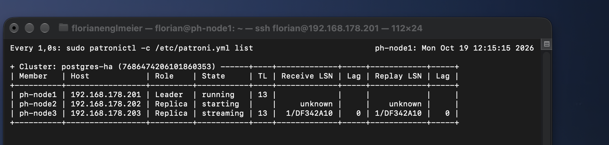

Momentaufnahme **12:15:15**, zweieinhalb Minuten nach `qm start` (12:12:45):

| Spalte | Wert | Bedeutung |
|---|---|---|
| **Role** | `Replica` ✅ | Er hat **akzeptiert**, dass ph-node1 jetzt Bürgermeister ist — kein Putschversuch. Patroni sah beim Rat: Schärpe gehört jemand anderem |
| **State** | `starting` ⏳ | PostgreSQL fährt noch hoch |
| **TL** | leer | Er weiß noch nicht, in welcher Ära er lebt |
| **Receive/Replay LSN** | `unknown` | Er kann noch nicht sagen, wo er im Tonband steht |

**Was in dieser Zeit passiert — von außen nach innen:**

| Schritt | Was | Dauer (grob) |
|---|---|---|
| 1 | **VM bootet** (Ubuntu, Netzwerk, Dienste) | 20–40 s |
| 2 | **Patroni startet automatisch** (`systemctl enable patroni`, repariert am 01.10.2026 — heute zahlt sich das aus) und meldet sich in etcd an → taucht in `list` auf | Sekunden |
| 3 | **Crash-Recovery:** Der Strom wurde gezogen, die Datenbank nicht sauber beendet. PostgreSQL spielt das WAL ab dem letzten **Checkpoint** nach, damit jede bestätigte Transaktion wirklich in den Datendateien steht | abhängig von WAL-Menge seit dem Checkpoint |
| 4 | **Abgleich mit dem neuen Leader:** Passt die eigene Geschichte (TL 12) zur offiziellen (TL 13)? Falls ph-node2 kurz vor dem Absturz noch WAL geschrieben hat, das nie bei den anderen ankam → **`pg_rewind`** | Sekunden bis Minuten |
| 5 | Als Replica von ph-node1 starten, WAL-Strom aufnehmen → `streaming`, TL 13 | Sekunden |

Bild: Der Bürgermeister wacht im **Krankenhaus** auf und liest zuerst **sein eigenes Tagebuch** bis zur letzten Seite (Crash-Recovery), bevor er das Bett verlässt. 📔🏥 Dann vergleicht er es mit dem **offiziellen Protokoll des Rats**. Was er sich nach dem letzten gemeinsamen Stand notiert hat, aber nie verkündet wurde, reißt er heraus (`pg_rewind`). Erst dann darf er wieder mitarbeiten — als einfacher Bürger.

> **Merksatz:** Ein sauber beendeter Knoten kommt schnell zurück. Ein hart abgeschalteter muss erst Crash-Recovery machen und eventuell zurückgespult werden — „starting“ ist kein Fehler, sondern Aufräumarbeit. Erst bei `streaming` mit Lag 0 ist er wieder vollwertige Reserve.

#### Befund: ph-node2 bleibt in „starting“ hängen — die WAL-Lücke

Auch Minuten nach dem Neustart wechselte ph-node2 nicht zu `streaming`. Das Patroni-Log (`sudo journalctl -u patroni --since "12:12" --no-pager`) erzählt die Geschichte:

| Zeit | Logzeile | Übersetzung |
|---|---|---|
| 12:12:55 | `doing crash recovery in a single user mode` | Patroni lässt ihn erst sein Tagebuch fertig lesen — allein im Zimmer, ohne Besucher |
| 12:12:56 | `primary: history= … 12  1/DF33E0B8` | Er holt sich vom neuen Leader das Fahrtenbuch: TL 12 endete bei 1/DF33E0B8 |
| 12:12:56 | `running pg_rewind from ph-node1` | Zurückspulen |
| 12:12:57 | `servers diverged at WAL location 1/DF33E0B8 on timeline 12` | Hier trennten sich die Wege — exakt die Stelle aus dem Fahrtenbuch |
| 12:12:57 | `rewinding from last common checkpoint at 1/DF33DFF0` … `Done!`, `exit code=0` | **pg_rewind erfolgreich** |
| 12:12:57 | `starting backup recovery with redo LSN 1/CE006958, checkpoint LSN 1/DF33DFF0` | Jetzt ab dem gemeinsamen Lesezeichen neu einlesen — ab **1/CE** |
| ab dann, alle paar s | `requested WAL segment 0000000C00000001000000CE has already been removed` → `waiting for WAL to become available` | ph-node1 hat dieses Bandstück nicht mehr — Endlosschleife |
| parallel | `Lock owner: ph-node1; I am ph-node2` … `no action. I am (ph-node2), a secondary, and following a leader (ph-node1)` | Patroni ist zufrieden, PostgreSQL steckt fest |

**Den Segmentnamen lesen:** `0000000C 00000001 000000CE` = Timeline 0x0C (**12**, hex), oberer LSN-Teil `1/`, Segment `CE`. Der Cluster stand bei 1/DF… → 0xDF − 0xCE = 17 Segmente × 16 MB ≈ **272 MB** Lücke.

**Warum liegt das Lesezeichen so weit zurück?** Die Steckbriefe (`pg_controldata`, von Patroni ins Log gedruckt) zeigen: letzter Checkpoint **10:27:06** — mitten im Lasttest vom Vormittag. Ein Checkpoint wird über Minuten verteilt (`checkpoint_completion_target` 0,9 × `checkpoint_timeout` 5 min ≈ 4,5 min) und hat deshalb zwei Enden:

| | Position | Zeit |
|---|---|---|
| **Start** (REDO) — ab hier muss nachgespielt werden | **1/CE**006958 | 10:27:06, mitten im Lasttest |
| **Ende** (Checkpoint-Eintrag) | 1/**DF**33DFF0 | Minuten später |

Danach war der Cluster fast im Leerlauf — kaum Änderungen, also kein neues Lesezeichen. Bild: Der Bürgermeister setzt ein Lesezeichen, **während ihm 272 Seiten diktiert werden**, und klappt das Buch erst nach dem Diktat zu. Nachlesen muss man ab dem Aufschlagen, nicht ab dem Zuklappen. 📖

**Wo liegt das fehlende Stück?** ph-node2 war vom 15.10. bis zum Ausfall Leader und hat es selbst archiviert:

```bash
florian@ph-node2:~$ sudo ls -la /var/lib/postgresql/wal_archive/ | grep 0000000C00000001000000CE
-rw------- 1 postgres postgres 16777216 Okt 19 10:27 0000000C00000001000000CE
florian@ph-node2:~$ sudo grep -n "restore_command" /etc/patroni.yml
florian@ph-node2:~$                      # keine Ausgabe
```

Die Akte liegt im Schrank, aber **der Archivar hat keinen Schlüssel**: Ohne `restore_command` schaut PostgreSQL nie ins Archiv.

**Die Kette in fünf Gliedern:**

1. 10:27 — Checkpoint startet mitten im Lasttest (REDO bei 1/CE), wird erst Minuten später abgeschlossen.
2. Danach Leerlauf — kein neues Lesezeichen.
3. 12:07 — Stromausfall; ph-node1 wird Leader und hält altes WAL nicht vor (`wal_keep_size` = 0).
4. 12:12 — ph-node2: Crash-Recovery und `pg_rewind` klappen, danach braucht er WAL ab 1/CE.
5. Das Stück liegt nur im **lokalen** Archiv von ph-node2 — und ohne `restore_command` liest es niemand.

Ein Fehler von 12:07 mit einer Ursache von 10:27.

**Was die Nutzer davon merkten — und was nicht:**

| | Status |
|---|---|
| Datenbank erreichbar? | ✅ nach dem Failover auf ph-node1 |
| Daten verloren? | ✅ nein, ph-node3 Lag 0 |
| **Reserve** ph-node2 einsatzbereit? | ❌ nein — der Cluster lief grün, aber auf einem Bein 🦩 |

Bild: Der Ersatzreifen ist montiert, das Auto fährt. Nur der kaputte Reifen lässt sich nicht flicken, weil das Flickzeug im falschen Kofferraum liegt. 🚗

**Blinder Fleck im Dashboard:** Während ph-node2 feststeckte, zeigte das eigene Dashboard alles grün — Leader-Status `OK`, Cache ph-node2 „100 %“ (wieder ein Geist: letzter Wert eines Knotens, der keine Verbindungen annimmt). Das Dashboard beantwortet „Gibt es genau einen Leader?“, aber nicht „Sind meine Reserven einsatzbereit?“. Bild: Die Feuerwache meldet „besetzt“, aber dass ein Löschfahrzeug mit Platten in der Halle steht, steht auf keiner Tafel. 🚒 → Verbesserung: Panel „Replicas im Zustand streaming“ (Soll 2), z. B. über `patroni_postgres_streaming`.

> **Merksatz:** Ein Dashboard, das immer grün ist, ist kein Monitoring, sondern Tapete. Lücken im Monitoring findet man, indem man etwas kaputt macht und schaut, ob es jemand merkt.

#### Warum das passieren konnte — und welche Schutzschichten in Produktion fehlen

Der Lasttest hat das Problem nicht verursacht, sondern **sichtbar gemacht**: Viel Schreiblast = viel WAL zwischen zwei Lesezeichen = große Lücke für eine zurückkehrende Replica. Im Lab 272 MB, im echten Betrieb leicht Gigabytes. Das Lab lief mit **Standardeinstellungen**, und die sind bei PostgreSQL bewusst sparsam — sie gehen davon aus, dass der DBA die Reserven selbst auslegt.

| Schutzschicht | Was | Bild | Stand im Lab |
|---|---|---|---|
| **Zentrales WAL-Archiv** + `restore_command` auf allen Knoten | Jeder Knoten holt jedes alte Bandstück, egal wer es archiviert hat (z. B. pgBackRest auf NAS) | ein gemeinsames Stadtarchiv statt Schuhkartons in jedem Haus 🗄️ | ❌ jeder Leader archiviert lokal, niemand liest |
| **`wal_keep_size`** | Der Leader hebt eine WAL-Reserve auf (z. B. 1–2 GB), statt sofort zu recyceln | der Rat schreddert Protokolle erst nach einem Monat | ❌ Standard 0 |
| **Monitoring der Replicas** | Alarm, wenn eine Replica nicht `streaming` ist | Tafel in der Feuerwache | ❌ blinder Fleck, siehe oben |
| **Runbook** „Replica kommt nicht zurück“ | Der Bereitschaftsdienst weiß: Log lesen, dann `patronictl reinit` | Notfallkarte im Handschuhfach | 🔜 |

Für Physiker: Das System war auf **Nennbetrieb** ausgelegt, nicht auf **Störfall plus Vorbelastung**. Der Test hat gezeigt, dass die Sicherheitsreserve für den Wiederanlauf fehlte — kein Konstruktionsfehler von PostgreSQL, sondern fehlende Auslegung. Genau dafür macht man Belastungs- und Ausfalltests im Labor und nicht in Produktion.

**Reparaturwege:**

| Weg | Was | Bewertung |
|---|---|---|
| **A: `patronictl reinit`** | Datenverzeichnis löschen, frische Kopie vom Leader (`pg_basebackup`) | Standardweg, funktioniert immer — **gewählt** |
| B: `restore_command` setzen | bei fehlendem WAL im Archiv nachschauen | richtig gedacht, mit lokalen Archiven aber nur zufällig wirksam → gehört zum zentralen Archiv |
| C: Segmente von Hand nach `pg_wal` kopieren | schnell | Bastelei, in Produktion tabu |

> **Merksatz:** Ein Failover ist erst fertig, wenn die Reserve wieder `streaming` ist. Bis dahin läuft der Cluster ohne Netz — und das sieht man nur, wenn man auch die Replicas überwacht.

#### Reparatur: `patronictl reinit`

```bash
sudo patronictl -c /etc/patroni.yml reinit postgres-ha ph-node2   # Rückfrage mit y bestätigen
```

Patroni löscht das Datenverzeichnis von ph-node2 und zieht per `pg_basebackup` eine frische Kopie vom Leader. Ergebnis nach rund einer Minute (12:33:37): alle drei Knoten auf **TL 13**, ph-node2 und ph-node3 `streaming`, Lag 0.

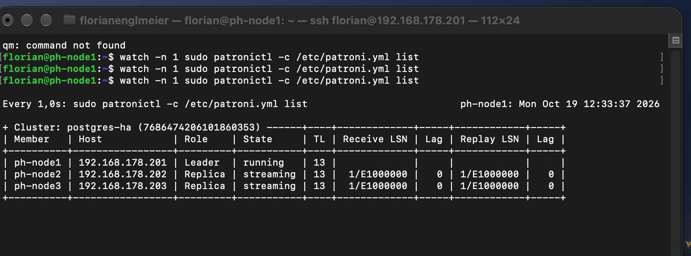

Nettes Detail im Lag-Panel: Während des `reinit` tauchte kurz ein Eintrag **`pg_basebackup`** in der Legende auf. Auch die Basissicherung ist für den Leader nur ein weiterer WAL-Empfänger in `pg_stat_replication` — mit `application_name` = `pg_basebackup`.


#### Erste Schutzschicht: `wal_keep_size`

Die cluster-weite Konfiguration in etcd zeigt `sudo patronictl -c /etc/patroni.yml show-config` — und bestätigt die Werte aus der Gemeinderat-Metapher:

| Parameter | Wert | Bedeutung |
|---|---|---|
| `ttl` | 30 | Schärpe gilt 30 s |
| `loop_wait` | 10 | Bürgermeister meldet sich alle 10 s |
| `maximum_lag_on_failover` | 1048576 (1 MiB) | nur wer höchstens 1 MiB hinterher ist, darf kandidieren |
| `use_pg_rewind` | true | deshalb lief `pg_rewind` automatisch |
| `archive_command` | `cp %p /var/lib/postgresql/wal_archive/%f` | jeder Leader legt in seinen eigenen Schuhkarton ab |
| `restore_command` | fehlt | Archivar ohne Schlüssel |
| `wal_keep_size` | fehlt (= 0) | der Rat schreddert sofort |

**Größe:** PostgreSQL erzwingt spätestens nach `max_wal_size` (Standard 1 GB) neues WAL einen Checkpoint — der Abstand zwischen REDO-Punkt und Ende liegt also grob in dieser Größenordnung (heute 272 MB). Hebt der Leader mindestens so viel auf, findet ein zurückkehrender Knoten das fehlende Band fast immer noch beim Leader. Platz: gut 9 GB frei je Knoten.

```bash
sudo patronictl -c /etc/patroni.yml edit-config -p wal_keep_size=1GB   # Diff prüfen, dann y
```

`-p` setzt einen Eintrag unter `postgresql.parameters`, ohne Editor — keine Einrückungsfehler möglich. `wal_keep_size` ist ein **Reload-Parameter** (Kontext `sighup`): Patroni lädt die Konfiguration auf allen Knoten neu, kein Neustart nötig. Ergebnis 19.10.2026 15:23: `show-config` zeigt `wal_keep_size: 1GB`.

> **Merksatz:** `wal_keep_size` ist der Aktenschrank des Leaders: Er schreddert WAL erst, wenn diese Reserve überschritten ist. Es ersetzt kein zentrales Archiv, deckt aber den häufigsten Fall ab — eine Replica, die nach Minuten zurückkommt.

#### Geplanter Switchover zurück: Leader und VIP trennen (19.10.2026, ~15:33)

Nach dem ersten Failover war ph-node1 **Leader und VIP-Halter** zugleich. Ein Ausfall hätte zwei Wechsel gleichzeitig ausgelöst (keepalived verschiebt die VIP, Patroni wählt neu) — nicht mehr unterscheidbar, welcher was verursacht. Regel aus dem Labor: **immer nur eine Variable ändern.** Deshalb `sudo patronictl -c /etc/patroni.yml switchover postgres-ha` (Primary ph-node1, Candidate ph-node2, now).

| | Failover 12:07 (Stecker gezogen) | Switchover 15:33 (Handschlag) 🤝 |
|---|---|---|
| Timeline | 12 → 13 | 13 → 14 |
| Alter Leader danach | `starting`, Crash-Recovery, `pg_rewind`, hing fest | **sofort `streaming`, Lag 0** |
| Warum | Tagebuch mitten im Satz abgebrochen | sauber heruntergefahren, letzter Eintrag ist ein Abschluss-Checkpoint — nichts nachzulesen, nichts zurückzuspulen |

Bild: Der eine Bürgermeister fällt im Amt um und landet im Krankenhaus. Der andere übergibt bei einer Feier die Schärpe und setzt sich als Bürger in die erste Reihe. 🎩

#### Durchgang 2: wieder im Leerlauf (20.10.2026)

Wieder lief pgbench beim Stecker-Ziehen nicht (Befehl in Fenster B eingetippt, aber nicht mit Enter gestartet) — zweite Nullmessung, diesmal mit dem Wiederanlauf als Bonus.

| Uhrzeit (CEST) | Ereignis |
|---|---|
| 09:35:22 | `date; qm stop 202` — Stromausfall ph-node2 (Leader, TL 14) |
| ~09:36 | **ph-node3** Leader, **TL 15**; ph-node1 `streaming`, Lag 0. Leader-Status-Sparkline zeigt wieder das „V“, das Leader-Panel (jetzt Instant) nur `ph-node3` |
| 09:40:41 | `date; qm start 202` |
| ~09:41 | ph-node2 **`streaming`, TL 15, Lag 0 — ohne `reinit`** |

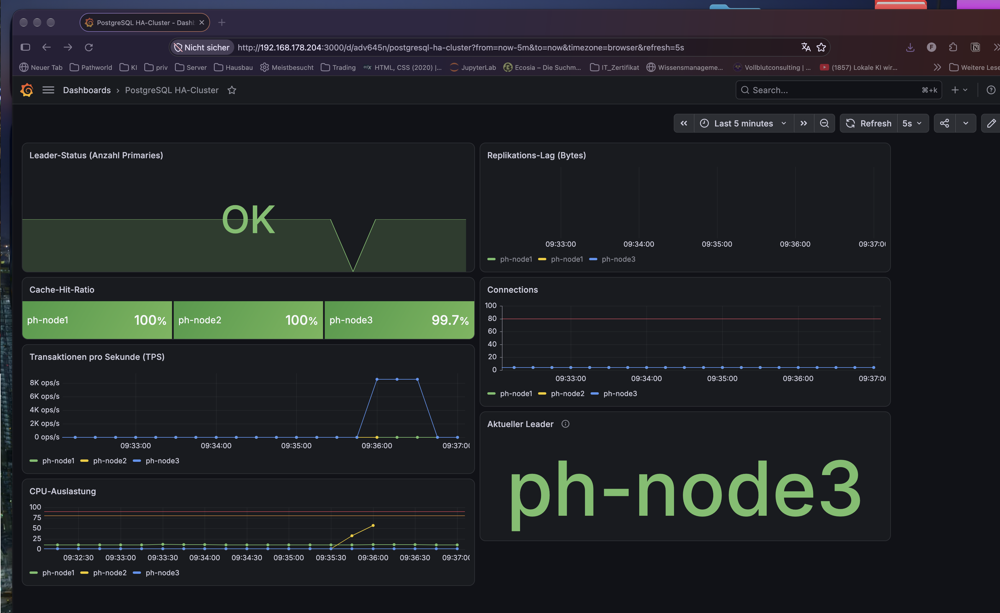

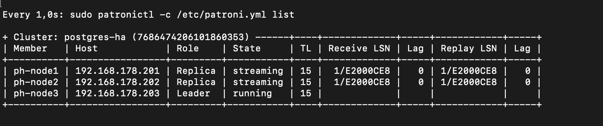

**Ehrliche Einordnung:** Das beweist `wal_keep_size` noch nicht. Seit dem Vortag lief keine Last, das letzte Lesezeichen lag nahe am Absturzpunkt, die Lücke war klein — ph-node2 wäre wahrscheinlich auch ohne Aktenschrank zurückgekommen. Prüfgewicht zu leicht. ⚖️ Aussagekräftig ist erst ein Ausfall **nach bzw. unter Schreiblast**.

| Test | WAL-Lücke | Aussagekraft für `wal_keep_size` |
|---|---|---|
| 19.10.: Lasttest 10:27, Ausfall 12:07 | 272 MB | hoch — ohne Schutz hängengeblieben |
| 20.10.: keine Last seit Vortag | klein | gering |

**Dashboard-Beobachtung:** Fünf Minuten nach dem Ausfall standen ph-node2 noch in den Legenden und mit „100 %“ in der Cache-Kachel. Die Legende listet alle Serien **im Zeitfenster** — ph-node2 lieferte bis 09:35:22 Daten. Die CPU-Linie endet korrekt; die Cache-Kachel ist wieder ein Geist (Range-Query, letzter Wert) → ebenfalls auf **Instant** umstellen.

#### Durchgang 3: Failover UNTER LAST (20.10.2026) 🔥

Lage vorher: ph-node3 Leader (VMID 203, TL 15), ph-node1 VIP-Halter, ph-node2 Replica — Leader und Pförtner getrennt. Reihenfolge diesmal strikt: **erst pgbench starten und Fortschrittszeilen abwarten, dann Stecker ziehen.**

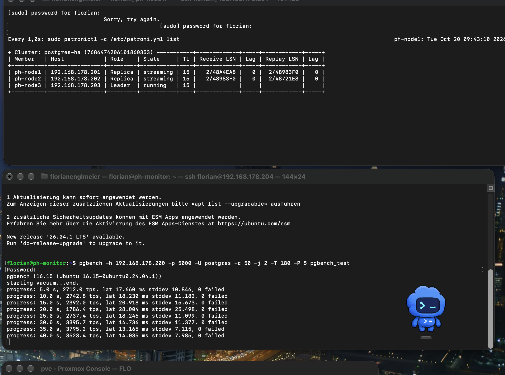

| Uhrzeit (CEST) | Quelle | Ereignis |
|---|---|---|
| ~09:42:30 | pgbench | Last läuft, 50 Clients, ~2 700–3 800 TPS, Connections ~55 |
| **09:43:25** | Proxmox | `date; qm stop 203` — Stromausfall des Leaders ph-node3 |
| sofort | pgbench | alle Clients: `aborted in command … perhaps the backend died while processing` |
| 09:43:27 … 09:43:57 | Patroni-Log ph-node2 | `no action. I am (ph-node2), a secondary, and following a leader (ph-node3)` — die Schärpe ist noch gültig, man wartet |
| während der Lücke | Grafana | Ampel **„KEIN LEADER“** (rot) |
| **09:44:00,751** | Patroni-Log ph-node2 | `promoted self to leader by acquiring session lock` → `server promoting` → `received promote request` |
| 09:44:00,841 | Patroni-Log ph-node2 | `updated leader lock during promote` |
| 09:44:01,939 | Patroni-Log ph-node2 | `no action. I am (ph-node2), the leader with the lock` |

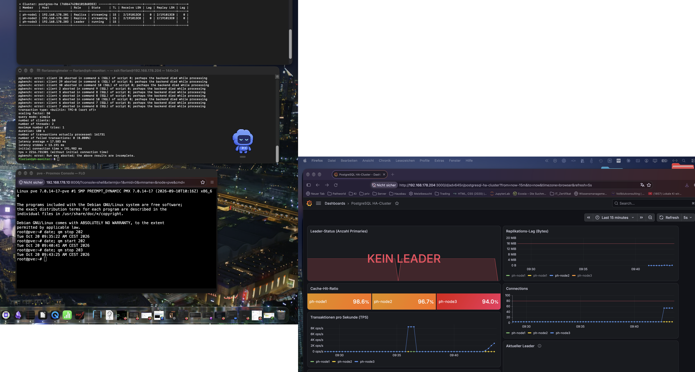

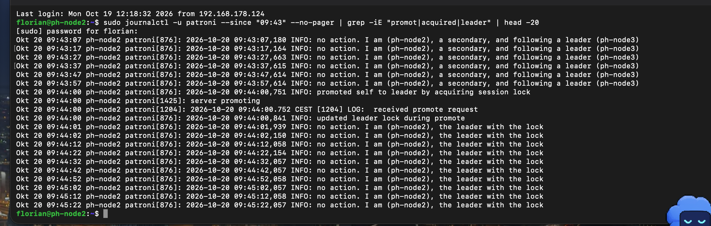

**Gemessene Zeit ohne Leader: 09:43:25 → 09:44:00,75 ≈ 35 Sekunden.** Erwartung aus der Konfiguration: Der Leader verlängert die Schärpe alle 10 s (`loop_wait`) auf 30 s (`ttl`) — je nachdem, wann die letzte Verlängerung vor dem Ausfall lag, läuft sie 20–30 s nach dem Ausfall ab; dazu Wahl und `promote`. Gemessen und erwartet passen zusammen.

**Detail:** Die regulären Runden von ph-node2 liegen auf :07, :17, :27 … — die Beförderung kam aber um **:00,75**, nicht erst in der nächsten Runde um 09:44:07. Patroni beobachtet den Leader-Schlüssel in etcd (*watch*) und reagiert sofort, wenn er verschwindet. Bild: Der Bürger wartet nicht auf seinen nächsten Rathausbesuch, sondern wird angerufen, sobald die Schärpe abläuft. 📞

**Was pgbench gemeldet hat:**

```
pgbench: error: client 28 aborted in command 6 (SQL) of script 0; perhaps the backend died while processing
...
number of transactions actually processed: 161731
number of failed transactions: 0 (0.000%)
tps = 2216.731301 (without initial connection time)
pgbench: error: Run was aborted; the above results are incomplete.
```

| Beobachtung | Bedeutung |
|---|---|
| alle 50 Clients `aborted` | pgbench verbindet sich **nicht neu**. Bild: 50 Bürger stehen am Schalter, der Beamte fällt um — und alle gehen nach Hause, statt auf den neuen Beamten zu warten 🚶 |
| `0 failed` trotz Abbruch | Abgebrochene Transaktionen zählen nicht als *failed*: Was nie mit `COMMIT` bestätigt wurde, gilt als nie passiert. Die 161 731 bestätigten Transaktionen sind nach dem Failover vorhanden |
| `tps = 2216` | unvollständig, weil der Lauf vorzeitig endete — kein Leistungswert |

> **Merksatz:** Der Cluster übernimmt den Failover, die **Anwendung** das Wiederverbinden. Ohne Retry-Logik im Client endet jeder Failover beim Nutzer als Fehlermeldung — mit Retry als kurze Verzögerung. Und: Kein Client hat ein „OK“ für etwas bekommen, das verloren ging (Durability, das D in ACID).

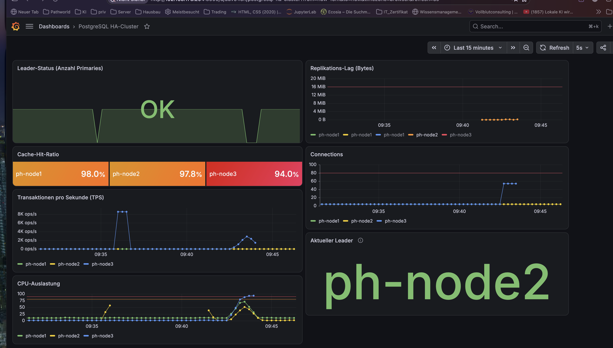

Dashboard danach: zwei Einbrüche in der Leader-Status-Sparkline (Durchgang 2 und 3), Leader-Panel zeigt `ph-node2`, Connections fallen nach dem Abbruch zurück. Die rote Cache-Kachel ph-node3 (94 %) ist wieder ein Geist — der Knoten ist tot, die Kachel zeigt seinen letzten Wert unter Last.

#### Der Crashtest für den Aktenschrank: Wiederanlauf von ph-node3

`date; qm start 203` um **09:47:31**. In `patronictl list` erschien ph-node3 zuerst als `Replica` / **`stopped`** — Patroni lebt und hat sich beim Rat zurückgemeldet, PostgreSQL läuft noch nicht (wach im Krankenbett, noch nicht aufgestanden). Rund zwei Minuten später: **`streaming`, TL 16, Lag 0 — ohne `reinit`.**

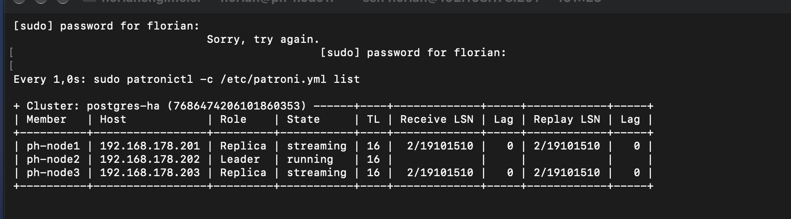

Dass er zurückkam, ist das Ergebnis. *Warum*, zeigt das Log (`sudo journalctl -u patroni --since "09:47" --no-pager | grep -iE "REDO location|Time of latest checkpoint|diverged|rewind|started streaming|removed"`):

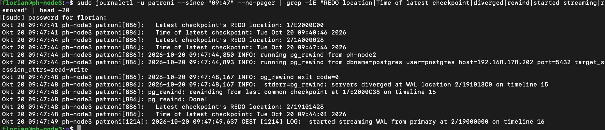

| Zeit | Logzeile | Bedeutung |
|---|---|---|
| 09:47:41 | `REDO location: 1/E2000C00`, `Time of latest checkpoint: 09:40:46` | Letztes eigenes Lesezeichen — **vor** dem Lasttest |
| 09:47:44 | `REDO location: 2/1A000028`, `09:47:44` | Crash-Recovery im Single-User-Modus setzt ein neues Lesezeichen |
| 09:47:44 | `running pg_rewind from ph-node2` | Zurückspulen |
| 09:47:48 | `servers diverged at WAL location 2/191013C0 on timeline 15` | Hier trennten sich die Wege |
| 09:47:48 | `rewinding from last common checkpoint at 1/E2000C38` … `Done!` | Zurück zum gemeinsamen Lesezeichen von 09:40 |
| 09:47:49 | `started streaming WAL from primary at 2/19000000 on timeline 16` | **Erst ab dem Trennpunkt** vom Leader angefordert |

**Der Vergleich mit gestern ist der Beweis:**

| | 19.10. (`wal_keep_size` 0) | 20.10. (`wal_keep_size` 1GB) |
|---|---|---|
| Nachlesen ab (REDO des gemeinsamen Lesezeichens) | 1/CE006958 | 1/E2000C00 |
| Trennpunkt | 1/DF33E0B8 | 2/191013C0 |
| Lücke | 17 Segmente ≈ 272 MB | 0x219 − 0x1E2 = **55 Segmente ≈ 880 MB** |
| Vom Leader angefordert ab | **1/CE000000** — also *vor* dem Trennpunkt, lokal fehlte das Band | **2/19000000** — erst ab dem Trennpunkt, alles davor lag **lokal** |
| Ergebnis | `segment … has already been removed`, Endlosschleife, `reinit` | `streaming` nach ~2 min |

**Was den Unterschied macht — der Mechanismus:** Beim Wiederanlauf setzt die Crash-Recovery ein **neues** Lesezeichen (09:47:44 bzw. gestern 12:12:56). Ein frisches Lesezeichen erlaubt PostgreSQL, alle älteren WAL-Segmente im eigenen `pg_wal` wegzuräumen. Danach spult `pg_rewind` aber auf das **alte** gemeinsame Lesezeichen zurück — und braucht genau die Seiten, die gerade weggeräumt wurden.

- **Gestern** (`wal_keep_size` 0): weggeräumt. Lokal fehlte das Band ab 1/CE, der Leader hatte es auch nicht mehr → hängengeblieben.
- **Heute** (`wal_keep_size` 1GB, gilt auf **allen** Knoten): Auch ph-node3 selbst hält 1 GB WAL zurück, die 880 MB Lücke lagen noch in der eigenen Schublade. Nur das Stück ab dem Trennpunkt kam vom Leader.

Bild: Gestern hat der Bürgermeister im Krankenhaus sein Tagebuch zu Ende gelesen und die alten Seiten **sofort ins Altpapier** geworfen — dann sollte er für den Abgleich genau diese Seiten nochmal lesen. Heute bewahrt jeder Bürger die letzten 1 000 Seiten in der Schublade auf, auch nach dem Lesen. 🗄️📔

**Ehrliche Grenze:** 880 MB von 1 GB — knapp. Ein längerer Lasttest zwischen zwei Lesezeichen (mehr als ~1 GB WAL) würde die Schublade wieder sprengen. `wal_keep_size` ist eine Reserve, keine Garantie; die belastbare Lösung bleibt das **zentrale WAL-Archiv mit `restore_command`**, dazu `max_wal_size` (Abstand der Lesezeichen) und `wal_keep_size` aufeinander abstimmen.

> **Merksatz:** `wal_keep_size` schützt nicht nur Replicas beim Leader, sondern auch den zurückkehrenden Knoten vor sich selbst: Er wirft nach der Crash-Recovery das Band nicht weg, das `pg_rewind` gleich wieder braucht. Die Reserve muss größer sein als das WAL zwischen zwei Checkpoints unter Last.

#### Werkzeug: Logs gezielt durchsuchen — wie man auf so einen Befehl kommt

```bash
sudo journalctl -u patroni --since "09:47" --no-pager | grep -iE "REDO location|Time of latest checkpoint|diverged|rewind|started streaming|removed" | head -20
```

Der Befehl entsteht nicht aus dem Nichts, sondern in fünf Denkschritten — wie eine **Fahndung mit Phantombild**:

| Schritt | Frage | Antwort hier |
|---|---|---|
| 1. Was will ich wissen? | Die *Behauptung* „wal_keep_size hat geholfen“ prüfen | Ab wo musste ph-node3 nachlesen, und woher kam das Band? |
| 2. Wo steht es? | Welches Protokoll? | Patroni startet PostgreSQL als Kindprozess — **beide** schreiben ins Journal der Unit `patroni` (gestern sichtbar: `patroni[1207]: … LOG: …`) |
| 3. Wann? | Zeitfenster | ab `qm start 203` um 09:47:31 → `--since "09:47"` |
| 4. Wonach suchen? | Fahndungsbegriffe | die **wörtlichen Meldungen vom Vortag** — das Phantombild |
| 5. Wie viel? | Ausgabe begrenzen | `head -20` |

**Die Fahndungsliste — jeder Begriff stammt aus dem Fall vom 19.10.:**

| Suchbegriff | gestern gesehen als | beantwortet |
|---|---|---|
| `REDO location` | `Latest checkpoint's REDO location: 1/CE006958` (Steckbrief `pg_controldata`) | Ab wo muss nachgelesen werden? |
| `Time of latest checkpoint` | `… Mon Oct 19 10:27:06` | Wann wurde das Lesezeichen gesetzt? |
| `diverged` | `servers diverged at WAL location 1/DF33E0B8` | Wo trennten sich die Wege? |
| `rewind` | `running pg_rewind from ph-node1` … `Done!` | Lief das Zurückspulen, erfolgreich? |
| `started streaming` | `started streaming WAL from primary at 1/CE000000` | **Ab wo** wurde beim Leader angefordert — der Schlüsselbeweis |
| `removed` | `requested WAL segment … has already been removed` | Fehlte Band? (Hoffnung: kein Treffer) |

**Lehre aus dem ersten Versuch am Vortag:** Damals stand `checkpoint` in der Liste — das passt auf **jede** Zeile der Steckbriefe (`Latest checkpoint location`, `…NextXID`, `…oldestXID` …), und `head -30` war nach den Steckbriefen voll; die wichtigen Zeilen fielen hinten heraus. Deshalb jetzt **präzise** Begriffe (`REDO location`, `Time of latest checkpoint`) statt eines Allerweltsworts.

**Die Bausteine:**

| Teil | Bedeutung |
|---|---|
| `sudo` | das Journal fremder Dienste lesen nur Admins (oder Gruppe `systemd-journal`) |
| `journalctl -u patroni` | nur die Meldungen der Unit `patroni.service` |
| `--since "09:47"` | ab heute 09:47 (ohne Datum = heute); auch `"2026-10-20 09:47"` oder `"10 min ago"` |
| `--no-pager` | alles direkt ausgeben statt im Blätterprogramm `less` — nötig, damit die Pipe es bekommt |
| `\|` (Pipe) | Ausgabe des einen Programms wird Eingabe des nächsten — ein Fließband |
| `grep -i` | Groß-/Kleinschreibung egal (`Rewind`, `rewind`, `REWIND`) |
| `grep -E` | erweiterte Regex: `\|` zwischen den Begriffen heißt **ODER** |
| `head -20` | nur die ersten 20 Treffer — schützt vor Bildschirmfluten |

Python-Analogie: `[z for z in journal if re.search(r"REDO location|diverged|…", z, re.I)][:20]`

**Alternative ohne grep:** `journalctl` kann selbst filtern: `sudo journalctl -u patroni -S "09:47" -g "REDO location|diverged|rewind" --no-pager` (`-S` = `--since`, `-g` = `--grep`, Regex, ohne Großbuchstaben im Muster automatisch case-insensitive).

> **Merksatz:** Logs durchsucht man nicht, man **befragt** sie: erst die Frage, dann Ort und Zeitfenster, dann die wörtlichen Meldungen als Fahndungsbegriffe — am besten die, die man beim letzten Fall schon gesehen hat. Je präziser der Begriff, desto weniger Rauschen.

### 17.14 Basis-Tuning: `shared_buffers` — die Werkbank vergrößern

`shared_buffers` ist die **Werkbank** von PostgreSQL: der RAM-Bereich, in dem Datenblöcke griffbereit liegen. Werkseinstellung 128 MB — die pgbench-Datenbank (Scale 50) ist aber ~750 MB groß. Unter Last lag die Cache-Hit-Ratio des Leaders deshalb bei ~94 % (rot).

#### Bestandsaufnahme (20.10.2026)

```bash
free -h
psql -h 192.168.178.200 -p 5000 -U postgres -c "SHOW shared_buffers;"   # → 128MB
```

| Spalte `free -h` | Wert | Bedeutung | Bild |
|---|---|---|---|
| total | 3,8 GiB | RAM der VM (4 GB in Proxmox) | die ganze Werkstatt |
| used | 633 MiB | von Programmen belegt | |
| shared | 141 MiB | gemeinsamer Speicher — im Wesentlichen `shared_buffers` (128 MB) plus Verwaltung | die **Werkbank** 🔧 |
| buff/cache | 2,3 GiB | Linux-Page-Cache | das **Nebenzimmer** 🚪 |
| available | 3,2 GiB | sofort verfügbar (Cache wird bei Bedarf freigegeben) | |
| Swap | **0 B** | keine Auslagerung — wird der RAM knapp, beendet der **OOM-Killer** einen Prozess, im schlimmsten Fall PostgreSQL | kein Notausgang ⚠️ |

**Befund:** Das Nebenzimmer (2,3 GiB) fasst die ganze Datenbank. Die „Fehlgriffe“ (`blks_read`) der 94 % kamen also aus dem RAM des Betriebssystems, nicht von der Platte — die Vermutung aus 17.12 ist bestätigt.

**Zielwert:** Faustregel ~25 % des RAM → 3,8 GiB × 0,25 ≈ **1 GB**. Die Datenbank passt dann komplett auf die Werkbank, für alles andere bleiben ~2,8 GB. Nicht mehr, weil Blöcke oft **doppelt** im RAM liegen (Werkbank *und* Nebenzimmer, *Double Buffering*) — eine größere Werkbank verkleinert das Nebenzimmer — und weil ohne Swap kein Puffer gegen Speichermangel existiert.

#### Hypothesen vorher

| | Florian | Jacky |
|---|---|---|
| TPS | steigen nur gering (Nebenzimmer war schon RAM) | steigen nur gering — zusätzlich ist bei 50 Clients die CPU der Engpass |
| Cache-Hit-Ratio | ändert sich gering | **springt** von ~94 % auf ~99,9 %: die Kennzahl zählt nur Werkbank-Treffer, jeder Griff ins Nebenzimmer gilt als Fehlgriff |

#### Vorher-Messung (128 MB, Leader ph-node2)

```bash
pgbench -h 192.168.178.200 -p 5000 -U postgres -c 50 -j 2 -T 120 pgbench_test
```

| Messgröße | Wert |
|---|---|
| TPS | **2 954** |
| Latenz Ø | **16,9 ms** |
| Transaktionen | 354 147, 0 failed |
| Cache-Hit-Ratio Leader ph-node2 | **94,0 %** (identisch zum Vortag — reproduzierbar) |
| Cache-Hit-Ratio Replicas | 94,6 % |
| CPU ph-node2 | ~88 % — CPU am Anschlag |

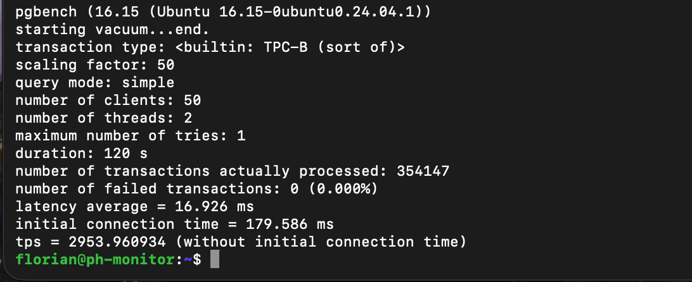

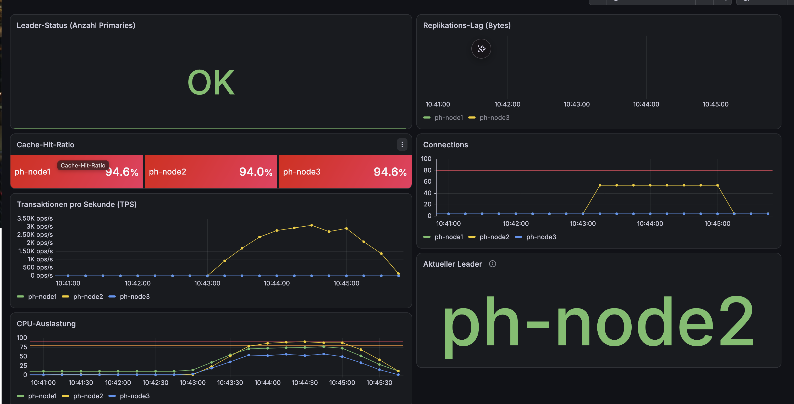

#### Incident während der Nachher-Messung: Platte voll auf dem Leader (20.10.2026, 11:08)

Mitten im Mess-Lauf (Leader ph-node2, `shared_buffers` bereits 1 GB) brachen alle pgbench-Clients ab:

```
ERROR:  could not extend file "base/16422/32891": No space left on device
HINT:  Check free disk space.
```

Der Lauf ist als Messung **ungültig** (2 882 TPS, „Run was aborted“). `0 failed`: Was bestätigt war, blieb sicher — PostgreSQL lehnt lieber ab, als halb zu schreiben.

**Lagebild auf ph-node2:**

| Verzeichnis | Größe |
|---|---|
| `/` gesamt | 18 G, **100 %**, 0 frei |
| **`wal_archive`** | **11 G** — 13 × so groß wie die Datenbank |
| `pg_wal` | 1,6 G (davon 1 GB `wal_keep_size`) |
| `base` (Daten) | 817 M |

Archiv nach Tagen (`sudo find … -printf '%TY-%Tm-%Td\n' | sort | uniq -c`, je Datei 16 MB):

| Tage | Dateien | ≈ Größe |
|---|---|---|
| 22.09.–17.10. | 96 | 1,5 GB |
| **19.10.** (Laststufen-Test) | **313** | **5 GB** |
| **20.10.** (Failover-Tests, Messungen) | **252** | **4 GB** |

Ursache: der seit 19.10. als offen notierte Punkt — **lokales Archiv ohne Aufbewahrungsregel**. Jede Lasttest-Minute erzeugt ~270 MB WAL, `archive_command` bewahrt jedes Segment auf. Bild: Jeder Span der Säge wandert in einen Karton, und keiner wird je weggeworfen. 📦

**Dominoeffekt — etcd auf demselben Knoten:**

```
11:08:58 etcd: cannot commit tx (write /var/lib/etcd/default.etcd/member/snap/db: no space left on device)
11:08:58 systemd: etcd.service: Failed with result 'exit-code'.
```

Ein Ratsmitglied, das nichts mehr protokollieren kann, beendet sich selbst — der Rat hatte nur noch 2 von 3 Stimmen, ohne Reserve. PostgreSQL und etcd teilen sich eine Platte: ein voller Schuhkarton legt Bürgermeister **und** Ratsmitglied lahm (Failure Domain im Kleinen). ph-node2 blieb trotzdem Leader — Patroni kennt alle drei etcd-Endpunkte und verlängerte die Schärpe beim Nachbarn; nur `patronictl` auf ph-node2 fragte das lokale etcd und bekam `Connection refused`.

**Aufräumen — nur im Archiv, nie in `pg_wal`:**

| Verzeichnis | Wer braucht es? | Von Hand löschen? |
|---|---|---|
| `pg_wal` | PostgreSQL selbst, jetzt (Recovery, Replicas, `wal_keep_size`) | **niemals** — Seiten aus dem Tagebuch reißen, während man schreibt |
| `wal_archive` | nur Point-in-Time-Recovery; ohne `restore_command` liest es kein laufender Prozess | alte Dateien ja — kostet nur Zeitreise-Reichweite (und das Archiv war auf drei Knoten verstreut, also ohnehin lückenhaft) |

```bash
# Probelauf: zählen, was gelöscht würde (erwartet 410 laut Tagestabelle)
sudo find /var/lib/postgresql/wal_archive -type f ! -newermt "2026-10-20" | wc -l   # → 409
# erst dann löschen
sudo find /var/lib/postgresql/wal_archive -type f ! -newermt "2026-10-20" -delete
df -h /   # → 6,4 G frei, 63 %
```

409 statt 410: eine Datei auf der Datumsgrenze, Abweichung in die sichere Richtung (es wird weniger gelöscht, nicht mehr). Wäre die Zahl größer gewesen als erwartet, hätte man gestoppt. Danach `sudo systemctl restart etcd` → `etcdctl … endpoint health`: alle drei `healthy`.

**Nachbeben: ein Leader-Wechsel durch den etcd-Neustart.** Um 11:20:17 übernahm ph-node3 (TL 18 → 19), ohne dass ein Switchover befohlen war. Das Patroni-Log von ph-node2 zeigt den Täter an der **Prozessnummer**:

| Zeit | Prozess | Meldung |
|---|---|---|
| 11:20:08 | `patroni[876]` | `I am (ph-node2), the leader with the lock` |
| **11:20:17** | – | etcd neu gestartet (`systemctl show etcd -p ActiveEnterTimestamp`) |
| 11:20:18 | `patroni[10501]` | `Lock owner: ph-node3; I am ph-node2` |
| 11:20:19 | `patroni[10501]` | `a secondary, and following a leader (ph-node3)` |

Neue PID = **Patroni selbst wurde neu gestartet**. Der Grund steht in der Unit:

```bash
$ systemctl cat patroni | grep -iE "requires|bindsto|partof|wants|after"
After=network.target etcd.service
Requires=etcd.service
```

`Requires=` heißt für systemd: Wird etcd **ausdrücklich** gestoppt oder neu gestartet, geschieht dasselbe mit Patroni. Ein sauber beendetes Patroni fährt PostgreSQL herunter und gibt die Schärpe **freiwillig** ab — daher kein 30-s-Warten, sondern ein Wechsel wie beim Switchover. Feines Detail: Beim **Absturz** von etcd um 11:08 blieb Patroni stehen (ein gescheiterter Dienst ist kein ausdrücklicher Stopp) — erst der **Neustart** zog es mit. Bild: Man weckt das Ratsmitglied, und der Bürgermeister zieht sich mit an. 🏛️

Gleiches Muster wie die `needrestart`-Falle (TL 6, 9–11): **Ein harmloser Neustart eines Nachbardienstes startet Patroni neu — auf dem Leader ist das ein Leader-Wechsel.** Optionen: auf dem Leader vor Wartung an etcd erst `switchover`; oder `Wants=` statt `Requires=` (Patroni erreicht die anderen etcd-Mitglieder ohnehin) — offen, Entscheidung später.

**Nebenbefund:** Auf der neuen Replica ph-node2 erscheint alle 15 s `ERROR: recovery is in progress` — im Takt des Scrape-Intervalls, vermutlich eine Exporter-Abfrage, die nur auf dem Primary funktioniert. Harmlos, offen.

| Lehre | Maßnahme |
|---|---|
| Archiv ohne Aufbewahrung läuft voll, Lasttests beschleunigen das massiv | Aufbewahrungsregel / zentrales Archiv (pgBackRest mit Retention), bis dahin vor Lasttests `df -h` auf allen Knoten |
| Ein voller Datenträger trifft alle Dienste darauf, auch etcd | Alarm auf Plattenfüllstand (z. B. > 80 %), langfristig etcd-Daten getrennt |
| `Requires=etcd.service` koppelt Patroni an etcd-Neustarts | vor etcd-Wartung auf dem Leader switchovern; `Wants=` prüfen |

> **Merksatz:** Ein offener Punkt im Betriebslog ist eine Zeitbombe mit unbekanntem Zünder. Hier: „Archiv ohne Aufbewahrungsregel“ — notiert am 19.10., explodiert am 20.10. um 11:08.

#### Umstellung und Nachher-Messung (1 GB)

**Ablauf der Umstellung:**

```bash
sudo patronictl -c /etc/patroni.yml edit-config -p shared_buffers=1GB   # Diff: genau eine Zeile +shared_buffers: 1GB
sudo patronictl -c /etc/patroni.yml list                                 # nach ~10 s: Spalten "Pending restart" *
sudo patronictl -c /etc/patroni.yml restart postgres-ha ph-node1         # Replicas zuerst
sudo patronictl -c /etc/patroni.yml restart postgres-ha ph-node3
sudo patronictl -c /etc/patroni.yml switchover postgres-ha               # Leader zuletzt
```

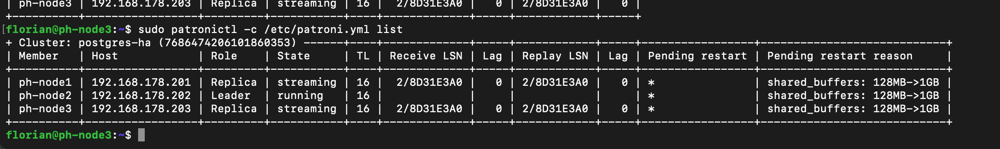

| Beobachtung | Erklärung |
|---|---|
| Direkt nach `edit-config` noch keine Änderung in `list` | Der Bauplan steht sofort in etcd, aber jeder Patroni liest ihn erst bei seiner nächsten Runde (`loop_wait` 10 s) — Aushang am Schwarzen Brett 📋 |
| Danach neue Spalten **Pending restart** `*` und **Pending restart reason** `shared_buffers: 128MB->1GB` | `patronictl list` zeigt diese Spalten nur, wenn mindestens ein Knoten etwas zu melden hat (wie eine Anlage zur Steuererklärung). Quelle: PostgreSQL selbst, `pg_settings.pending_restart`, von Patroni in seinen Member-Eintrag in etcd geschrieben |
| Warum Neustart? | Die Werkbank wird beim Start **einmal am Stück** als gemeinsamer Speicher reserviert — eine festgeschraubte Werkbank verlängert man nicht im Betrieb. `wal_keep_size` ist dagegen nur eine Regel (Reload genügt) |
| Nach dem Switchover war der `*` beim alten Leader weg — ohne eigenen `restart` | Ein Primary kann sich nicht im Betrieb in eine Replica verwandeln: Der Switchover fährt PostgreSQL herunter und startet es als Replica neu (Zwischenzustand `Replica / stopped` sichtbar). Der Bürgermeister geht auf dem Heimweg direkt beim Friseur vorbei 💇 |

**Faire Messung:** Für den Vergleich wieder ph-node2 als Leader (Switchover zurück — nur eine Variable ändern), dann ein **Aufwärm-Lauf** (60 s, nicht gewertet): Nach dem Neustart ist die Werkbank leer (kalter Cache), die Vorher-Messung lief mit warmer Werkbank. Bild: Ein Sprinter wird nicht direkt aus dem Bett gemessen. Für Produktion lädt `pg_prewarm` nach einem Neustart die vorherigen Blöcke automatisch.

| Messgröße | Vorher (128 MB) | Nachher (1 GB) | Änderung |
|---|---|---|---|
| TPS | 2 954 | **2 844** | −3,7 % (im Rauschen: Läufe der letzten Tage 2 831–2 977) |
| Latenz Ø | 16,9 ms | **17,6 ms** | +0,7 ms (im Rauschen) |
| Transaktionen / Fehler | 354 147 / 0 | 340 965 / 0 | – |
| Cache-Hit-Ratio Leader | **94,0 %** 🔴 | **99,2 %** 🟢 (5-min-Fenster, enthält noch Reste des Kaltstarts) | **+5,2 Punkte** |
| Cache-Hit-Ratio Replicas | 94,6 % | **100 %** | +5,4 Punkte |
| CPU Leader | ~88 % | ~85 % | unverändert am Anschlag |

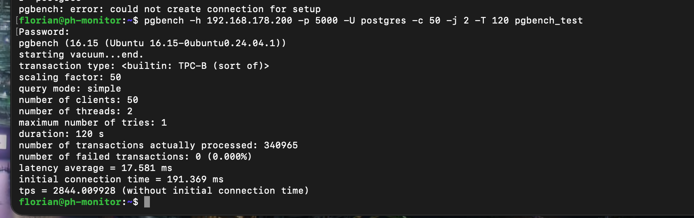

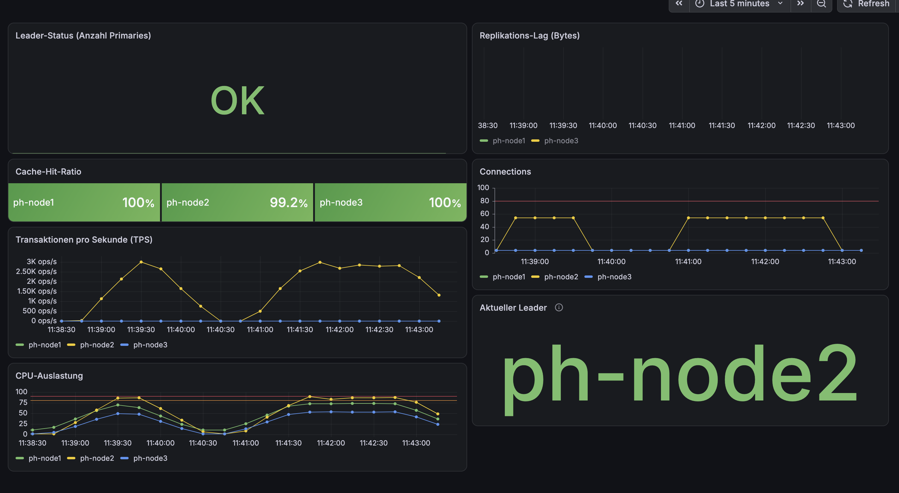

**CPU im Mess-Lauf (Zoom 11:38–11:43):** zwei gleich hohe Berge (Aufwärm- und Mess-Lauf → reproduzierbar). Plateau: ph-node2 (Leader) **~87 %**, ph-node1 (Replica + VIP/HAProxy) **~73 %**, ph-node3 (nur Replica) **~53 %**. Der Leader rechnet am Anschlag — der Engpass ist die CPU. Zwischen den beiden Replicas liegen ~20 Punkte, einziger Unterschied ist die VIP: der Pförtner zahlt bei ~2 800 TPS spürbar mit.

**Kontroll-Lauf mit aufgeräumtem Dashboard (12:27–12:29, warm, von ph-monitor):** 2 897 TPS, 17,3 ms, 0 Fehler. Cache-Hit-Ratio **100 % auf allen drei Knoten** (grün), Lag-Panel zeigt beide Replicas mit kleinen Zacken nahe 0 B, CPU Leader ~87 %.

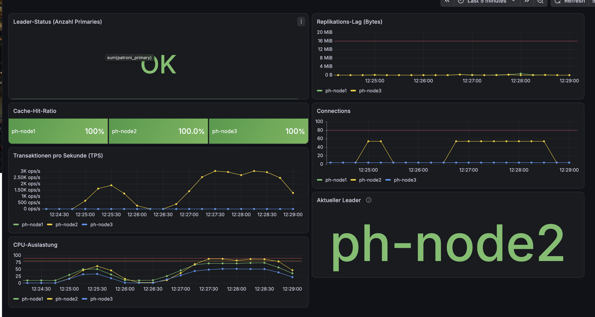

**Auswertung der Hypothesen:**

| | Florian | Jacky | Ergebnis |
|---|---|---|---|
| TPS steigen nur gering | ✅ | ✅ | unverändert (−3,7 %, im Rauschen) |
| Cache-Hit-Ratio | ändert sich gering ❌ | springt ✅ | 94 % → 99–100 % |

**Warum die Kennzahl springt, der Durchsatz aber nicht:**

1. Die Cache-Hit-Ratio zählt nur **Werkbank-Treffer**. Jeder Griff ins Nebenzimmer (Linux-Page-Cache) zählt als Fehlgriff — auch wenn er aus dem RAM kommt und kaum Zeit kostet. Vorher lagen ~6 % der Griffe im Nebenzimmer, nachher passt die ganze Datenbank auf die Werkbank.
2. Bei 50 Clients ist die **CPU** der Engpass (Group Commit, siehe 17.12), nicht das Lesen. Eine größere Werkbank verkürzt Wege, schafft aber keine Rechenleistung.

Bild: Man räumt alles Werkzeug vom Nebenzimmer auf die Werkbank. Die Statistik „Griffe auf die Werkbank“ springt auf 100 % — der Schreiner baut deshalb nicht schneller, weil er ohnehin schon mit beiden Händen am Anschlag sägt. 🪚

**Wann hilft `shared_buffers` wirklich?** Wenn die Daten **nicht** ins Nebenzimmer passen (Datenbank größer als der RAM) und Fehlgriffe echte Plattenzugriffe sind — dann sinken iowait und Latenz deutlich. In diesem Lab (750 MB Daten, 2,3 GB Page-Cache) ist der Gewinn eine gesunde Kennzahl und Reserve für Wachstum, kein Durchsatz.

> **Merksatz:** Eine Kennzahl kann sich stark verbessern, während der Nutzen klein bleibt. Erst messen, was der Engpass ist — dann tunen, was den Engpass trifft. Und Tuning immer mit Vorher-Messung, Aufwärmen und nur einer geänderten Variable.

#### Schnell-Referenz (zum Abfragen)

- **Pull oder Push bei Prometheus?** → Pull: Prometheus holt die Werte selbst ab.
- **Warum eine eigene Monitoring-VM?** → Muss Knotenausfälle überleben; Messwerkzeug nicht neben Messobjekt.
- **`Couldn't connect … after 0 ms` bedeutet?** → Rechner da, Dienst fehlt.
- **`up` vs. `pg_up`?** → Exporter erreichbar vs. Datenbank erreichbar.
- **Wo legt man die Monitoring-Rolle an?** → Einmal auf dem Leader; die Replikation verteilt sie.
- **Welches Recht braucht der Exporter?** → Mitgliedschaft in `pg_monitor`.
- **Warum `\password` statt `ALTER ROLE … PASSWORD`?** → Kein Klartext in History und Server-Log.
- **Warum zeigt sich ein falsches Passwort oft erst später?** → PostgreSQL prüft nur beim Verbindungsaufbau.
- **Erweitert `lvextend` auch das Dateisystem?** → Nur mit `-r`, sonst bleibt `df` unverändert.
- **Warum 38 % statt 35 % nach dem Erweitern?** → ext4 reserviert 5 % für root.
- **Root-FS bei 69,5 % – was füllt die Platte?** → WAL-Archiv und alte Kernel; `du -sh`, `apt autoremove`, `lvextend`, Archiv-Aufbewahrung.
- **Was prüft `promtool check config`?** → Nur die Syntax, nicht die Erreichbarkeit.
- **Was macht `== 1` in PromQL?** → Filtert auf Zeitreihen mit Wert 1.
- **Startet Grafana nach der Installation automatisch?** → Nein, bei Paketen aus dem Grafana-Repository nicht.
- **Prometheus liefert auf `/targets` nur `404`?** → Ubuntu-Paket `+ds` ohne Weboberfläche; API (`/api/v1/targets`) oder Grafana nutzen.
- **Warum `localhost:9090` als Datenquelle?** → Grafana fragt serverseitig ab, und Prometheus läuft auf derselben VM.
- **Was verrät `shared_buffers = 128 MiB` auf 4 GB RAM?** → Werkseinstellung, der Cluster ist ungetunt.
- **„System restart required“ vs. „Pending restart“?** → Ganze VM (Kernel) vs. nur PostgreSQL (Parameter).
- **Replica rebooten: Switchover nötig?** → Nein. Nur beim Leader zuerst `patronictl switchover`.
- **Warum braucht `patronictl` plötzlich `sudo`?** → `/etc/patroni.yml` ist auf `root:postgres 640` gehärtet.
- **Switchover vs. Failover?** → Geplant vs. erzwungen.
- **Warum ist `pause` für einen Leader-Reboot falsch?** → Es schaltet den automatischen Failover ab.
- **Darf man auf dem Leader `apt upgrade` ausführen?** → Nein, `needrestart` startet danach `patroni.service` neu.
- **Ändert ein Switchover die Timeline?** → Ja, jede Beförderung erzeugt eine neue.
- **Warum haben gleich gepatchte Knoten verschiedene Kernel?** → Unterschiedlich alte Paketlisten, dazu Phased Updates.
- **Wie sieht man, was `apt` tun würde?** → `sudo apt -s upgrade` (Simulation).
- **Warum braucht etcd Ubuntu Pro?** → Es liegt in `universe`, Sicherheitsupdates dort nur über `esm-apps`.
- **Verteilt `timedatectl` die Zeitzone im Cluster?** → Nein, jede VM einzeln.
- **Muss `edit-config` auf dem Leader laufen?** → Nein, es schreibt nach etcd, jeder Patroni liest selbst.
- **Wann fällt ein Tippfehler in einem Reload-Parameter auf?** → Erst beim nächsten Neustart, dann startet PostgreSQL nicht.
- **Was ergibt `sum(patroni_primary)` im gesunden Cluster?** → 1. Bei 0 fehlt der Leader, bei 2 droht Split-Brain.
- **Meldet ein ausgefallener Knoten `patroni_primary 0`?** → Nein, seine Zeitreihe fehlt ganz; Panel braucht ein Mapping für „keine Daten“.
- **Welches Label zeigt den Knotennamen?** → `name` (Patroni), nicht `instance` (IP:Port).
- **Was liefert `up == 0` im gesunden Cluster?** → Nichts. Vergleiche filtern; jede Zeile wäre ein ausgefallenes Target.
- **`up` = 1, `pg_up` = 0 — wo liegt das Problem?** → Exporter läuft, Datenbank nicht erreichbar.
- **Gauge vs. Counter?** → Momentwert (rauf und runter) vs. nur steigend; `rate()` nur auf Counter.
- **`count by (postgres) (up)` liefert `{}` und 11 — warum?** → In `by (...)` gehört der Label-Name (`job`), nicht der Wert; ein unbekanntes Label gruppiert alles zusammen.
- **Warum schlägt Lag in Sekunden auf einem ruhigen Cluster Alarm?** → Er misst das Alter der letzten Transaktion; ohne Schreiblast wächst er, obwohl nichts hinterherhinkt. Byte-Lag bleibt 0.
- **Warum `> 0` in der Lag-Query?** → Der Leader meldet `replayed_location = 0`; ohne Filter erschiene bei ihm die gesamte WAL-Position als Lag.
- **Was ergibt `rate()` auf `patroni_xlog_location`?** → WAL-Schreibdurchsatz in Bytes pro Sekunde.
- **In welcher Einheit stehen `patroni_xlog_*_location`?** → Bytes (Position im WAL, die LSN), keine Zeit.
- **`SHOW TABLES` in PostgreSQL?** → Gibt es nicht; `SHOW` liest Parameter. Tabellen listet `\dt`.
- **Lag klein, aber stetig steigend — harmlos?** → Nein. Die Replica spielt langsamer ein, als der Leader schreibt, und holt nie auf.
- **Warum Alarm mit „für 5 Minuten“?** → Kurze Lastspitzen sind normal; nur dauerhafter Lag ist ein Problem.
- **Standard-Thresholds bei `sum(patroni_primary)`?** → Base grün/80 rot färbt auch 0 und 2 grün — unbrauchbar, selbst setzen.
- **Value mapping zeigt weiter die Zahl?** → Text steht in der Bedingungsspalte *Value* statt in *Display text*.
- **Wer gewinnt: Mapping-Farbe oder Threshold?** → Die Mapping-Farbe.
- **Warum ein eigenes HA-Dashboard neben den Community-Dashboards?** → Zielgruppe: Der Operator braucht in zwei Sekunden eine Ampel, nicht 50 Panels.
- **Warnlinie im Time-Series-Panel nicht zu sehen?** → Auto-Skalierung folgt nur den Daten; Axis → Soft max setzen (nicht Max, das schneidet ab).
- **Warum zeigt `postgres` ~100 Cache-Treffer/s ohne Benutzer?** → Der postgres_exporter fragt bei jedem Scrape Statistiken ab (Beobachter-Effekt).
- **Warum Autovacuum-Aktivität nur auf dem Leader?** → Replicas sind read-only; sie erhalten aufgeräumte Blöcke per WAL.
- **Warum `rate()` für die Cache-Hit-Ratio?** → Lebenszeit-Counter verschleiern einen aktuell kalten Cache.
- **Unit Percent (0.0-1.0) oder (0-100) für eine Ratio?** → 0.0-1.0; die Formel liefert einen Bruch.
- **Thresholds bei Prozent-Unit in welcher Größe eintragen?** → Im Rohwert (0.99), nicht in Prozent (99).
- **Kachelnamen aus IP-Adressen ableiten?** → Transformation *Rename fields by regex*, Gruppe `(\d)` und `$1`; Legend vorher auf Custom setzen.
- **Warum zeigt der Leader in `numbackends` nicht mehr Verbindungen?** → WAL-Sender hängen an keiner Datenbank; `numbackends` zählt nur DB-gebundene Sessions.
- **Wie sieht man alle Prozesse samt Typ?** → `pg_stat_activity`, gruppiert nach `backend_type`.
- **Dashboard zeigt eine Änderung nicht an, obwohl Prometheus sie hat?** → Auto-Refresh steht auf Off; Scrape-Intervall und Refresh-Intervall sind zwei getrennte Takte.
- **Zählt Replikation als Transaktion in `xact_commit`?** → Nein, der WAL-Sender streamt Bytes.
- **Warum `rate(...[1m])` statt `[5m]` beim Lasttest?** → Kurze Ereignisse wie ein Failover würden sonst weggemittelt.
- **Stat-Kachel zeigt die ganze Label-Liste statt eines Namens?** → Legend auf Custom `{{label}}` setzen; Text mode allein reicht nicht.
- **Warum zeigt das Lag-Panel unter Last negative Werte?** → Leader und Replica werden zu verschiedenen Zeitpunkten gescrapt; unter Last läuft das WAL in der Zwischenzeit weiter. Lösung: beide Werte aus einer Abfrage auf dem Leader (`pg_stat_replication`).
- **Warum fällt die Cache-Hit-Ratio unter pgbench-Last?** → Zufallszugriffe passen nicht in `shared_buffers` (128 MiB Werkseinstellung).
- **Welche Metrik misst den Replikations-Lag ohne Scrape-Versatz?** → `pg_stat_replication_pg_wal_lsn_diff` vom postgres_exporter, berechnet in einer Abfrage auf dem Leader.
- **Wie sieht man den Spitzenwert einer Metrik im Zeitfenster?** → `max_over_time(metrik[10m])` — wie ein Schleppzeiger.
- **In welcher Reihenfolge liest man verschachteltes PromQL?** → Von innen nach außen: Metrik/Filter → `rate` → `avg/sum by` → Umrechnung.
- **Was bedeutet `=~` im Label-Filter?** → Regex-Vergleich (z. B. `instance=~".*20[1-3]:9100"`).
- **CPU-Kurve zeigt mehr als 100 %?** → Darstellung steht auf *Stacked lines*.
- **Was bedeutet `iowait`?** → Die CPU ist untätig und wartet auf Platten-I/O; zählt in „alles außer idle“ trotzdem als Auslastung.
- **Wann ist *Stacked lines* richtig?** → Wenn die Kurven Teile eines Ganzen sind (z. B. CPU-Modi); für Vergleiche *Lines*.
- **Warum reichen zwei Rechenzentren für automatischen Failover nicht?** → Eines hält zwangsläufig die etcd-Mehrheit; fällt es aus, kann das andere keinen Leader wählen. Man braucht drei Failure Domains (ggf. einen reinen Schiedsrichter).
- **Was besagt das Little'sche Gesetz für pgbench?** → TPS = Clients ÷ Latenz; ist der Durchsatz gesättigt, steigt mit jedem Client die Latenz.
- **Warum sinkt iowait bei mehr Clients?** → Group Commit: Ein `fsync` schreibt die WAL-Einträge mehrerer gleichzeitiger Commits.
- **Woran erkennt man Sättigung?** → TPS stagniert (+2 %), Latenz steigt stark (+47 %).


### 17.15 Aufräumliste nach dem Lasttest-Marathon

Nach Lasttest, Failover unter Last und Tuning (17.12–17.14) blieben kleine Baustellen liegen. Sie werden einzeln abgearbeitet, jede mit Prüfung **vor** der Änderung und einer Zeile im Betriebslog.

Stand zu Beginn (20.10.2026): Leader ph-node2, TL 20, `shared_buffers` 1 GB, `wal_keep_size` 1 GB.

#### Punkt 1 — Das doppelte Grafana-Dashboard

**Bild:** Ein Dashboard ist ein **Bilderrahmen**, die Messwerte sind die **Fotos im Archiv** (Prometheus). Einen Rahmen abzuhängen löscht keine Fotos — die Zeitreihen in Prometheus bleiben unberührt, nur die Ansicht verschwindet. Zwei Rahmen mit demselben Schild („PostgreSQL HA-Cluster“) unterscheidet man nicht am Schild, sondern an der **Seriennummer auf der Rückseite: der UID**.

Was passiert ist — drei Lehrstücke in zehn Minuten:

1. **Prüfregel veraltet.** Die Erkennungsregel „das gültige Dashboard hat 6 Panels“ stammte vom 17.10. Seitdem war das CPU-Panel dazugekommen; das geöffnete Dashboard hatte 7 Panels und sah verdächtig aktuell aus. Erst die URL klärte es: `/d/adv645n` — das gültige. *Lehre:* Gelöscht wird nach **eindeutiger Kennung**, nie nach Titel, Aussehen oder Erinnerung. Gleiches Prinzip wie `patronictl list` vor jedem Switchover.
2. **Falsches Negativ.** Der erste Aufruf des Duplikats lieferte „**Page** not found“ — die URL enthielt `/d//ad5pq6d` (doppelter Schrägstrich). Mit korrekter URL kam „**Dashboard** not found“: Grafana hat die UID verstanden und gesucht. *Bild:* Wer bei Hausnummer „1 2“ statt „12“ klingelt und keine Antwort bekommt, weiß nicht, ob der Nachbar ausgezogen ist. *Lehre:* Ein Negativbefund zählt nur, wenn der Test selbst korrekt war (Health-Check mit falschem Port, `pg_isready` gegen falschen Host …). Der **genaue Fehlertext** verrät, wie weit der Test gekommen ist.
3. **„Not found“ ≠ „gibt es nicht“.** In Grafana heißt „not found“ auch „du darfst es nicht sehen“ (Ordnerrechte, anderer Benutzer). Erst mit dem Wissen „angemeldet als `admin`“ — sieht alle Dashboards der Organisation — ist der Befund eindeutig: Das Duplikat war **schon gelöscht**, Zeitpunkt unbekannt.

**Ergebnis:** `ad5pq6d` existiert nicht mehr; gültig ist `adv645n`. Im Betriebslog steht ehrlich „Zeitpunkt unbekannt, nicht dokumentiert“ — eine offen zugegebene Lücke ist mehr wert als ein nachträglich geglättetes Log. Nebenbefund: Der Stern an `adv645n` fehlte und wird neu gesetzt.

> **Merksatz:** Löschen nach Kennung, nicht nach Namen. Und bevor man „ist weg“ meldet: prüfen, ob man an der richtigen Tür geklingelt hat.

**Kontrollfragen**
- **Was passiert mit den Messwerten, wenn man ein Grafana-Dashboard löscht?** → Nichts — die Daten liegen in Prometheus, gelöscht wird nur die Ansicht.
- **Woran erkennt man zwei Dashboards gleichen Namens sicher?** → An der UID in der URL (`/d/<uid>/…`).
- **„Page not found“ vs. „Dashboard not found“?** → Ersteres: URL nicht verstanden (Tippfehler). Letzteres: UID verstanden, aber kein Dashboard gefunden — oder keine Berechtigung.
- **Was ist ein falsches Negativ im Betrieb?** → Ein Test meldet „nicht vorhanden/nicht erreichbar“, obwohl nur der Test falsch war.


#### Punkt 2 — VM-Name `ph-monitorr` → `ph-monitor`

```bash
# auf dem Proxmox-Host
qm set 204 --name ph-monitor
qm config 204 | grep ^name      # → name: ph-monitor
# in der VM
hostname                        # → ph-monitor (war schon richtig)
```

**Bild: Briefkasten und Telefon.** Ein Rechner hat zwei Namen, die nichts voneinander wissen:

| Ebene | Wo steht der Name? | Wer sieht ihn? |
|---|---|---|
| **Briefkastenschild** (Hypervisor) | `/etc/pve/qemu-server/204.conf` → `name:` | Proxmox-UI, `qm list` |
| **Wie sich der Bewohner am Telefon meldet** (Gast-OS) | `/etc/hostname` | `hostname`, Prompt, Logs, node_exporter (`node_uname_info{nodename=…}`) |

`qm set --name` tauscht nur das Schild — **kein Neustart**, der Gast merkt nichts. Hier lag der Tippfehler nur auf dem Schild; `hostname` war schon korrekt. Prometheus kennt Targets über **IP:Port** aus `prometheus.yml` und ist vom Proxmox-Namen unabhängig. Ein falscher *Gast*-Hostname würde dagegen im Monitoring auffallen: im Label `nodename` von `node_uname_info`, z. B. in der Host-Auswahl des Dashboards *Node Exporter Full*.

**Reihenfolge-Regel:** Harmlose, umkehrbare Änderung → *ändern, dann prüfen*. Nicht umkehrbare Änderung (Löschen, `reinit`) → *erst prüfen, dann ändern*. Bild: Ein Briefkastenschild tauscht man und schaut, ob es gerade hängt; bevor man den Briefkasten abschraubt, schaut man, ob noch Post drin ist.

**Kontrollfragen**
- **Ändert `qm set <id> --name` den Hostnamen im Gast?** → Nein, nur den Anzeigenamen in Proxmox. Der Gast-Hostname steht in `/etc/hostname`.
- **Braucht die Umbenennung einen Neustart?** → Nein.
- **Wo fiele ein falscher Gast-Hostname im Monitoring auf?** → Im Label `nodename` von `node_uname_info` (node_exporter), z. B. in der Host-Auswahl von *Node Exporter Full*.


#### Punkt 3 — Panel „Replicas streaming“: Überlegungen vor dem Bauen

**Warum ein neues Panel?** Beim Failover-Test am 19.10. stand „Leader-Status: OK“, während eine Replica wegen einer WAL-Lücke nicht mehr streamte. `sum(patroni_primary)` zählt nur Leader — eine hängende Replica hat wie eine gesunde `patroni_primary = 0`. *Bild:* Das Schild am Rathaus sagt „Bürgermeister im Dienst“, nicht ob seine Stellvertreter krank im Bett liegen. Das Lag-Panel hilft auch nicht zuverlässig: Eine Replica, die nicht mehr streamt, verschwindet aus `pg_stat_replication` — ihre Linie wird nicht rot, sie ist einfach **weg**.

| Panel | Frage | bemerkt hängende Replica? |
|---|---|---|
| Leader-Status `sum(patroni_primary)` | Gibt es genau einen Leader? (immer 1, unabhängig von der Knotenzahl) | nein |
| Replikations-Lag | Wie weit hinken streamende Replicas hinterher? | nur, wenn man die *fehlende* Linie bemerkt |
| **Replicas streaming** | Wie viele Stellvertreter sind einsatzbereit? | ja — Zahl fällt |

**Wer weiß es?** Der **Leader**: `pg_stat_replication` listet, an wen er gerade WAL sendet. An sich selbst sendet er nicht — bei 3 Knoten also höchstens **2** Zeilen.

**Ampel:** 2 = grün, 1 = gelb (läuft, aber ohne Reserve), 0 = rot (beim nächsten Leader-Ausfall kann niemand übernehmen). Eine Ampel „grün bei 3“ wäre dauerhaft gelb — der Chef, der sich selbst als Stellvertreter mitzählt, wird nie vollzählig. Eine Ampel, die immer dieselbe Farbe zeigt, ist Tapete. (Ein *anderes* Panel, „wie viele Knoten leben“, `count(up{job="patroni"} == 1)`, soll dagegen 3 zeigen — man muss wissen, *was* man zählt.)

**Feste Soll-Zahl oder „Soll aus Meldungen ableiten“?** Verlockend wäre: *Knoten mit `patroni_primary == 0` minus streamende Replicas = fehlende Replicas* — skaliert automatisch mit der Clustergröße. Aber: Ist ph-node3 **komplett aus**, meldet er gar kein `patroni_primary` mehr. Soll = 1, Ist = 1, fehlend = 0 → **grün**, obwohl ein Knoten fehlt.

**Bild: die Schulklasse.** Die Lehrerin weiß, dass ihre Klasse 25 Kinder hat, zählt 24 → eins fehlt (Weg A). Fragt sie stattdessen „Wer fehlt heute? Bitte melden!“, meldet sich niemand — das fehlende Kind sitzt ja nicht im Raum (Weg B).

> **Merksatz:** Wer ausgefallen ist, kann sich nicht krankmelden. Die Soll-Zahl muss von außen kommen.

**Entscheidung:** feste Schwelle (grün bei 2). Preis: Beim Einbinden eines vierten Knotens die Schwelle auf 3 anheben — gehört auf die Checkliste „neuen Knoten einbinden“.

**Kontrollfragen**
- **Warum erkennt `sum(patroni_primary)` keine hängende Replica?** → Es zählt nur Leader; eine hängende Replica hat wie eine gesunde den Wert 0.
- **Warum zeigt `pg_stat_replication` bei 3 Knoten höchstens 2 Zeilen?** → Der Leader listet nur die Empfänger seines WAL, nicht sich selbst.
- **Warum kann man das Soll nicht aus den Meldungen der Knoten ableiten?** → Ein ausgefallener Knoten meldet nichts mehr und fällt so aus Soll *und* Ist heraus — die Differenz bleibt 0.


#### Punkt 3 — Panel „Replicas streamen“: der Bau

**Erst die Birne testen, dann in die Lampe schrauben:** Query zuerst in **Explore** ausführen (Ergebnis: 2). Zeigt Explore schon „No data“, liegt der Fehler in der Query, nicht in Panel-Einstellungen.

```promql
count(pg_stat_replication_pg_wal_lsn_diff{state="streaming"}) or vector(0)
```

| Teil | Wirkung | Bild |
|---|---|---|
| `pg_stat_replication_pg_wal_lsn_diff` | eine Zeile je Replica, an die der Leader sendet (dieselbe Metrik wie das Lag-Panel) | die Liste des Chefs: „an diese Stellvertreter schicke ich Post“ |
| `{state="streaming"}` | nur Replicas, die wirklich streamen (nicht `catchup`) | nur wer am Platz sitzt und arbeitet |
| `count(…)` | Anzahl → 2 | die Lehrerin zählt durch |
| `or vector(0)` | keine Zeile → 0 statt „No data“ | leeres Klassenzimmer: „Wenn keiner antwortet, schreib 0 an die Tafel“ |

Ohne `or vector(0)` liefert `count()` über eine leere Menge **gar nichts** — das Panel wäre grau statt rot, genau im schlimmsten Fall.

**Einstellungen im Panel (Grafana 13):**
- Edit → „+“ → Visualization → Typ **Stat** (*Tankanzeige* statt *Fahrtenbuch* Time series — gefragt ist der Wert *jetzt*)
- Query-Options: **Type: Instant** (sonst Geister-Werte, siehe Aktueller Leader)
- **Value mappings** statt nackter Zahl, Zahl im Text mitführen:

| Wert | Text | Farbe |
|---|---|---|
| 0 | `0 – keine Reserve!` | rot |
| 1 | `1 – ohne Reserve` | gelb |
| 2–99 | `2 – voll abgesichert` | grün |
| null + NaN | `Keine Daten` | rot (fängt ab, dass Prometheus selbst nicht antwortet — da hilft auch `or vector(0)` nicht) |

- Texte kurz halten, Begründung in die Panel-Beschreibung (ⓘ). Jedes Wort muss stimmen: „mehr als 2 streamen“ wäre falsch gewesen — eine Tankanzeige mit „mehr als voll“ glaubt man beim nächsten Mal weniger.
- Speichern mit aussagekräftiger Message (*was* + *warum*), wie `git commit -m`. Grafana führt eine eigene Versionsgeschichte (*Settings → Versions*). *Bild:* Zettel an der Gefriertüte — „Gulasch, 20.10., 4 Portionen“ statt „Essen“. Edit = `BEGIN`, Save = `COMMIT`, Discard = `ROLLBACK`; andere sehen Änderungen erst nach dem Speichern.

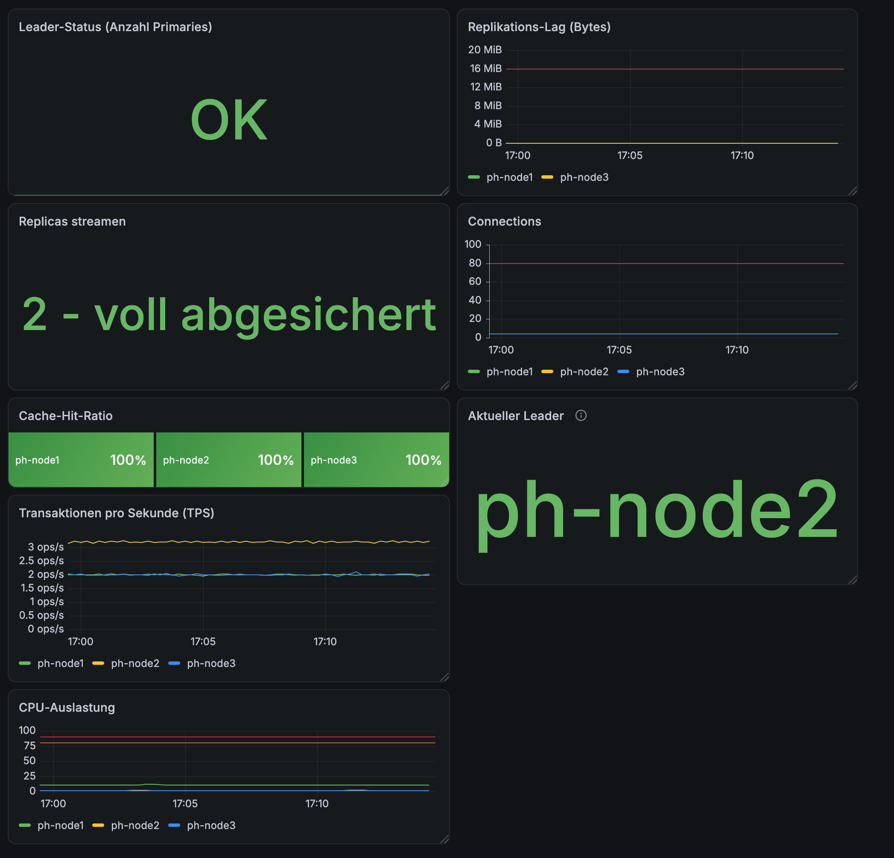

Das Panel steht direkt unter dem Leader-Status: oben „Gibt es einen Bürgermeister?“, darunter „Sind seine Stellvertreter einsatzbereit?“

**Checkliste „neuen Knoten einbinden“ (Ergänzung):** Ampel in „Replicas streamen“ anheben (bei 4 Knoten: grün ab 3, gelb 1–2, rot 0). Sonst zeigt das Panel bei 2 von 3 Replicas grün — die Lehrerin weiß nicht, dass die Klasse gewachsen ist.

**Nebenfrage: Ist ein vierter Knoten nicht schlecht, weil gerade?** Nein. Ungerade muss der **Gemeinderat** sein (etcd, stimmt ab); Patroni-/PostgreSQL-Knoten sind **Bürger**, die sich nur bewerben. Ein 4. Datenknoten (z. B. auf dem i7, eigene Failure Domain) bleibt Client des 3er-etcd-Clusters.

> **Merksatz:** Ungerade muss der Rat sein (etcd), nicht die Zahl der Bürger (Datenknoten).

**Kontrollfragen**
- **Warum `or vector(0)`?** → `count()` über eine leere Menge liefert keine Daten statt 0; das Panel würde grau statt rot.
- **Warum zusätzlich ein Mapping für null/NaN?** → Antwortet Prometheus selbst nicht, hilft `or vector(0)` nicht; „Keine Daten“ muss rot sein.
- **Warum Stat und nicht Time series?** → Gefragt ist der aktuelle Zustand (Tankanzeige), nicht der Verlauf (Fahrtenbuch).
- **Muss die Zahl der PostgreSQL-Knoten ungerade sein?** → Nein, nur die der etcd-Mitglieder (Abstimmende).

---

## Anhang — Metaphern-Spickzettel (für Gespräch und Wiederholung)

Jede Metapher in einer Zeile: **Fachbegriff → Bild → der Satz, den man im Gespräch sagt.** Gesammelt aus dem Lab, damit sich die Zusammenhänge ohne Unterlagen rekonstruieren lassen.

### HA, Wahl und Failover

| Fachbegriff | Bild | Satz fürs Gespräch |
|---|---|---|
| etcd (3 Mitglieder, Raft) | **Gemeinderat** — stimmberechtigt, ungerade Zahl | „etcd ist der Rat, der per Mehrheit festhält, wer Leader ist.“ |
| Patroni-Knoten | **Bürger**, die Bürgermeister werden können | „Datenknoten wählen nicht mit, sie bewerben sich.“ |
| Leader-Schlüssel mit `ttl` 30 s | **Bürgermeister-Schärpe mit Ablaufdatum**, alle 10 s (`loop_wait`) verlängert | „Ein toter Leader verliert sein Amt erst, wenn die Schärpe abläuft.“ |
| `ttl` statt sofortiger Neuwahl | **Lieber kein Bürgermeister als zwei** | „Die 30 Sekunden sind der bewusste Preis gegen Split-Brain.“ |
| Member-Keys in etcd | **Einwohnerregister** — wer sich nicht meldet, wird gestrichen | „Ein toter Knoten verschwindet aus `patronictl list`.“ |
| `patronictl history` | **Fahrtenbuch** — jede Zeile wird erst am Ende einer Fahrt geschrieben | „Zeile n = Ende von Timeline n; aktuelle TL = letzte Zeile + 1.“ |
| VIP + HAProxy | **Pförtner** am Eingang, trägt jedem Gast die Taschen ins richtige Büro | „VIP und Leader müssen nicht zusammen liegen; der VIP-Knoten zahlt dafür CPU.“ |
| Failure Domains | Kein Haus darf die **Ratsmehrheit** allein beherbergen | „Mit zwei Standorten hält einer immer die Mehrheit — man braucht drei.“ |

### Crash, Recovery und Wiedereinstieg

| Fachbegriff | Bild | Satz fürs Gespräch |
|---|---|---|
| WAL / LSN | **Tonband** mit Zählwerk in Bytes | „Die LSN ist die Position auf dem Band; Lag ist der Abstand zweier Positionen.“ |
| Checkpoint | **Lesezeichen im Tagebuch**: bis hier ist alles in den Datendateien | „Nach einem Crash wird ab dem letzten Lesezeichen nachgespielt.“ |
| verteilter Checkpoint (REDO ≠ Checkpoint-Eintrag) | **Lesezeichen setzen, während 272 Seiten diktiert werden**, zuklappen erst danach | „Nachlesen muss man ab dem Aufschlagen, nicht ab dem Zuklappen.“ |
| Crash-Recovery | **Bürgermeister im Krankenhaus** liest erst sein eigenes Tagebuch zu Ende | „`starting` ist kein Fehler, sondern Aufräumarbeit.“ |
| `pg_rewind` | Die **nie verkündeten Notizen herausreißen** und das offizielle Protokoll übernehmen | „Der alte Leader spult auf die gemeinsame Geschichte zurück.“ |
| WAL-Archiv ohne `restore_command` | **Archivar ohne Schlüssel** — die Akte liegt im Schrank, niemand darf hinein | „Archivieren allein reicht nicht; der Wiederanlauf muss auch lesen dürfen.“ |
| lokales vs. zentrales Archiv | **Schuhkartons in jedem Haus** vs. **Stadtarchiv** | „Nur ein zentrales Archiv hilft jedem Knoten.“ |
| `wal_keep_size` | Der Rat **schreddert Protokolle erst, wenn der Schrank voll ist** | „Der Leader hält eine WAL-Reserve für Nachzügler.“ |
| Replica kaputt, Cluster läuft | **Ersatzreifen montiert, Flickzeug im falschen Kofferraum** | „Failover ist erst fertig, wenn die Reserve wieder streamt.“ |
| `patronictl reinit` | **Neuer Reifen statt Flicken** | „Wenn Zurückspulen nicht reicht: frische Kopie vom Leader.“ |

### Performance

| Fachbegriff | Bild | Satz fürs Gespräch |
|---|---|---|
| `shared_buffers` / Cache-Hit-Ratio | **Werkbank** (Treffer) vs. **Keller** (Lesen) | „Von 100 Griffen, wie viele lagen schon auf der Bank?“ |
| `blks_read` aus dem OS-Cache | eher **Nebenzimmer** als Keller | „Nicht jeder Miss ist ein Plattenzugriff.“ |
| Replica-Cache sinkt unter Last | **Handwerker legt das Werkstück auf die Bank**, bevor er es repariert | „Auch WAL-Replay holt Blöcke in den Cache.“ |
| Counter vs. `rate()` | **Kilometerstand** vs. **aktueller Verbrauch** | „Counter nie roh vergleichen, immer als Rate.“ |
| Group Commit | **Sammeltaxi statt Einzelfahrten** | „Mehr Clients, weniger fsync pro Transaktion — der Engpass wandert zur CPU.“ |
| Little'sches Gesetz | **Supermarkt mit fester Kassenleistung** | „Ist der Durchsatz gesättigt, verlängert jeder neue Kunde nur die Schlange.“ |
| `numbackends` vs. walsender | **Hotel**: nur Gäste mit Zimmer (Datenbank) werden gezählt | „Replikationsverbindungen haben keine Datenbank und fehlen in der Zahl.“ |

### Monitoring und Grafana

| Fachbegriff | Bild | Satz fürs Gespräch |
|---|---|---|
| Lag als Differenz zweier Scrapes | **Zwei Fotografen, zwei Autos** — die Fotos sind nicht gleichzeitig | „Eine Differenz ist nur so gut wie die Gleichzeitigkeit ihrer Werte.“ |
| `pg_stat_replication_pg_wal_lsn_diff` | **Ein Foto mit beiden Autos** | „Lag dort messen, wo beide Positionen im selben Moment bekannt sind.“ |
| Stat-Panel mit „letztem Wert“ eines toten Knotens | **Foto des alten Bürgermeisters an der Rathauswand** 👻 | „Der letzte Wert eines toten Knotens ist ein Geist, kein Leader.“ |
| Dashboard ohne Replica-Status | **Feuerwache meldet „besetzt“**, ein Löschfahrzeug steht mit Platten in der Halle | „Wir überwachen auch, ob die Reserven einsatzbereit sind.“ |
| immer grünes Dashboard | **Tapete** | „Lücken im Monitoring findet man, indem man etwas kaputt macht.“ |
| in der Legende isolierte Serie, mitgespeichert | **festgeschraubtes Fernglas** auf ein Haus — zieht der Bewohner um, sieht man nichts | „Leeres Panel heißt nicht immer keine Daten — manchmal ist die Linie nur ausgeblendet.“ |
| Grafana / patronictl / Log | **Rauchmelder / Blick in den Raum / Brandursachen-Ermittlung** | „Dashboards zum Bemerken, Logs zum Verstehen.“ |
| zwei Dashboards gleichen Titels | **Zwillinge** — man erkennt sie an der Narbe am Knie (UID), nicht am Namen | „Gelöscht wird nach Kennung, nie nach Titel.“ |
| falsches Negativ (Tippfehler im Test) | **an der falschen Hausnummer klingeln** — keiner öffnet, der Nachbar wohnt trotzdem noch da | „Ein Negativbefund zählt nur, wenn der Test selbst stimmt.“ |
| Dashboard löschen | **Bilderrahmen abhängen** — die Fotos (Prometheus) bleiben im Archiv | „Ein Dashboard ist nur die Ansicht, nicht die Daten.“ |
| Proxmox-VM-Name vs. Hostname | **Briefkastenschild vs. wie sich der Bewohner am Telefon meldet** | „`qm set --name` ändert das Schild, nicht den Hostnamen im Gast.“ |
| umkehrbar vs. nicht umkehrbar | **Schild tauschen vs. Briefkasten abschrauben** | „Umkehrbares: ändern, dann prüfen. Unumkehrbares: erst prüfen, dann ändern.“ |
| Leader-Panel vs. Replica-Panel | **Schild „Bürgermeister im Dienst“** sagt nichts über kranke Stellvertreter | „Ein Leader allein ist noch keine Hochverfügbarkeit — die Reserve muss streamen.“ |
| Soll aus Selbstmeldungen ableiten | **Schulklasse: „Wer fehlt, bitte melden!“** — das fehlende Kind kann sich nicht melden | „Wer ausgefallen ist, kann sich nicht krankmelden. Die Soll-Zahl muss von außen kommen.“ |
| Ampel „grün bei 3“ für Replicas | **Chef zählt sich selbst als Stellvertreter mit** — nie vollzählig | „Erst klären, *was* man zählt: Knoten oder streamende Replicas.“ |
| `or vector(0)` | **leeres Klassenzimmer** — keiner antwortet, also „0“ an die Tafel | „Fehlende Daten in einen echten Alarm verwandeln.“ |
| Stat vs. Time series | **Tankanzeige vs. Fahrtenbuch** | „Für den Zustand jetzt: Stat. Für den Verlauf: Time series.“ |
| Query erst in Explore testen | **Glühbirne in der Hand testen**, bevor man sie in die Lampe schraubt | „Erst die Messung prüfen, dann den Rahmen bauen.“ |
| Dashboard-Edit / Save / Discard | **BEGIN / COMMIT / ROLLBACK** | „Andere sehen meine Änderung erst nach dem Speichern.“ |
| Save-Message | **Zettel an der Gefriertüte** | „Eine Message sagt *was* und *warum* — wie ein Commit.“ |
| etcd ungerade, Datenknoten egal | **Gemeinderat vs. Bürger** | „Ungerade muss der Rat sein, nicht die Zahl der Bürger.“ |
